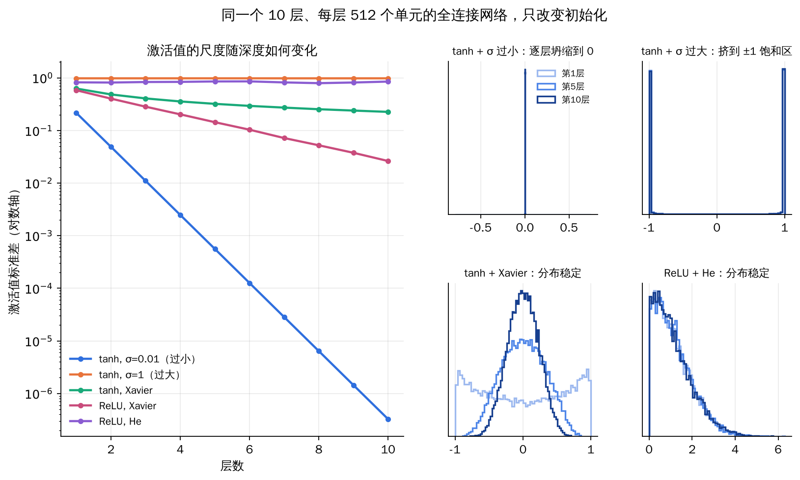
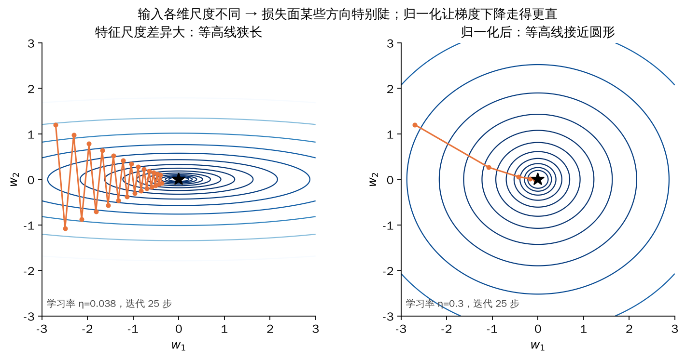
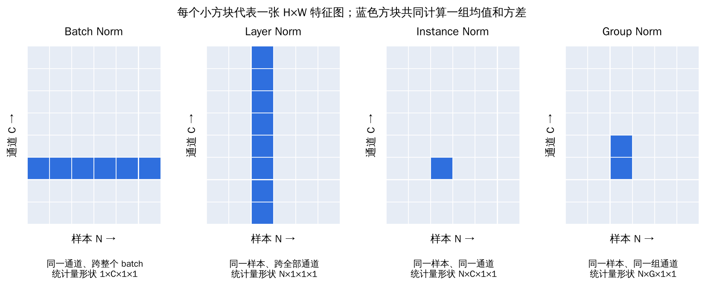
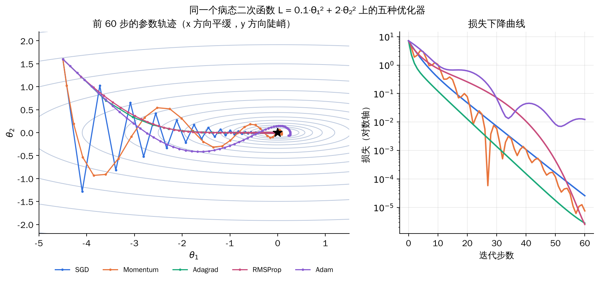
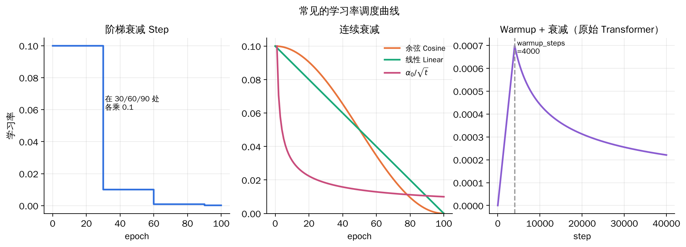

## 1. 训练前要先定下的四件事

前面已经说明了网络怎样前向计算、怎样用反向传播求梯度。真正动手训练时，还要回答几个看似“工程细节”、实则决定能否训练成功的问题：

| 问题 | 对应技术 | 主要作用 |
| --- | --- | --- |
| 参数从哪里出发 | 权重初始化 Weight Initialization | 打破对称性，让信号与梯度在各层保持合理尺度 |
| 中间层分布乱飘怎么办 | 批归一化 Batch Normalization 及其变体 | 稳定每层输入的分布，使损失面更平滑 |
| 拿到梯度后怎么走 | 优化器 Optimizer | 决定更新方向和每个参数的步长 |
| 步长要不要随时间变 | 学习率调度 LR Scheduler | 前期快速下降、后期精细收敛 |

四者互相影响：好的初始化与归一化让更大的学习率成为可能；自适应优化器降低了对学习率的敏感度，但仍需配合调度。

## 2. 权重初始化

### 2.1 初始化决定了训练的起点

训练开始前，要给每个可训练的权重 W 和偏置 b 赋初值。以全连接层为例：

<div class="course-math">
\[
h^{(l)}=f\!\left(W^{(l)}h^{(l-1)}+b^{(l)}\right),
\qquad
W_{t+1}=W_t-\eta\,\nabla_W\mathcal L .
\]
</div>

梯度下降只负责“从当前位置往下走”，起点由初始化决定。起点会影响三件事：**梯度能否顺利流动、训练是否稳定以及收敛速度、最终模型的质量**。因此初始化的设计目标可以概括为一句话：**让各层的激活值和梯度都保持在合理的尺度上。**

### 2.2 全零初始化：对称性无法打破

假设两个隐藏单元接收同一输入 x：

<div class="course-math">
\[
h_1=f(w_1^{\mathsf T}x+b_1),\qquad h_2=f(w_2^{\mathsf T}x+b_2),
\qquad w_1=w_2=0,\ b_1=b_2=0 .
\]
</div>

两单元的输出相同，反向传播得到的梯度也相同，更新后参数依旧相同。无论训练多久，它们都在学**同一个特征**，宽度为 H 的隐藏层实际只相当于一个单元。只要所有权重取同一个常数，这种对称性就会保留。

**解决办法是随机初始化权重；偏置通常可以初始化为 0**，因为权重已经足以打破对称。

### 2.3 梯度消失与梯度爆炸

对 z⁽ˡ⁾ = W⁽ˡ⁾h⁽ˡ⁻¹⁾ + b⁽ˡ⁾、h⁽ˡ⁾ = f(z⁽ˡ⁾)，相邻两层之间的局部导数为：

<div class="course-math">
\[
\frac{\partial h_i^{(l)}}{\partial h_j^{(l-1)}}=f'\!\left(z_i^{(l)}\right)W_{ij}^{(l)},
\qquad
\frac{\partial\mathcal L}{\partial h^{(l)}}
=\left(\frac{\partial h^{(l+1)}}{\partial h^{(l)}}\right)^{\!\mathsf T}
\left(\frac{\partial h^{(l+2)}}{\partial h^{(l+1)}}\right)^{\!\mathsf T}
\cdots
\left(\frac{\partial h^{(L)}}{\partial h^{(L-1)}}\right)^{\!\mathsf T}
\frac{\partial\mathcal L}{\partial h^{(L)}} .
\]
</div>

梯度要经过一长串雅可比矩阵的连乘。用一个玩具模型体会量级：假设每过一层梯度尺度都乘同一个因子，

- 每层 ×0.5，8 层后剩 0.5⁸ ≈ **0.004**：前几层几乎收不到梯度，即**梯度消失**；
- 每层 ×1.5，8 层后变成 1.5⁸ ≈ **25.6**：更新步长失控，即**梯度爆炸**；
- 只有因子接近 1，信号才能稳定地传过很多层。

权重的尺度直接决定了这个因子。权重过大时，sigmoid / tanh 的输入落到饱和区，导数接近 0，反而造成梯度消失；权重过小时，信号每过一层都缩小一点，前向的激活和反向的梯度一起衰减。


*在 10 层、每层 512 单元的随机网络上实测：tanh 配 σ=0.01 时激活值逐层指数衰减；σ=1 时激活值全部挤到 ±1 的饱和区；Xavier 配 tanh、He 配 ReLU 时，各层分布基本保持稳定。ReLU 配 Xavier 则会逐层缩小。*

### 2.4 简单随机初始化

最直接的做法是从某个分布独立采样每个权重：

<div class="course-math">
\[
W_{ij}\sim\mathcal N(0,\sigma^2)
\qquad\text{或}\qquad
W_{ij}\sim\mathcal U(-a,a),\quad \operatorname{Var}(W)=\frac{a^2}{3}.
\]
</div>

它**能打破对称性**，但**没有回答 σ 或 a 取多大**。尺度选得不好，前向信号或反向梯度仍会逐层缩小或放大。下面两种方法都是在回答“方差该取多少”。

### 2.5 Xavier（Glorot）初始化

Xavier 初始化面向 tanh 或近似线性的激活函数，目标是**让信号方差在层间保持不变**。考虑一个输出单元：

<div class="course-math">
\[
z_j=\sum_{i=1}^{n_{\mathrm{in}}}W_{ji}x_i .
\]
</div>

假设权重与输入相互独立、均值都为 0，各项方差可以直接相加：

<div class="course-math">
\[
\operatorname{Var}(z_j)=n_{\mathrm{in}}\operatorname{Var}(W)\operatorname{Var}(x).
\]
</div>

想让 Var(z) = Var(x)，就需要 Var(W) ≈ 1/n_in。对反向传播做同样的分析，梯度方差保持不变要求 Var(W) ≈ 1/n_out。

- **fan-in**：每个单元接收的输入个数；
- **fan-out**：每个单元连向的输出个数。

两个条件一般不能同时满足，Xavier 取二者的调和折中：

<div class="course-math">
\[
\operatorname{Var}(W)=\frac{2}{n_{\mathrm{in}}+n_{\mathrm{out}}},
\qquad
W_{ij}\sim\mathcal N\!\left(0,\frac{2}{n_{\mathrm{in}}+n_{\mathrm{out}}}\right)
\quad\text{或}\quad
W_{ij}\sim\mathcal U\!\left(-\sqrt{\tfrac{6}{n_{\mathrm{in}}+n_{\mathrm{out}}}},\ \sqrt{\tfrac{6}{n_{\mathrm{in}}+n_{\mathrm{out}}}}\right).
\]
</div>

均匀分布的边界由 a²/3 = 2/(n_in+n_out) 解出 a = √(6/(n_in+n_out))，两种形式的方差相同。

### 2.6 He（Kaiming）初始化

ReLU f(x)=max(0,x) 会把一半输入直接置零，Xavier 的推导没有考虑这一点，所以 ReLU 网络用 Xavier 时信号会逐层减弱。He 初始化显式补偿了这部分损失。

若预激活 z 关于 0 对称，ReLU 只保留正半轴，于是：

<div class="course-math">
\[
\mathbb E\!\left[\operatorname{ReLU}(z)^2\right]=\frac12\,\mathbb E\!\left[z^2\right].
\]
</div>

被减半的是**二阶矩**，而下一层方差递推真正用到的正是它（ReLU 输出均值不为 0，方差本身不一定恰好减半）。把权重方差加倍即可补偿：

<div class="course-math">
\[
\operatorname{Var}(W)=\frac{2}{n_{\mathrm{in}}},
\qquad
W_{ij}\sim\mathcal N\!\left(0,\frac{2}{n_{\mathrm{in}}}\right)
\quad\text{或}\quad
W_{ij}\sim\mathcal U\!\left(-\sqrt{\tfrac{6}{n_{\mathrm{in}}}},\ \sqrt{\tfrac{6}{n_{\mathrm{in}}}}\right).
\]
</div>

以 256→256 的全连接层为例：Xavier 的标准差为 √(2/512) = **0.0625**，He 的标准差为 √(2/256) ≈ **0.0884**，后者更大，正是为了抵消 ReLU 的“砍半”。PyTorch 中两种写法：

```python
import torch.nn as nn

# Xavier normal：适合 tanh 等近似线性的激活
layer = nn.Linear(256, 256)
nn.init.xavier_normal_(layer.weight)

# He normal：适合 ReLU 层
layer = nn.Linear(256, 256)
nn.init.kaiming_normal_(layer.weight, mode="fan_in", nonlinearity="relu")
```

### 2.7 fan-in 与 fan-out 怎样数

Xavier 和 He 使用相同的 fan-in / fan-out 定义，区别只在于怎样把它们换算成方差。二者都**只由权重张量的形状决定**，不包括偏置、batch 大小和特征图的高宽。

| 层类型 | 权重形状 | fan-in | fan-out |
| --- | --- | --- | --- |
| 全连接 | N_out × N_in | N_in | N_out |
| 二维卷积 | C_out × C_in × K_h × K_w | C_in·K_h·K_w | C_out·K_h·K_w |

例：3×3 卷积，3 个输入通道、64 个输出通道，则 fan-in = 3×3×3 = **27**，fan-out = 64×3×3 = **576**。

| 初始化 | 权重方差 | 本例数值 |
| --- | --- | --- |
| Xavier（gain=1） | 2 / (fan-in + fan-out) | 2/603 ≈ 0.0033 |
| He，ReLU，fan_in 模式 | 2 / fan-in | 2/27 ≈ 0.074 |
| He，ReLU，fan_out 模式 | 2 / fan-out | 2/576 ≈ 0.0035 |

**fan_in 模式保证前向信号尺度，fan_out 模式保证反向梯度尺度**；ReLU 网络常用的 He 公式默认采用 fan_in。

### 2.8 初始化的总目标

无论具体公式如何，初始化都在追求：

<div class="course-math">
\[
\operatorname{Var}\!\left(h^{(l)}\right)\approx\operatorname{Var}\!\left(h^{(l-1)}\right),
\qquad
\operatorname{Var}\!\left(\frac{\partial\mathcal L}{\partial h^{(l)}}\right)\approx
\operatorname{Var}\!\left(\frac{\partial\mathcal L}{\partial h^{(l-1)}}\right).
\]
</div>

也就是选择合适的初始分布或矩阵结构，使前向信号与反向梯度都能稳定传播。沿这一思路还有正交初始化（Saxe et al., 2013）、数据相关初始化（LSUV，Mishkin & Matas, 2015）、无需归一化即可训练深层残差网络的 Fixup（Zhang et al., 2019）等工作。彩票假设（Frankle & Carbin, 2019）则从另一个角度说明了初始值的重要性：大网络中存在某些“中奖”的子网络，用原始初始值单独训练也能达到相近精度。

## 3. 批归一化与归一化家族

### 3.1 从协变量偏移说起

**协变量偏移（Covariate Shift）**：训练集和测试集的输入分布不同，但输入到标签的映射不变。例如用白天照片训练、在黄昏照片上测试。

**内部协变量偏移（Internal Covariate Shift）**：同样的现象发生在网络内部。前一层参数一更新，后一层收到的输入分布就随之改变，每一层都在追赶一个不断移动的目标。批归一化最初正是以缓解这一问题为动机提出的。

### 3.2 损失面视角：尺度不同让优化变难

设一个简单模型 y = w₁x₁ + w₂x₂ + b。若 x₁ 的取值在 1、2 左右，x₂ 的取值在 100、200 左右：

- w₁ 变化 Δw₁ 时，输出只变化一点点，损失对 w₁ 很平缓；
- w₂ 同样变化 Δw₂ 时，输出变化很大，损失对 w₂ 很陡峭。

于是损失面在不同方向的曲率差别悬殊，等高线呈细长椭圆。同一个学习率对陡峭方向太大、对平缓方向太小，梯度下降只能走锯齿路线。**如果让各维输入处于相同范围，等高线接近圆形，梯度方向更直接地指向最优点。**


*左：两个方向曲率相差 25 倍，学习率只能迁就陡峭方向，轨迹来回振荡；右：归一化后曲率接近，可以用更大的学习率直线前进。*

### 3.3 特征归一化

对 R 个样本 x¹, …, xᴿ，在每个维度 i 上分别计算均值 mᵢ 和标准差 σᵢ：

<div class="course-math">
\[
\tilde x_i^{\,r}\leftarrow\frac{x_i^{\,r}-m_i}{\sigma_i}.
\]
</div>

处理后每个维度的均值为 0、方差为 1。一般来说，特征归一化能让梯度下降收敛得更快。

### 3.4 深层网络中每一层都需要归一化

输入层做了归一化，第一层的输出 z = W¹x 各维仍可能处在完全不同的范围，对下一层而言同样难以优化。因此也应该对中间层的 z（或激活 a）做归一化。

网络中间层的统计量无法事先对整个训练集计算（参数一直在变），于是只在**当前 mini-batch** 上估计。设一个 batch 内有 B 个样本：

<div class="course-math">
\[
\mu=\frac1B\sum_{i=1}^{B}z^i,
\qquad
\sigma=\sqrt{\frac1B\sum_{i=1}^{B}\left(z^i-\mu\right)^2},
\qquad
\tilde z^i=\frac{z^i-\mu}{\sigma}.
\]
</div>

注意 μ 和 σ 依赖 batch 内所有 zⁱ。**某一个样本变化，会通过 μ、σ 影响同批其他样本的输出**；反向传播时梯度也要经过 μ 和 σ。也就是说，此时应把整个 batch 看成一个大网络，这就是“批”归一化名称的由来。

### 3.5 BN 的完整计算：再加可学习的缩放与平移

强行让每层输出均值为 0、方差为 1，可能限制网络的表达能力（例如 sigmoid 被限制在近似线性的区间）。BN 在标准化之后再加一组可学习参数 γ、β：

<div class="course-math">
\[
\mu_{\mathcal B}\leftarrow\frac1m\sum_{i=1}^{m}x_i,\qquad
\sigma_{\mathcal B}^2\leftarrow\frac1m\sum_{i=1}^{m}(x_i-\mu_{\mathcal B})^2,
\]
\[
\hat x_i\leftarrow\frac{x_i-\mu_{\mathcal B}}{\sqrt{\sigma_{\mathcal B}^2+\epsilon}},\qquad
y_i\leftarrow\gamma\hat x_i+\beta\equiv\mathrm{BN}_{\gamma,\beta}(x_i).
\]
</div>

| 步骤 | 计算 | 说明 |
| --- | --- | --- |
| 1 | mini-batch 均值 μ_B | 每个特征维度单独统计 |
| 2 | mini-batch 方差 σ²_B | 同上 |
| 3 | 标准化得到 x̂ | ε 防止除以 0 |
| 4 | 缩放平移 y = γx̂ + β | γ、β 随网络一起训练 |

γ、β 初始常设为 1 和 0。若网络学到 γ = √(σ²+ε)、β = μ，BN 就退化为恒等映射，所以加入 BN **不会减小网络能表示的函数集合**，只是换了一种更易优化的参数化方式。

### 3.6 推理时不能用测试 batch 的统计量

推理时可能一次只处理一个样本，此时 batch 均值与方差没有意义；即使 batch 较大，输出也不应依赖同批其他样本。做法是：**训练时用指数滑动平均记录全局均值和方差，推理时直接使用。**

<div class="course-math">
\[
\bar\mu\leftarrow p\,\bar\mu+(1-p)\,\mu_{\mathcal B_t},
\qquad
\bar\sigma^2\leftarrow p\,\bar\sigma^2+(1-p)\,\sigma_{\mathcal B_t}^2,
\qquad
\tilde z=\frac{z-\bar\mu}{\sqrt{\bar\sigma^2+\varepsilon}} .
\]
</div>

p 一般接近 1。需要注意 PyTorch 的 `momentum=0.1` 指的是新 batch 统计量所占的权重，相当于这里的 1−p。推理前务必调用 `model.eval()` 切换到滑动平均统计量。

### 3.7 BN 带来了什么

| 效果 | 说明 |
| --- | --- |
| 深层网络明显更容易训练 | 后续研究认为，BN 的主要作用是让损失面更平滑，而不只是减小内部协变量偏移 |
| 改善梯度流 | 各层输入尺度稳定，饱和区与梯度消失都更少出现 |
| 允许更大学习率，收敛更快 | 参数尺度变化不会直接放大到输出 |
| 对初始化更鲁棒 | 初始尺度偏差会被下一层的 BN 修正 |
| 训练时带有正则化效果 | batch 统计量带来的随机扰动类似加噪 |

**训练和测试时 BN 的行为不同，这是非常常见的 bug 来源**：忘记切换 `eval()`、batch 太小导致统计量噪声过大、微调时冻结与否处理不当，都会让测试效果异常。

### 3.8 BN 在卷积网络中的形式

对卷积特征图，同一通道在不同空间位置共享卷积核，因此 BN 也按**通道**统计，把 batch 维与空间维一起求平均：

| 网络类型 | 输入形状 | μ、σ 的形状 | γ、β 的形状 | 统计范围 |
| --- | --- | --- | --- | --- |
| 全连接 | N × D | 1 × D | 1 × D | 每个特征在 batch 上统计 |
| 卷积（BatchNorm2d） | N × C × H × W | 1 × C × 1 × 1 | 1 × C × 1 × 1 | 每个通道在 N、H、W 上统计 |

输出都写作 y = γ(x − μ)/σ + β，只是广播的维度不同。

### 3.9 归一化家族

把卷积特征看作 N×C×H×W 的张量，不同归一化方法的区别只在于**沿哪些维度计算均值和方差**：


*横轴是 batch 中的样本，纵轴是通道，每个格子代表一张 H×W 特征图；同色的格子一起计算一组统计量。*

| 方法 | 统计范围 | 统计量形状 | 典型场景 |
| --- | --- | --- | --- |
| Batch Norm | 同一通道，跨 N、H、W | 1×C×1×1 | 图像分类 CNN，batch 较大 |
| Layer Norm | 同一样本，跨 C、H、W（序列中为同一词元的全部特征） | N×1×1×1 | RNN、Transformer |
| Instance Norm | 同一样本、同一通道，跨 H、W | N×C×1×1 | 风格迁移、图像生成 |
| Group Norm | 同一样本，把通道分成 G 组，组内跨通道与 H、W | N×G×1×1 | 检测、分割等小 batch 任务 |

Layer Norm、Instance Norm 和 Group Norm 的统计量都只来自单个样本，**训练和测试时的计算完全相同**，也不受 batch 大小影响。此外还有 Batch Renormalization、Weight Normalization、Spectral Normalization 等变体。

## 4. 优化器：从梯度下降到 Adam

### 4.1 回顾：梯度下降

训练目标是 w* = arg min_w L(w)。只有一个参数时：

1. 随机选取初值 w⁰；
2. 计算导数 dL/dw 在 w⁰ 处的值：为负说明向右损失减小，应增大 w；为正则应减小 w；
3. 更新 w¹ ← w⁰ − η·dL/dw|_{w=w⁰}，其中 η 称为**学习率**；
4. 重复多次迭代。

有多个参数时，把所有偏导数排成梯度向量 ∇L，同时更新。梯度下降可能停在**局部最小值**而非全局最小值；不过在高维神经网络中，更常见的障碍其实是鞍点和大片平坦区域。

### 4.2 批量、随机与小批量梯度下降

| 方法 | 每次更新使用的数据 | 特点 |
| --- | --- | --- |
| 批量梯度下降 Batch GD | 全部训练样本 | 梯度准确，但一次更新代价很高 |
| 随机梯度下降 SGD | 单个样本 | 更新很快，但损失曲线噪声大、路径曲折 |
| 小批量梯度下降 Mini-batch GD | 一小批 B 个样本 | 兼顾效率与稳定性，能利用 GPU 并行 |

小批量训练时，把 N 个样本分成若干 batch，依次计算每个 batch 的损失 Lᵇ 的梯度并更新：

<div class="course-math">
\[
g^{t}=\nabla L^{(t+1)}(\theta^{t}),\qquad \theta^{t+1}\leftarrow\theta^{t}-\eta\,g^{t}.
\]
</div>

**所有 batch 都看过一遍称为一个 epoch**，每个 epoch 之后通常重新打乱数据。日常说的 “SGD” 往往就是指小批量梯度下降。

### 4.3 SGD 的困难

- **平坦区与鞍点**：梯度接近 0，参数几乎不动；
- **局部最小值**：梯度为 0，无法逃出；
- **峡谷地形**：陡峭方向来回振荡，平缓方向前进缓慢；
- **所有参数共用一个学习率**：而不同参数方向的“陡峭程度”可能相差很多。

现实世界中，从山坡滚下的小球不会在平地上立刻停住，惯性会带它冲过小坑和平台。把这个现象引入梯度下降，就得到动量法。

### 4.4 动量法 SGD with Momentum

普通 SGD 的移动方向只看当前梯度。动量法的移动量 = **上一步的移动量 − 当前梯度**：

<div class="course-math">
\[
m^{0}=0,\qquad
m^{t+1}=\lambda m^{t}-\eta g^{t},\qquad
\theta^{t+1}=\theta^{t}+m^{t+1}.
\]
</div>

展开递推可以看出，移动量是此前所有梯度的指数加权和：

<div class="course-math">
\[
m^{1}=-\eta g^{0},\qquad
m^{2}=-\lambda\eta g^{0}-\eta g^{1},\qquad
m^{t}=-\eta\sum_{i=0}^{t-1}\lambda^{\,t-1-i}g^{i}.
\]
</div>

这就是**指数加权移动平均（EMA）**的思想：越近的梯度权重越大，越早的梯度按 λ 的幂次衰减。效果有两点：

- 在梯度方向一致的平缓方向上，动量不断累积，前进更快；
- 在来回振荡的方向上，正负梯度相互抵消，振荡减弱；
- 即使到达 ∂L/∂w = 0 的点，上一步的动量仍可能带参数越过局部小坑。

另一种常见写法是 mₜ = β₁mₜ₋₁ + (1−β₁)gₜ，θₜ = θₜ₋₁ − ηmₜ，二者只差一个缩放系数。

### 4.5 不同参数需要不同的学习率：Adagrad

对单个参数 θᵢ，普通更新是 θᵢᵗ⁺¹ ← θᵢᵗ − ηgᵢᵗ。如果某个方向一直很陡（梯度大），应当用小学习率；一直平缓，则应当用大学习率。Adagrad 把学习率改为与参数相关：

<div class="course-math">
\[
\theta_i^{t+1}\leftarrow\theta_i^{t}-\frac{\eta}{\sigma_i^{t}}\,g_i^{t},
\qquad
\sigma_i^{t}=\sqrt{\frac{1}{t+1}\sum_{k=0}^{t}\left(g_i^{k}\right)^2}.
\]
</div>

σᵢᵗ 是该参数历史梯度的均方根。梯度一直较大的参数 σ 大、步长小；梯度一直较小的参数 σ 小、步长大。

问题在于 σ 平均了**全部**历史梯度。误差曲面可能很复杂：同一个参数在某段区域很陡、在另一段又很平。Adagrad 对过去和现在一视同仁，无法及时响应这种变化，而且在实际训练中常常导致学习率过早变得很小。

### 4.6 RMSProp：只看最近的梯度大小

RMSProp 再次用上 EMA，让近期梯度的影响更大，旧梯度逐渐被遗忘：

<div class="course-math">
\[
\sigma_i^{0}=\left|g_i^{0}\right|,\qquad
\sigma_i^{t}=\sqrt{\alpha\left(\sigma_i^{t-1}\right)^2+(1-\alpha)\left(g_i^{t}\right)^2},
\qquad 0\lt\alpha\lt1 .
\]
</div>

小球从平地进入陡坡时，σ 迅速增大、步长变小；从陡坡回到平地时，σ 很快减小、步长恢复。这样学习率就能随误差曲面**动态调整**。

### 4.7 Adam = 动量 + RMSProp

Adam 同时维护梯度的一阶矩（方向）和二阶矩（大小）：

<div class="course-math">
\[
g_t=\nabla_\theta f_t(\theta_{t-1}),
\]
\[
m_t=\beta_1m_{t-1}+(1-\beta_1)g_t,\qquad
v_t=\beta_2v_{t-1}+(1-\beta_2)g_t^2,
\]
\[
\hat m_t=\frac{m_t}{1-\beta_1^{\,t}},\qquad
\hat v_t=\frac{v_t}{1-\beta_2^{\,t}},\qquad
\theta_t=\theta_{t-1}-\alpha\,\frac{\hat m_t}{\sqrt{\hat v_t}+\epsilon}.
\]
</div>

| 量 | 回答的问题 | 来源 |
| --- | --- | --- |
| gₜ | 当前梯度是多少 | 反向传播 |
| mₜ | 最近的梯度平均朝哪个方向 | 动量 |
| vₜ | 最近的梯度通常有多大 | RMSProp |
| m̂ₜ、v̂ₜ | 修正初始化为 0 带来的偏差 | 偏差修正 |
| θₜ 更新 | 用方向除以典型尺度决定步长 | 二者结合 |

常用默认值：α = 0.001，β₁ = 0.9，β₂ = 0.999，ε = 10⁻⁸，m₀ = v₀ = 0。

**为什么要偏差修正？** m₀ = 0，第一步 m₁ = 0.1g₁，只有真实梯度的十分之一；v₁ = 0.001g₁² 更是严重偏小。除以 1−β₁ᵗ 和 1−β₂ᵗ 后，第一步恰好得到 m̂₁ = g₁、v̂₁ = g₁²。随着 t 增大，修正因子趋于 1，自动失效。

**一个数值例子**（α = 0.01，第一步）：

| 计算量 | 参数 1 | 参数 2 |
| --- | --- | --- |
| 当前梯度 g₁ | 10 | 1 |
| m₁ = 0.1g₁ | 1 | 0.1 |
| v₁ = 0.001g₁² | 0.1 | 0.001 |
| 修正后 m̂₁ | 10 | 1 |
| 修正后 v̂₁ | 100 | 1 |
| m̂₁ / √v̂₁ | 1 | 1 |
| 参数变化 Δθ₁ | −0.01 | −0.01 |

梯度相差 10 倍，第一步的步长却完全一样。**Adam 的步长大致由 α 决定，而与梯度的绝对尺度无关**，这让它对不同层、不同参数的尺度差异不敏感，也让它成为最常用的默认优化器。


*SGD 在陡峭的 θ₂ 方向来回振荡；动量法冲得更快但会过冲；Adagrad、RMSProp 按维度调整步长，路径更直；Adam 的步长接近固定值 α，靠近最优点时会小幅振荡，这也是它常与学习率衰减搭配的原因。*

### 4.8 从 GD 到 Adam 的脉络

| 阶段 | 更新形式 | 学习率 |
| --- | --- | --- |
| 梯度下降 → SGD（小批量）→ SGD + 动量 | θᵢᵗ⁺¹ ← θᵢᵗ − η gᵢᵗ（动量时用 mᵢᵗ 代替 gᵢᵗ） | 固定 |
| Adagrad → RMSProp → Adam | θᵢᵗ⁺¹ ← θᵢᵗ − (η / σᵢᵗ) gᵢᵗ | 按参数自适应 |
| 学习率调度 | θᵢᵗ⁺¹ ← θᵢᵗ − (ηᵗ / σᵢᵗ) gᵢᵗ | 随时间可调 |

| 优化器 | 提出 |
| --- | --- |
| SGD | Cauchy, 1847 |
| SGD with momentum | Rumelhart et al., Nature 1986 |
| Adagrad | Duchi et al., JMLR 2011 |
| RMSProp | Hinton, Lecture slides, 2013 |
| Adam | Kingma & Ba, ICLR 2015 |

## 5. 学习率调度

### 5.1 学习率选多大

SGD、动量法、Adagrad、RMSProp、Adam 都把学习率当作超参数。典型的训练曲线是：

- **学习率过高**：损失很快爆炸或剧烈振荡；
- **学习率偏高**：开始下降很快，但很早就停在较高的平台；
- **学习率过低**：一直在降，但慢得难以接受；
- **合适的学习率**：既下降得快，最终损失也低。

与其纠结固定取哪一个，不如**开始用较大的学习率，之后随时间逐渐衰减**：前期大步接近目标，后期小步精细收敛。

### 5.2 常见的衰减方式

<div class="course-math">
\[
\text{Cosine:}\ \ \alpha_t=\frac12\alpha_0\left(1+\cos\frac{t\pi}{T}\right),\qquad
\text{Linear:}\ \ \alpha_t=\alpha_0\left(1-\frac tT\right),\qquad
\text{Inverse sqrt:}\ \ \alpha_t=\frac{\alpha_0}{\sqrt t}.
\]
</div>

α₀ 是初始学习率，αₜ 是第 t 个 epoch 的学习率，T 是总 epoch 数。

| 调度方式 | 做法 | 代表用法 |
| --- | --- | --- |
| 阶梯衰减 Step | 在几个固定节点把学习率乘以常数 | ResNet：第 30、60、90 个 epoch 各乘 0.1 |
| 按指标衰减 ReduceLROnPlateau | 验证指标停滞若干 epoch 后才降低 | 不确定何时该降时使用 |
| 余弦 Cosine | 按半个余弦周期平滑降到 0 | 图像分类常用（SGDR，ICLR 2017） |
| 线性 Linear | 线性降到 0 | 语言模型预训练 / 微调常用 |
| 平方根倒数 Inverse sqrt | 按 1/√t 衰减 | Transformer 类模型 |

### 5.3 Warmup：先升后降

有时一开始就用大学习率反而不行，需要**先用小学习率热身，再升到目标值，之后再衰减**。

- 训练 110 层 ResNet 时，0.1 的初始学习率太大，难以开始收敛。做法是先用 0.01 训练到训练误差低于 80%（约 400 次迭代），再回到 0.1 继续。
- 原始 Transformer 使用 Adam（β₁ = 0.9，β₂ = 0.98，ε = 10⁻⁹），学习率按下式变化：

<div class="course-math">
\[
\mathrm{lrate}=d_{\mathrm{model}}^{-0.5}\cdot
\min\!\left(\mathrm{step}^{-0.5},\ \mathrm{step}\cdot\mathrm{warmup\_steps}^{-1.5}\right),
\qquad \mathrm{warmup\_steps}=4000 .
\]
</div>

前 4000 步学习率线性增大，之后按步数的平方根倒数减小。

**为什么需要 warmup？** 训练初期参数是随机的，梯度大且方向不稳定；Adam 的二阶矩估计也只基于很少几步，偏差较大。先用小步长让参数和统计量进入较稳定的区域，再放开步长，可以避免早期发散。


*左：阶梯衰减；中：三种连续衰减（初始学习率 0.1，共 100 个 epoch）；右：d_model=512、warmup_steps=4000 时原始 Transformer 的学习率曲线。*

## 6. 小结与易错点

| 问题 | 结论 |
| --- | --- |
| 权重可以全部初始化为 0 吗 | 不可以，隐藏单元会保持对称；偏置通常可以为 0 |
| Xavier 与 He 怎样选 | tanh / 近似线性激活用 Xavier；ReLU 及其变体用 He |
| 卷积层的 fan-in 是多少 | C_in·K_h·K_w，不包括特征图高宽与 batch |
| BN 推理时用什么统计量 | 训练期间累积的滑动平均，而不是测试 batch 的统计量 |
| BN 为什么还要 γ、β | 恢复表达能力，必要时可退化为恒等映射 |
| 小 batch 训练时用什么归一化 | Group Norm / Layer Norm，统计量不依赖 batch |
| 动量法的“动量”是什么 | 历史梯度的指数加权和 |
| Adagrad 的缺点 | 累计全部历史梯度，学习率只减不增，响应慢 |
| Adam 为什么要偏差修正 | m、v 从 0 开始，前几步估计偏小 |
| 用了 Adam 还需要学习率调度吗 | 通常仍然需要，warmup 与衰减能进一步稳定训练 |
