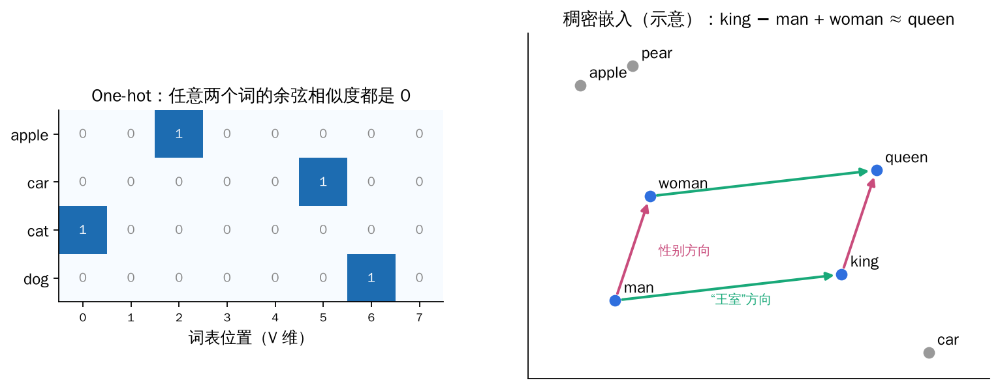
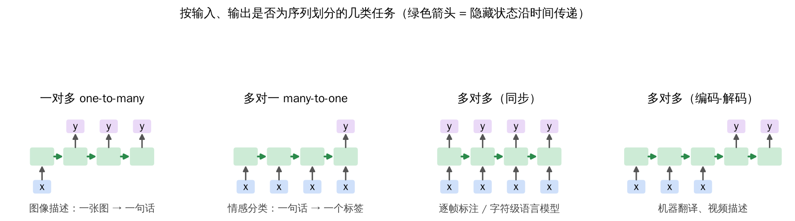
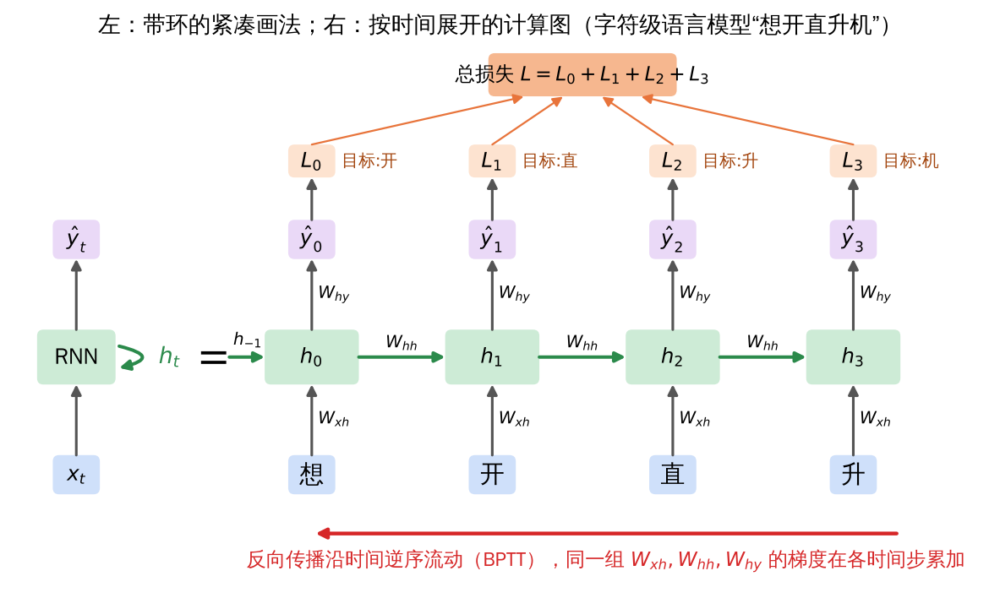
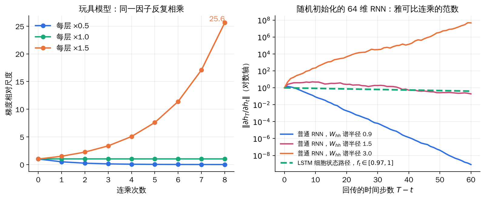
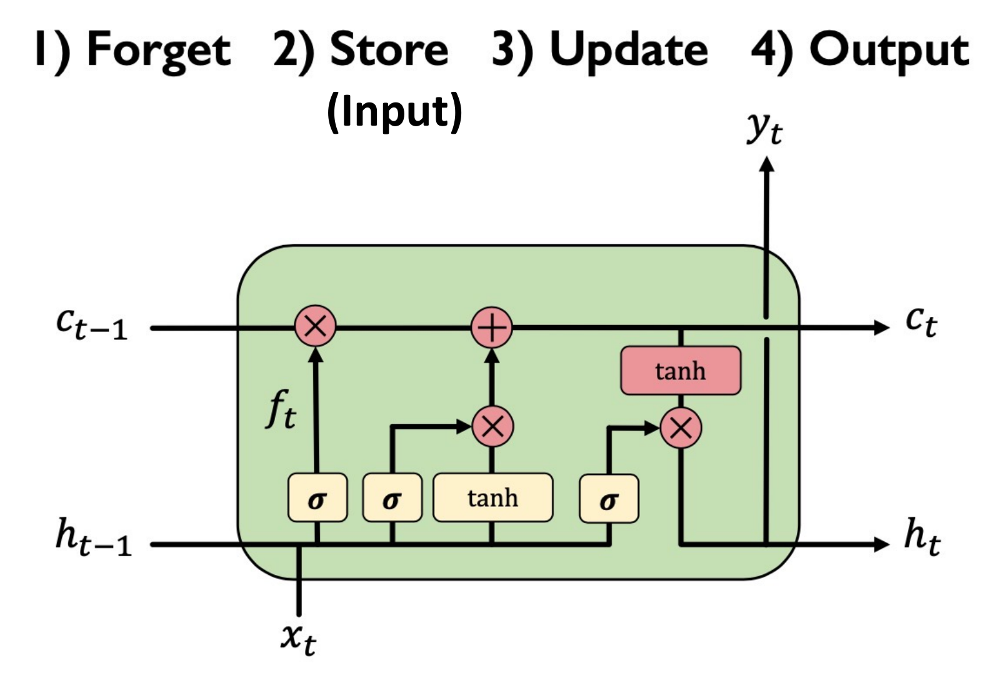

## 1. 从独立样本到序列数据

前几章处理的输入都是**静态、相互独立**的：一张图片是一个样本，分类结果只取决于这张图片本身。但很多数据天然是**序列**，前后元素相互依赖：

| 数据 | 序列的单位 | 为什么不能逐个独立处理 |
| --- | --- | --- |
| 文本 | 字、词或子词 | “花”是动词还是名词，取决于上下文 |
| 音频 | 一帧帧声学特征 | 一个音素持续多帧，单帧难以判断 |
| 视频 | 一帧帧图像 | 动作由多帧的变化构成 |

处理序列需要两样东西：**把离散符号变成数值向量的方法**，以及**能够记住前文的网络结构**。本章先讲前者，再讲循环神经网络（RNN）和 LSTM。

## 2. 文本怎样变成向量

处理文本一般分三步：

1. **分词 Tokenization**：把文本切成词元，每个词元映射成一个整数 ID；
2. **嵌入 Embedding**：把每个 ID 映射成一个数值向量；
3. **网络模型**：在上下文中处理这些向量，完成具体任务的预测。

### 2.1 词元与词表

- **词元（Token）**：模型处理文本的基本单位，可以是整词、词的一部分或标点；
- **词表（Vocabulary）**：所有词元的集合，每个词元对应一个固定 ID。

例如 “I like reading.” 可以切成 ["I", "like", "read", "ing", "."]。

### 2.2 分词的粒度

同一句 “A hippopotamus ate my homework.” 用三种粒度切分：

| 粒度 | 词元示例 | 序列长度 |
| --- | --- | --- |
| 字符级 Character | 'A', ' ', 'h', 'i', 'p', 'p', 'o', … , 'k', '.' | 31 |
| 子词级 Subword | 'A', 'hip', '##pop', '##ota', '##mus', 'ate', 'my', 'homework', '.' | 9 |
| 词级 Word | 'A', 'hippopotamus', 'ate', 'my', 'homework', '.' | 6 |

**字符级**：词表很小、序列很长。好处是任何新词都能用已知字符拼出来；坏处是单个字符本身携带的语义很少。

**词级**：按空格和标点切分。词表外的词通常只能映射为 “UNK”；“cat” 和 “cats” 拿到完全无关的两个 ID；中文这类不以空格分词的语言还需要额外规则。

**子词级**：常见词保持完整，罕见词拆成更小的片段；片段可以在不同词之间复用，从而**在词表大小和序列长度之间取得平衡**。词表从语料中学习，学好后在推理时固定。关键问题变成：**哪些片段应该成为词元？**

### 2.3 字节对编码 BPE

BPE（Byte Pair Encoding）是最常用的子词分词方法之一，核心是**反复合并最高频的相邻词元对**：

1. 用单个字符初始化词表；
2. 在训练语料中统计所有相邻词元对的出现次数；
3. 把出现最多的一对合并成新词元，并更新切分结果；
4. 重复，直到词表达到目标大小。

例：语料中各词及其频次为 ("hug", 10)、("pug", 5)、("pun", 12)、("bun", 4)、("hugs", 5)，初始词表为 b, g, h, n, p, s, u。

| 轮次 / 新词元 | hug ×10 | pug ×5 | pun ×12 | bun ×4 | hugs ×5 |
| --- | --- | --- | --- | --- | --- |
| 0：字符 | h u g | p u g | p u n | b u n | h u g s |
| 1：ug（20 次） | h ug | p ug | p u n | b u n | h ug s |
| 2：un（16 次） | h ug | p ug | p un | b un | h ug s |
| 3：hug（15 次） | hug | p ug | p un | b un | hug s |

第 1 轮中 “u g” 在 hug、pug、hugs 中共出现 10+5+5 = 20 次，频次最高，于是合并；第 3 轮 “h ug” 出现 10+5 = 15 次。三轮之后词表新增 ug、un、hug。早期 GPT 使用 478 个基础符号加 40000 次合并，词表共 40478 项。

### 2.4 从词元到 ID：特殊词元

固定词表把每个词元映射为整数，还会加入若干**特殊词元**：

| 词元 | ID | 用途 |
| --- | --- | --- |
| beer / i / want / a / is / cute | 0 – 5 | 普通词元 |
| UNK | 6 | 词表外的未知词 |
| PAD | 7 | 填充，使一个 batch 内序列等长 |
| BOS | 8 | 序列开始 |
| EOS | 9 | 序列结束 |

于是 “I want a beer!” → [8, 1, 2, 3, 0, 9, 7, 7]，“Beer is cute!” → [8, 0, 4, 5, 9, 7, 7, 7]。PAD 只是为了对齐长度，**计算注意力或损失时应在相应位置用掩码屏蔽**。特殊词元的具体约定因模型而异。

### 2.5 词嵌入

ID 只是符号的编号，**相邻的 ID 并不代表意思相近**。需要把每个离散词元映射成定长的实数向量：

| 表示方法 | 主要思想 |
| --- | --- |
| One-hot | 长度为 V 的稀疏向量，只有该词的位置为 1 |
| Word2vec | 从上下文中学到的稠密向量 |
| 可学习嵌入矩阵 | 与模型一起端到端训练的稠密向量 |

**One-hot 的局限**：任意两个不同词的向量正交，余弦相似度恒为 0，无论意思多接近；而且维度等于词表大小，高维且稀疏。

**Word2vec** 从大规模语料中学习稠密词向量：出现在相似上下文中的词得到相似的向量。训练目标来自文本本身，无需人工标注，有两种形式：

- **CBOW**：用上下文预测中心词；
- **Skip-gram**：用中心词预测上下文。

学到的向量空间常呈现线性结构，例如 king − man + woman ≈ queen（“男人之于女人，如同国王之于王后”）。

**可学习嵌入矩阵**：保存一个 V 行 d 列的矩阵 E，每一行是一个词元的向量，ID 直接选出对应的行。用 one-hot 向量乘以 E 与查表完全等价：

\[
e_{\text{token}}=\mathrm{onehot}(\text{id})^{\mathsf T}E=E[\text{id},:],
\qquad E\in\mathbb R^{V\times d}.
\]

E 与模型其余部分一起通过反向传播训练，现代模型几乎都用这种方式。

*左：one-hot 向量两两正交，看不出任何语义关系；右：稠密嵌入空间中，“性别”和“王室”可以对应近似平行的方向（二维坐标仅为示意）。*

## 3. 循环神经网络 RNN

### 3.1 序列任务的几种形态

普通前馈网络是“一个输入 → 一个输出”。按输入、输出是否为序列，可以组合出多种任务：

*一对多：图像描述；多对一：动作分类（视频帧序列 → 动作类别）、情感分类（词序列 → 情绪）；多对多：逐帧标注，或视频描述、机器翻译这类先读完再输出的任务。*

### 3.2 给神经元加上“记忆”

若对每个时间步独立地做 ŷₜ = f(xₜ)，模型无法利用前面时刻的信息。RNN 让每一步额外接收上一步留下的**隐藏状态**：

\[
\hat y_t=f(x_t)\quad\Longrightarrow\quad\hat y_t=f(x_t,\,h_{t-1}).
\]

hₜ₋₁ 就是“过去的记忆”。把这个过程画成一个带自环的单元：每个时间步读入 xₜ，更新内部状态 hₜ，并给出输出 ŷₜ。

### 3.3 循环关系与 Vanilla RNN

在每个时间步应用同一个**递推关系**：

\[
h_t=f_W\!\left(h_{t-1},\,x_t\right).
\]

其中 hₜ 是新状态（cell state），f_W 是由参数 W 决定的函数，hₜ₋₁ 是旧状态，xₜ 是 t 时刻的输入向量。最基本的 RNN（Vanilla RNN）取：

\[
h_t=\tanh\!\left(W_{hh}h_{t-1}+W_{xh}x_t+b_h\right),
\qquad
\hat y_t=W_{hy}h_t+b_y .
\]

**所有时间步使用同一个函数、同一组参数** W_xh、W_hh、W_hy。这和卷积在空间上共享权重是同一个思想，只不过 RNN 在**时间**上共享。因此 RNN 能处理任意长度的序列，参数量也不随序列长度增长。

### 3.4 按时间展开的计算图

把自环沿时间展开，RNN 就变成一个很深的前馈网络，每层对应一个时间步，各层共享权重。以字符级语言模型为例：输入“想开直升”，每一步预测下一个字，目标分别是“开直升机”。

*每个时间步都有一个损失 Lₜ，总损失是它们的和；反向传播沿时间逆向流动，共享参数在每个时间步都会收到一份梯度。*

总损失与对共享参数的梯度为：

\[
L=\sum_{t}L_t,\qquad
\frac{\partial L}{\partial W}=\sum_{t}\frac{\partial L_t}{\partial W}.
\]

这种在展开图上做反向传播的方法称为**随时间反向传播（Backpropagation Through Time, BPTT）**。它仍然是普通的链式法则：同一参数被多处使用，梯度就把每一处的贡献相加。

### 3.5 Vanilla RNN 的梯度流

把两项矩阵乘法合并，可以写成：

\[
h_t=\tanh\!\left(W_{hh}h_{t-1}+W_{xh}x_t\right)
=\tanh\!\left(\begin{pmatrix}W_{hh}&W_{xh}\end{pmatrix}\begin{pmatrix}h_{t-1}\\x_t\end{pmatrix}\right)
=\tanh\!\left(W\begin{pmatrix}h_{t-1}\\x_t\end{pmatrix}\right).
\]

从 hₜ 反传到 hₜ₋₁，每一步都要乘一次 W_hh（准确说是乘它的转置）和 tanh 的导数：

\[
\frac{\partial h_t}{\partial h_{t-1}}
=\operatorname{diag}\!\left(\tanh'\!\left(W_{hh}h_{t-1}+W_{xh}x_t\right)\right)W_{hh}.
\]

最后一个时间步的损失对 W 的梯度，要从 T 一路传回第 1 步：

\[
\frac{\partial L_T}{\partial W}
=\frac{\partial L_T}{\partial h_T}\frac{\partial h_T}{\partial h_{T-1}}\cdots\frac{\partial h_1}{\partial W}
=\frac{\partial L_T}{\partial h_T}\left(\prod_{t=2}^{T}\frac{\partial h_t}{\partial h_{t-1}}\right)\frac{\partial h_1}{\partial W}.
\]

又出现了长串连乘。连乘项（大致由 W_hh 的奇异值与 tanh′ 决定）**普遍小于 1 时梯度消失，普遍大于 1 时梯度爆炸**。这与深层前馈网络的问题完全相同，只是 RNN 的“深度”等于序列长度，而且每一步乘的是**同一个矩阵**，问题更加严重。梯度消失意味着远处时间步的信息几乎无法影响参数更新，RNN 实际上只能学到短程依赖。

*左：每步乘 0.5、1.0、1.5 时，8 步后的梯度尺度分别约为 0.004、1、25.6。右：64 维随机 RNN 的实测结果。W_hh 谱半径为 0.9 时梯度指数衰减；谱半径为 3 时梯度迅速放大；谱半径为 1.5 时，tanh 进入饱和区，其导数抵消了一部分放大作用。虚线是 LSTM 细胞状态路径，遗忘门接近 1 时梯度几乎不衰减。*

### 3.6 应对方法

**梯度爆炸：梯度裁剪（Gradient Clipping）**。若梯度范数超过阈值 c，就把它等比例缩小：

\[
\text{if }\ \|g\|\gt c:\qquad g\leftarrow c\,\frac{g}{\|g\|}.
\]

方向不变，只限制步长，实现简单且非常有效。

**梯度消失**没有这么直接的修补办法，常见思路有三类：

1. **激活函数**：例如使用导数不易饱和的激活；
2. **权重初始化**：例如把 W_hh 初始化为单位阵或正交阵，使连乘因子接近 1；
3. **网络结构**：使用门控单元，从结构上为梯度提供一条不衰减的通路，这是最根本的方法。

## 4. 长短期记忆网络 LSTM

### 4.1 门控单元的思想

用一个**更复杂、带有“门”的循环单元**来控制哪些信息能够通过。LSTM（Long Short-Term Memory）和 GRU 都属于门控单元；LSTM 依靠门控在许多时间步中追踪信息。

标准 RNN 的重复模块里只有一个简单的计算节点（一个 tanh 层）。LSTM 的模块中则有几个相互配合的计算块，用来控制信息流动。

**门（gate）**的实现是一个 sigmoid 层加一次逐元素乘法。sigmoid 输出 0 到 1 之间的数：0 表示“完全不让通过”，1 表示“全部通过”，中间值表示部分通过。门可以有选择地添加或删除信息。

### 4.2 LSTM 的四步计算

LSTM 维护两个状态：**细胞状态 cₜ**（长期记忆，贯穿整条链）和**隐藏状态 hₜ**（当前输出）。设 zₜ = [hₜ₋₁, xₜ] 为上一隐藏状态与当前输入的拼接，σ 为 sigmoid，⊙ 为逐元素乘法：

\[
f_t=\sigma(W_f z_t+b_f),\qquad
i_t=\sigma(W_i z_t+b_i),\qquad
\tilde c_t=\tanh(W_c z_t+b_c),
\]
\[
c_t=f_t\odot c_{t-1}+i_t\odot\tilde c_t,\qquad
o_t=\sigma(W_o z_t+b_o),\qquad
h_t=o_t\odot\tanh(c_t).
\]

*上方水平线是细胞状态 c，下方是隐藏状态 h。从左到右的三个 σ 分别是遗忘门、输入门、输出门，中间的 tanh 生成候选记忆。*

| 步骤 | 计算 | 作用 |
| --- | --- | --- |
| 1）遗忘 Forget | 遗忘门 fₜ 与 cₜ₋₁ 逐元素相乘 | 丢弃旧状态中无关的部分 |
| 2）存储 Store | 输入门 iₜ 筛选候选值 c̃ₜ | 把当前输入中相关的新信息写入 |
| 3）更新 Update | cₜ = fₜ⊙cₜ₋₁ + iₜ⊙c̃ₜ | 有选择地更新细胞状态 |
| 4）输出 Output | hₜ = oₜ⊙tanh(cₜ) | 输出门决定把细胞状态的哪些部分传给下一步和输出层 |

举例来说，在语言模型中读到新的主语时，遗忘门可以清掉旧主语的单复数信息，输入门写入新主语的信息，输出门则在需要预测动词时把这部分信息放出来。

### 4.3 LSTM 为什么能缓解梯度消失

只看细胞状态这条路径：

\[
c_t=f_t\odot c_{t-1}+i_t\odot\tilde c_t
\quad\Longrightarrow\quad
\frac{\partial c_t}{\partial c_{t-1}}=\operatorname{diag}(f_t)\ \ \text{（忽略经由门间接产生的项）}.
\]

与 Vanilla RNN 相比有两个关键区别：

- 反传时**不再反复乘同一个权重矩阵 W_hh**，也不经过 tanh 的饱和导数，而只是逐元素乘遗忘门；
- 遗忘门由网络学习，每一步可以不同。需要长期记忆时，网络可以让 fₜ 接近 1，梯度就能几乎不衰减地传回很远的时间步。

因此细胞状态形成了一条**梯度“高速公路”**，反向传播可以沿它不间断地流过多个时间步。这与 ResNet 中恒等捷径的作用非常相似：都是用**加法**连接新旧信息，给梯度留一条直接通路。实践中常把遗忘门偏置初始化为正数（如 1），让训练初期默认“记住”。

需要注意，LSTM 是**缓解**而非彻底消除梯度消失，也不能防止梯度爆炸，后者仍常配合梯度裁剪。

### 4.4 要点回顾

1. **把细胞状态与输出分开维护**，细胞状态负责长期记忆；
2. **用门控制信息流**：
   - 遗忘门丢弃无关信息；
   - 输入门存储当前输入中的相关信息；
   - 有选择地更新细胞状态；
   - 输出门返回细胞状态经过筛选的版本；
3. **随时间反向传播时，梯度沿细胞状态不间断地流动。**

GRU 是 LSTM 的常见简化版本：它把遗忘门和输入门合并为一个更新门，并去掉单独的细胞状态，参数更少，效果通常相近。

## 5. 小结与易错点

| 问题 | 结论 |
| --- | --- |
| 为什么要用子词分词 | 平衡词表大小与序列长度，罕见词也能用已知片段表示 |
| BPE 每轮做什么 | 合并当前语料中出现次数最多的相邻词元对 |
| ID 相邻是否说明词义相近 | 不是，ID 只是编号，语义要靠嵌入向量表示 |
| one-hot 乘嵌入矩阵等于什么 | 直接取嵌入矩阵的对应行 |
| RNN 每个时间步的参数是否不同 | 相同，参数在时间上共享 |
| BPTT 对共享参数的梯度怎么得到 | 把各时间步的梯度贡献相加 |
| 梯度爆炸怎么办 | 梯度裁剪 |
| 梯度消失怎么办 | 改进激活与初始化，根本上使用 LSTM、GRU 等门控结构 |
| LSTM 的 c 和 h 有何区别 | c 是长期记忆，h 是经过输出门筛选后的当前输出 |
| LSTM 为什么能保留长程梯度 | 细胞状态通过逐元素乘遗忘门和加法更新，不反复乘同一个权重矩阵 |
