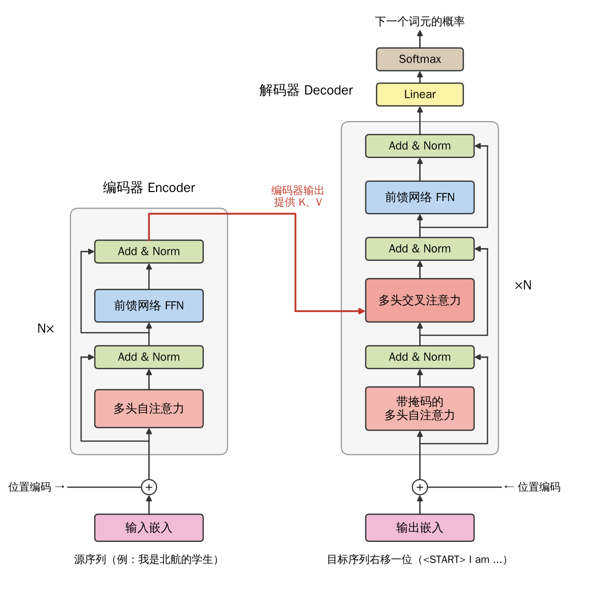
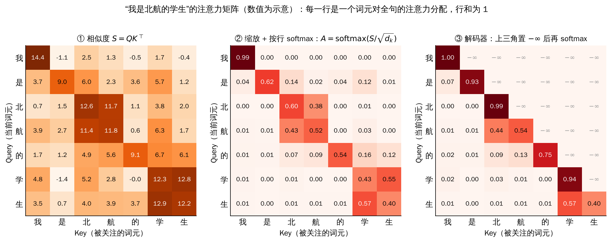
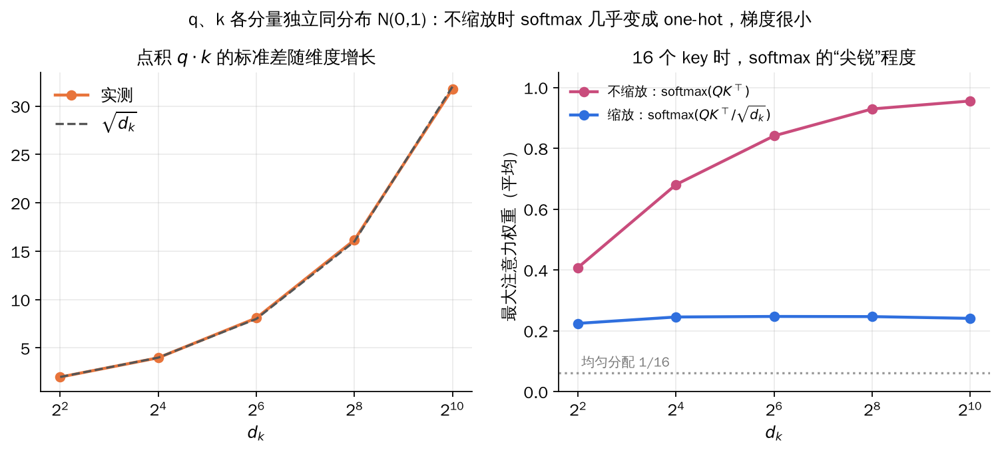
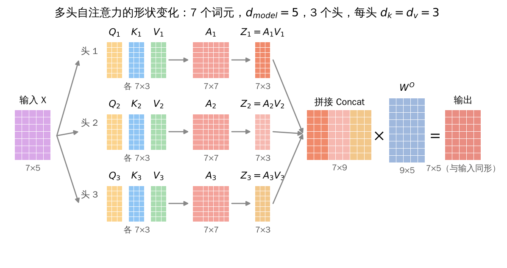
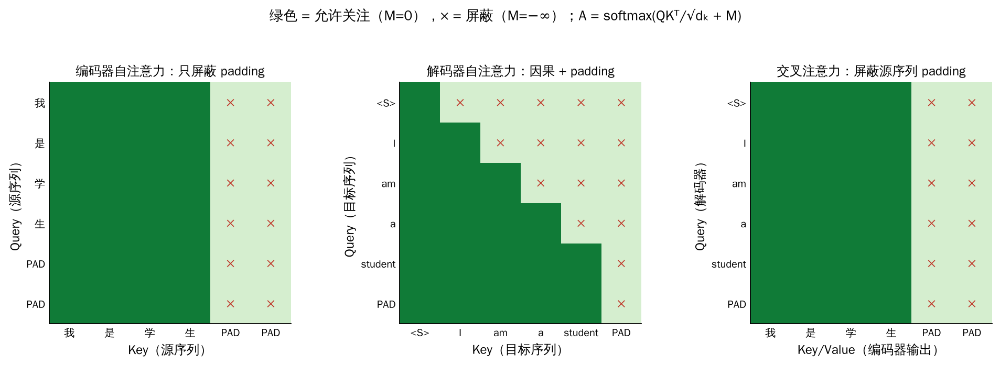
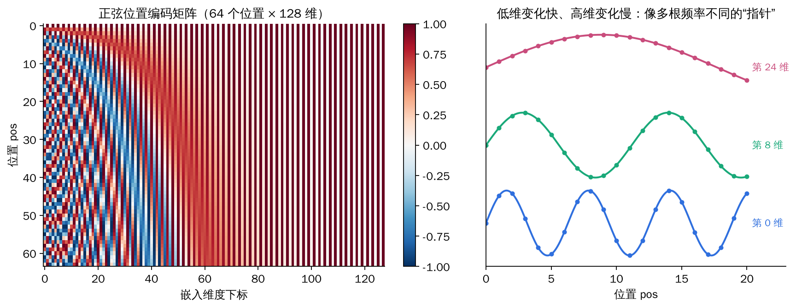

## 1. 序列到序列：输出长度由模型决定

很多任务的输入和输出都是序列，而且**输出长度不能事先确定**，需要模型自己决定：

| 任务 | 输入 | 输出 |
| --- | --- | --- |
| 语音识别 | 长度 T 的语音帧 | 长度 N 的文字 |
| 机器翻译 | 长度 N 的中文“深度学习” | 长度 N′ 的英文“Deep Learning” |
| 语音翻译 | 英文语音 | 中文文字（也适用于没有文字的语言） |

这类任务称为**序列到序列（Sequence-to-Sequence，Seq2seq）**。

### 1.1 编码器-解码器

用 RNN 做 Seq2seq，可以拼接上一章的两种形态：**多对一 + 一对多**。

- **编码器（多对一）**：逐步读入整个输入序列，把它压缩成一个向量；
- **解码器（一对多）**：从这个向量出发，逐个生成输出序列。

解码时先输入特殊词元 START，输出第一个字“深”的概率分布并取最大者；再把“深”作为下一步的输入，依次得到“度”“学”“习”，直到输出 END 为止。**每一步的输出会成为下一步的输入**，这种生成方式称为**自回归**。

RNN 编码器-解码器有两个硬伤：整个输入只能挤进一个定长向量，长句信息容易丢失；而且必须逐步计算，无法在时间维上并行。Transformer 用注意力机制同时解决了这两个问题。

## 2. Transformer 总览

Transformer 是 2017 年在论文 *Attention Is All You Need*（NeurIPS 2017）中提出的网络架构，最初用于机器翻译，如今是 ChatGPT、Gemini、Llama 等大语言模型的共同基础。

*左侧编码器由 N 个相同的块堆叠，每块包含多头自注意力和前馈网络；右侧解码器多了带掩码的自注意力和交叉注意力，后者从编码器输出中读取 K、V。*

| 组件 | 作用 |
| --- | --- |
| 分词 Tokenization、嵌入 Embedding | 把文本变成向量序列 |
| 位置编码 Positional Encoding | 补充词元的顺序信息 |
| 自注意力 Self-attention | 让每个词元从整个序列中收集相关信息 |
| 交叉注意力 Cross-attention | 解码器从编码器的输出中读取信息 |
| 前馈网络 MLP / FFN | 对每个词元的特征单独做非线性变换 |
| Add & Norm | 残差连接加层归一化，稳定深层训练 |
| Linear + Softmax | 把解码器输出变成下一个词元的概率 |

### 2.1 输入嵌入

以“我是一名学生”为例，得到最终输入嵌入需要四步：

1. **分词**：我 / 是 / 一 / 名 / 学 / 生；
2. **获得词元嵌入**：按 ID（如 3145、8123、6919 …）从嵌入矩阵中查出向量；
3. **补充位置信息**：为位置 0、1、2 … 各生成一个位置编码；
4. **相加**：词元嵌入 + 位置编码 = 最终输入嵌入。

## 3. 自注意力 Self-attention

### 3.1 从注意力到自注意力

注意力并不是 Transformer 首创。在图像描述任务中，模型生成 “bird” 时把注意力集中在鸟所在的区域，生成 “water” 时转向水面，这是**输出对输入的注意力**。

**自注意力**考虑的是**同一序列内部各元素之间的关系**。例如：

> 我**花**了一下午的时间浇**花**。

第一个“花”是动词“花费”，线索是后面表示时长的“一下午的时间”；第二个“花”是名词“花朵”，线索是动词“浇”。**一个词的含义取决于句子中其他词**，自注意力就是让每个词元都能“看”遍整个序列，按相关程度汇总信息。

### 3.2 每个输出都看到全部输入

自注意力层输入一组向量 a¹, …, aⁿ（可以是嵌入，也可以是上一层的隐藏表示），输出同样数量的向量 b¹, …, bⁿ。**每个 bⁱ 都是综合考虑所有 aʲ 之后得到的。**计算 b¹ 时，先要回答：序列中哪些向量与 a¹ 相关、相关程度 α 有多大？

### 3.3 Query、Key、Value

可以用搜索引擎类比：

- **Query（查询）**：你在搜索框里输入的内容，例如“北航”；
- **Key（键）**：每个网页的标题或标签，用来和 Query 比较相似度；
- **Value（值）**：网页的实际内容，按相似度加权后返回。

自注意力中，每个词元同时扮演三种角色：用自己的 Query 去和所有词元的 Key 比相似度，再按相似度对所有词元的 Value 加权求和。三种角色由三个不同的可学习线性变换得到。

### 3.4 计算步骤

把 n 个词元的输入按行堆成矩阵 X（n × d_model）：

\[
Q=XW^{Q},\qquad K=XW^{K},\qquad V=XW^{V},
\qquad W^{Q},W^{K}\in\mathbb R^{d_{\mathrm{model}}\times d_k},\ W^{V}\in\mathbb R^{d_{\mathrm{model}}\times d_v}.
\]

以“我是北航的学生”7 个字、d_model = 5、d_k = d_v = 3 为例，Q、K、V 都是 7×3。

1. **算相似度**：S = QKᵀ，形状 7×7。第 i 行第 j 列是第 i 个词元的 Query 与第 j 个词元的 Key 的点积；
2. **缩放**：除以 √dₖ；
3. **按行 softmax**：得到注意力矩阵 A，每行非负且和为 1，表示该词元把注意力怎样分配给全句；
4. **加权求和**：Z = AV，形状 7×3，每行是一个词元的新表示。

合起来就是缩放点积注意力（Scaled Dot-Product Attention）：

\[
\operatorname{Attention}(Q,K,V)=\operatorname{softmax}\!\left(\frac{QK^{\mathsf T}}{\sqrt{d_k}}\right)V,
\qquad
\operatorname{softmax}(x)_i=\frac{e^{x_i}}{\sum_j e^{x_j}} .
\]

*“北”和“航”互相关注、“学”和“生”互相关注，因为它们组成一个词。注意力矩阵常被称为 Attention Map 或 Attention Filter，第三幅图是解码器中使用的因果掩码版本。*

需要学习的参数只有 W^Q、W^K、W^V 三个矩阵；注意力权重 A 是根据输入**动态计算**出来的，而不是固定的参数。这一点与全连接层、卷积层都不同。

### 3.5 为什么要除以 √dₖ

设 q、k 的各分量独立、均值 0、方差 1，则点积 q·k = Σᵢ qᵢkᵢ 的方差为 dₖ，标准差为 √dₖ。维度越高，点积的数值越大，softmax 就越接近 one-hot：几乎全部权重集中在一个位置，其余位置的梯度趋近于 0，训练困难。除以 √dₖ 把点积的方差拉回 1，让 softmax 保持在梯度合适的区间。

*左：实测点积标准差与 √dₖ 重合。右：16 个 key 时，不缩放的 softmax 在 dₖ=1024 时平均最大权重接近 0.96，几乎是 one-hot；缩放后与维度基本无关。*

### 3.6 形状与计算量

| 矩阵 | 形状 | 含义 |
| --- | --- | --- |
| Q、K | n × dₖ | 查询与键 |
| V | n × dᵥ | 值 |
| A = softmax(QKᵀ/√dₖ) | n × n | 注意力权重 |
| AV | n × dᵥ | 每个词元一行输出 |

多个头拼接后为 n × (h·dᵥ)，经输出投影变为 n × d_model。

注意力矩阵是 n×n 的，**计算量和显存都随序列长度平方增长，即 O(n²)**，这是长文本建模的主要瓶颈。另一方面，所有位置的计算可以一次矩阵乘法完成，不像 RNN 那样必须逐步进行，非常适合 GPU 并行。任意两个位置之间也只隔一步，不存在 RNN 那种长距离梯度要穿过很多时间步的问题。

## 4. 多头自注意力

一组 W^Q、W^K、W^V 只能刻画一种“相关”的标准，而词之间的关系有很多种：语法搭配、指代、语义相近……**多头注意力让多组参数并行计算注意力**，每个头学习一种关系：

\[
\mathrm{head}_i=\operatorname{Attention}\!\left(XW_i^{Q},XW_i^{K},XW_i^{V}\right),
\qquad
\operatorname{MultiHead}(X)=\operatorname{Concat}(\mathrm{head}_1,\ldots,\mathrm{head}_h)\,W^{O}.
\]

继续前面的例子，3 个头各自得到 7×3 的 Z₁、Z₂、Z₃：

1. **沿特征维拼接**：得到 Z（7 × 9）；
2. **输出投影**：乘以 W^O（9 × 5），得到 7 × 5 的输出，与输入形状相同，便于残差相加和堆叠多层。同一个投影作用于全部 7 个位置。

*每个头有独立的 Q、K、V 投影和注意力矩阵；拼接后再用 W^O 混合各头的信息。*

实际模型中常取 dₖ = dᵥ = d_model / h，此时多头注意力的总计算量与单个全维度头相近。原始 Transformer 中 d_model = 512、h = 8、dₖ = 64。

## 5. 残差连接、层归一化与前馈网络

### 5.1 Add & Norm

每个子层（注意力或 FFN）外面都包了一层 Add & Norm：

\[
X'=\operatorname{LayerNorm}\!\left(X+\operatorname{MultiHead}(X)\right),
\qquad
Y=\operatorname{LayerNorm}\!\left(X'+\operatorname{FFN}(X')\right).
\]

**残差连接（Add）**的作用：

1. **保留已有知识**：子层只需学习在输入基础上的修改量，原始信息不会被覆盖；
2. **缓解梯度消失**：恒等路径让梯度可以直接传回浅层，与 ResNet 的捷径相同。

**层归一化（Norm）**对**每个词元的特征向量单独**做归一化，再乘以 γ、加上 β。例如某个词元特征的均值为 0.67、标准差为 0.44，其中值为 0.98 的分量被归一化为：

\[
\hat x=\frac{0.98-0.67}{\sqrt{0.44^2+0.0001}}\approx0.70 .
\]

序列长度可变、推理时 batch 可能为 1，用 Batch Norm 的统计量不方便，所以 Transformer 选择 Layer Norm。原始论文把归一化放在残差相加之后（Post-LN）；现代大模型多改为子层之前（Pre-LN），训练更稳定。

### 5.2 逐位置前馈网络

\[
\operatorname{FFN}(x)=\operatorname{ReLU}(xW_1+b_1)\,W_2+b_2 .
\]

- **每个词元经过同一个网络**，各位置之间互不交流；
- 原始 Transformer 中维度变化为 512 → 2048 → 512，先升维再降维；
- **注意力负责在词元之间混合信息，FFN 负责变换每个词元自身的特征**，二者分工明确。模型的大部分参数其实在 FFN 中。

## 6. 解码器：掩码与交叉注意力

### 6.1 带掩码的自注意力

解码器逐个生成词元。生成第 t 个词元时，后面的词元还不存在，**训练时也不能让模型偷看答案**。做法是在 softmax 之前把注意力分数矩阵的上三角（未来位置）设为 −∞：

\[
A=\operatorname{softmax}\!\left(\frac{QK^{\mathsf T}}{\sqrt{d_k}}+M\right),
\qquad
M_{ij}=\begin{cases}0,&j\le i\\-\infty,&j\gt i\end{cases}.
\]

e^(−∞) = 0，被屏蔽的位置权重恰好为 0，每个位置只能关注自己和之前的位置。这称为**因果掩码（causal mask）**。

### 6.2 交叉注意力

解码器中间的注意力子层：**Query 来自解码器，Key 和 Value 来自编码器最后一层的输出**。生成每个目标词时，解码器据此决定应该关注源句的哪些部分，取代了 RNN 编码器-解码器中那个单一的定长向量。

### 6.3 三种注意力与掩码

| 注意力 | Query 来源 | Key / Value 来源 | 掩码 |
| --- | --- | --- | --- |
| 编码器自注意力 | 编码器状态 | 同一组编码器状态 | padding |
| 解码器自注意力 | 解码器状态 | 同一组解码器状态 | 因果 + padding |
| 交叉注意力 | 解码器状态 | 编码器最终输出 | 源序列 padding |

M 中允许关注的位置为 0，屏蔽的位置为 −∞。

*绿色表示允许关注，× 表示被屏蔽。PAD 只用于把 batch 内的序列补齐，任何位置都不应关注它。*

### 6.4 训练与推理

**推理**是自回归的：编码器先把“我是北航的学生”编码成 K、V；解码器从 START 开始，每步预测一个词，把预测结果接到输入末尾，再预测下一个，直到输出 END，得到 “I am a student of Beihang”。

**训练**时则使用 **Teacher Forcing**：解码器的输入直接用真实答案右移一位（START, I, am, …），每个位置预测下一个词，与真实目标计算交叉熵损失。因为有因果掩码，所有位置可以**一次并行计算**，而不必像推理那样逐步展开。如果某一步预测错了（比如把 “I” 预测成 “You”），下一步的输入仍是正确的 “I”，错误不会在训练中累积。

## 7. 位置编码

### 7.1 顺序很重要

> 虽然我**不**喜欢吃苦瓜，但是我今天吃了。
> 虽然我喜欢吃苦瓜，但是我今天**不**吃了。

两句话用字几乎相同，意思却完全不同。自注意力本身**对位置不敏感**：把输入词元打乱，每个词元得到的输出只是跟着换位，数值不变。因此必须显式地把位置信息加入输入：第 i 个词元的输入为 eᵢ + pᵢ。

### 7.2 两种朴素做法的问题

| 方案 | pᵢ 的取值 | 问题 |
| --- | --- | --- |
| 直接用下标 | 0, 1, 2, 3, … | 数值无界，长序列后部的位置值远大于嵌入本身，淹没语义信息 |
| 归一化下标 | i/(N−1)，如 N=4 时为 0, 0.33, 0.66, 1 | 同一位置在不同长度的句子中编码不同，相邻位置的间隔也随长度改变 |

### 7.3 正弦位置编码

原始 Transformer 采用一组频率不同的正弦和余弦函数：

\[
PE_{(pos,\,2i)}=\sin\!\left(\frac{pos}{10000^{2i/d_{\mathrm{model}}}}\right),
\qquad
PE_{(pos,\,2i+1)}=\cos\!\left(\frac{pos}{10000^{2i/d_{\mathrm{model}}}}\right).
\]

pos 是位置下标，i 是嵌入维度下标，d_model 是嵌入维度。偶数维用正弦，奇数维用余弦。

- **低维频率高、变化快，高维频率低、变化慢**，就像钟表上转速不同的指针，组合起来能唯一确定位置；
- 只看一个频率时，不同位置可能取到相同的值（例如 p₀ 与 p₆ 在某一维上相等），但多个频率合在一起就不会重复；
- 每个分量都在 [−1, 1] 之间，与序列长度无关；
- 对任意固定偏移 k，PE_{pos+k} 都可以写成 PE_{pos} 的线性变换（由三角函数和角公式得到），便于模型学习相对位置。

*左：每一行是一个位置的编码向量，左侧维度条纹密集，右侧维度几乎不变；右：第 0、8、24 维随位置变化的曲线，圆点为整数位置上的取值。*

位置编码也可以作为参数直接学习，BERT 和早期 GPT 就使用可学习的位置嵌入；现代大模型多使用 RoPE 等相对位置编码。

## 8. 三种架构与大语言模型

### 8.1 编码器、解码器与二者组合

| 架构 | 信息流 | 代表与用途 |
| --- | --- | --- |
| 仅编码器 Encoder-only | 双向自注意力 | BERT；分类、序列标注、检索 |
| 编码器-解码器 Encoder–decoder | 源序列编码器 + 因果解码器，由交叉注意力连接 | 原始 Transformer、T5；翻译等 Seq2seq 任务 |
| 仅解码器 Decoder-only | 因果自注意力，没有单独的编码器 | GPT、Llama、DeepSeek；文本生成 |

**注意力模式决定了每个词元能使用哪些信息。**近年来大语言模型几乎都采用仅解码器结构，开源（Llama、DeepSeek 等）和闭源模型都是如此。

### 8.2 BERT 与 GPT 的预训练目标

| | BERT：掩码语言模型 | GPT：下一个词元预测 |
| --- | --- | --- |
| 输入 | The [MASK] sat on the mat. | The cat sat on the |
| 预测 | cat | mat |
| 可用上下文 | 左右两侧 | 只有前缀 |
| 实现方式 | 在输入中遮住部分词元 | 用因果掩码阻止关注未来词元 |

### 8.3 BERT：双向编码器

BERT = Bidirectional Encoder Representations from Transformers（Devlin et al., 2019）。

- 每层包含自注意力和 FFN；
- 每个位置都能同时使用左右两侧的上下文；
- 没有因果掩码，但 padding 位置仍需屏蔽。

| 模型 | 层数 | 隐藏维度 | FFN 维度 | 头数 | dₖ = dᵥ | 参数量 |
| --- | --- | --- | --- | --- | --- | --- |
| BERT-Base | 12 | 768 | 3072 | 12 | 64 | 110M |
| BERT-Large | 24 | 1024 | 4096 | 16 | 64 | 340M |

**预训练**使用两个任务：掩码语言模型（MLM），以及判断两句话是否相邻的下一句预测（NSP）。**微调**时用有标签的任务数据，在顶部接上任务相关的输出层。

**输入嵌入** = 词元嵌入 + 段嵌入（区分句子 A / B）+ 可学习的位置嵌入。序列开头放 [CLS]，其最终表示常用于分类；句子之间用 [SEP] 分隔。

BERT-Base 与 2018 年的初代 GPT 规模相近（110M vs 117M 参数），区别在于预训练数据和目标：GPT 只用 BooksCorpus（8 亿词），BERT 还加入了英文维基百科（25 亿词）。

### 8.4 预训练、微调与上下文学习

| 阶段 / 方法 | 模型接收什么 | 是否更新参数 |
| --- | --- | --- |
| 预训练 Pretraining | 大规模文本，自监督目标 | 是 |
| 微调 Fine-tuning | 任务或指令示例 | 是，全部或部分参数 |
| 上下文学习 In-context learning | 提示中的指令或示例 | 推理时不更新 |

上下文学习的例子：在提示里给出 “Loved it!” → Positive，“Terrible.” → Negative，再问 “Very enjoyable.” → ?。模型无需任何梯度更新，仅凭提示中的示例就能输出 Positive。

### 8.5 自回归生成与 KV Cache

仅解码器模型每步只预测一个新词元，然后把它接到输入末尾。若每步都把整个前缀重新算一遍，大量计算是重复的。由于因果掩码的存在，**已经生成的词元的 K、V 不会因为后面的新词元而改变**，可以缓存起来复用：

| 阶段 | 计算 | KV Cache |
| --- | --- | --- |
| 预填充 Prefill | 用因果掩码并行处理整个提示 | 为每一层保存提示的 K、V |
| 解码 Decode | 只处理新生成的一个词元 | 追加新的 K、V，并与缓存中的 K、V 一起计算注意力 |

- 每一步仍只预测一个词元；
- 缓存大小随上下文长度线性增长，约为 2 × 层数 × 序列长度 × d_model × 每个数的字节数；
- 注意力仍需读取全部历史 K、V，所以缓存省去的是重复的投影计算，并不能把长上下文变成免费的。

## 9. 小结与易错点

| 问题 | 结论 |
| --- | --- |
| 自注意力中可学习的参数是什么 | W^Q、W^K、W^V（多头时还有 W^O）；注意力权重是动态计算的 |
| 为什么除以 √dₖ | 点积方差随 dₖ 增长，不缩放时 softmax 过于尖锐、梯度很小 |
| 注意力矩阵的形状 | n × n，计算量与序列长度平方成正比 |
| 多头注意力的输出形状 | 拼接为 n × (h·dᵥ)，经 W^O 投影回 n × d_model |
| 注意力与 FFN 的分工 | 注意力在词元之间混合信息，FFN 逐词元变换特征 |
| 为什么用 Layer Norm | 按词元归一化，不依赖 batch 和序列长度 |
| 因果掩码怎样实现 | softmax 前把未来位置的分数设为 −∞ |
| 交叉注意力的 Q、K、V 从哪来 | Q 来自解码器，K、V 来自编码器最终输出 |
| 为什么需要位置编码 | 自注意力对输入顺序不敏感 |
| 训练时解码器为什么能并行 | Teacher Forcing 加因果掩码，所有位置一次算完 |
| BERT 与 GPT 的根本区别 | BERT 双向、预测被遮住的词；GPT 因果、预测下一个词 |
| KV Cache 缓存的是什么 | 每一层历史词元的 Key 和 Value |
