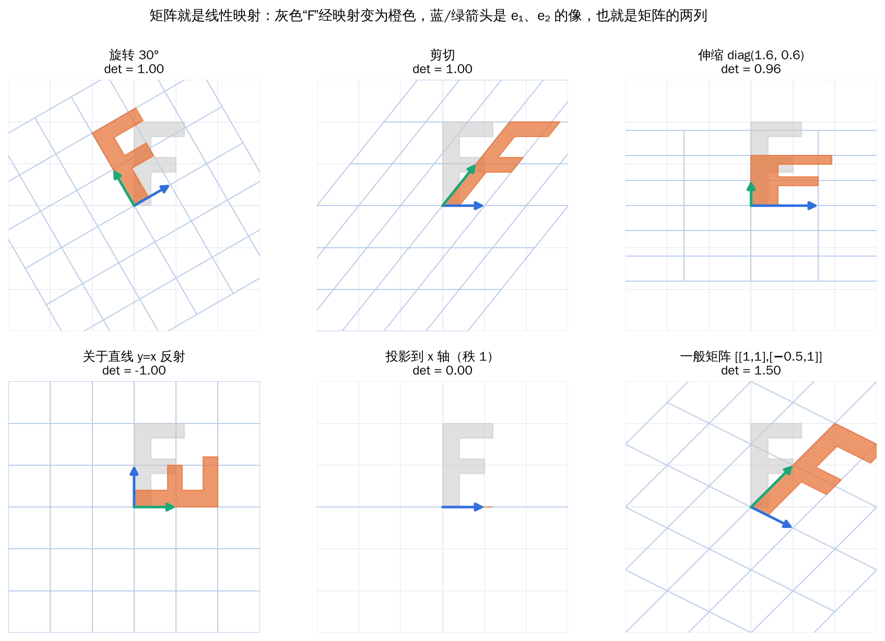
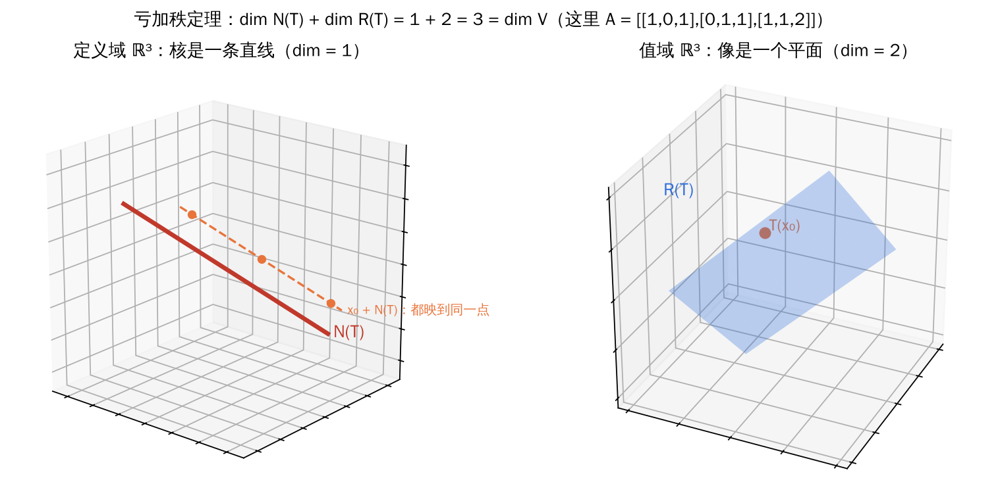
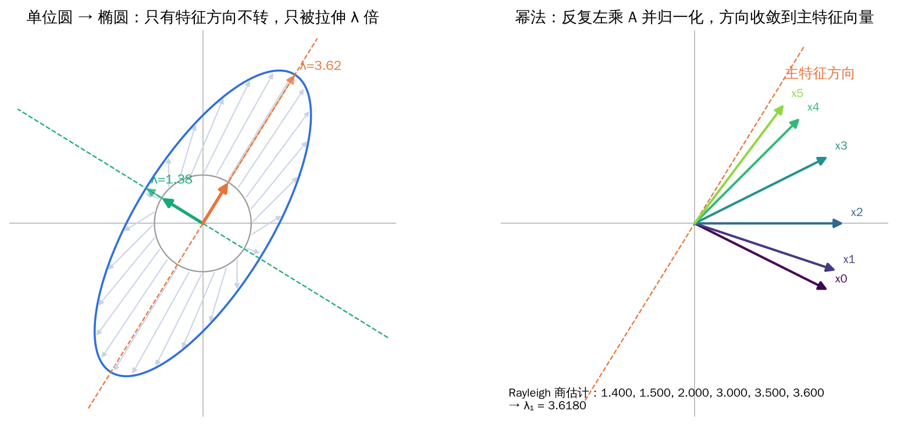
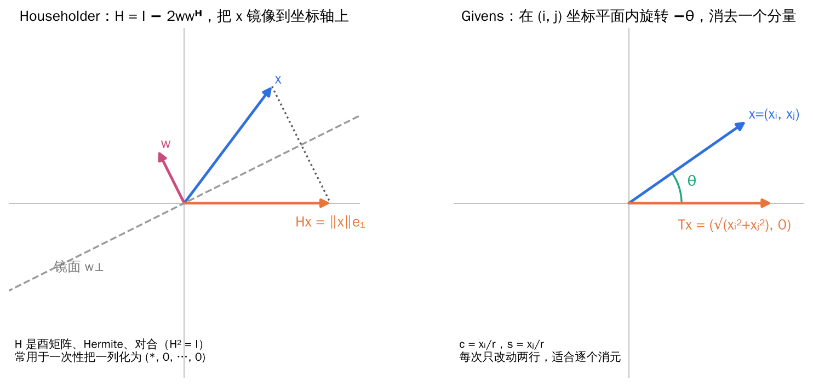

## 1. 映射与多项式

### 1.1 映射的基本概念

**定义**：设 V、W 是非空集合，若对每个 x ∈ V 都有唯一的 f(x) ∈ W 与之对应，则称 f 为从 V 到 W 的**映射**，记作 f: V → W。V 到自身的映射称为**变换**。

- **单射**：x₁ ≠ x₂ ⇒ f(x₁) ≠ f(x₂)；
- **满射**：W 中每个元素都有原像；
- **双射**：既单又满。

**定理**：映射 f: V → W 可逆（存在 g 使 g∘f = 恒等、f∘g = 恒等）当且仅当 f 是双射；可逆映射的逆映射唯一。映射乘积满足结合律，但一般不满足交换律。

### 1.2 多项式工具

后面讨论特征多项式、最小多项式、Jordan 标准形时，经常用到多项式的整除、公因式等概念。

**定义**：

- **带余除法**：对 g(λ) 和 h(λ) ≠ 0，存在唯一的 q(λ)、r(λ) 使 g = qh + r，且 r = 0 或 deg r < deg h；
- **整除**：若 r = 0，则称 h 整除 g，记 h | g；
- **最大公因式 / 最小公倍式**：首项系数为 1 的公因式中次数最高者 / 公倍式中次数最低者；
- **友矩阵**：首一多项式 f(λ) = λⁿ + aₙ₋₁λⁿ⁻¹ + ⋯ + a₁λ + a₀ 的友矩阵

\[
C_f=\begin{pmatrix}
0&0&\cdots&0&-a_0\\
1&0&\cdots&0&-a_1\\
0&1&\cdots&0&-a_2\\
\vdots&&\ddots&&\vdots\\
0&0&\cdots&1&-a_{n-1}
\end{pmatrix},
\qquad \det(\lambda I-C_f)=f(\lambda).
\]

**直观理解**：友矩阵说明“任何首一多项式都是某个矩阵的特征多项式”。数值软件求多项式的根时，实际上就是构造友矩阵再求它的特征值。

## 2. 线性映射

### 2.1 定义与例子

**定义（线性映射）**：设 V、W 是数域 F 上的线性空间。若映射 T: V → W 满足

\[
T(kx+ly)=kT(x)+lT(y),\qquad\forall\,x,y\in V,\ k,l\in F,
\]

则称 T 为**线性映射**；V 到 V 的线性映射称为**线性变换**。全体线性映射记作 ℒ(V, W)，它对映射的加法与数乘也构成线性空间。

| 例子 | 映射 | 是否线性 |
| --- | --- | --- |
| 数乘变换 | T(x) = kx | 是（k = 0 时为零变换，k = 1 时为恒等变换） |
| 平面旋转 | 把向量逆时针转 θ | 是 |
| 求导 | T(f) = f′，Pₙ → Pₙ | 是 |
| 积分 | T(f)(x) = ∫ₐˣ f(t) dt | 是 |
| 正交投影 | 把 x 投到子空间 W | 是 |
| 平移 | T(x) = x + a（a ≠ 0） | 否，T(0) ≠ 0 |

*线性映射把直线变成直线（或点），保持原点不动，网格变形后仍然平行等距。矩阵的第 j 列就是第 j 个基向量的像；行列式是面积的缩放倍数，负号表示翻转了朝向。*

**定理（基本性质）**：设 T 是线性映射，则

1. T(θ) = θ，T(−x) = −T(x)；
2. T 保持线性组合：T(Σ kᵢxᵢ) = Σ kᵢT(xᵢ)；
3. **线性相关的向量组映射后仍线性相关**；但线性无关组映射后可能变得线性相关（例如投影）；
4. T 由它在一组基上的像**完全确定**。

第 4 条最重要：要描述一个线性映射，只需要说清楚每个基向量被送到哪里。这正是“矩阵表示”的出发点。

### 2.2 核与值域

**定义**：设 T ∈ ℒ(V, W)。

- **值域**（像空间）R(T) = {T(x) | x ∈ V}，是 W 的子空间，dim R(T) 称为 T 的**秩**；
- **核**（零空间）N(T) = {x ∈ V | T(x) = θ}，是 V 的子空间，dim N(T) 称为 T 的**亏**（零度）。

**定理（亏加秩定理 / 秩–零化度定理）**：设 V 是有限维空间，T ∈ ℒ(V, W)，则

\[
\dim N(T)+\dim R(T)=\dim V .
\]

推论：T 是单射 ⇔ N(T) = {θ}；若 dim V = dim W，则 T 单射 ⇔ T 满射 ⇔ T 可逆。

*定义域被“压扁”了一个维度：核那条直线上的点全部变成零，任意 x₀ 加上核里的向量后像不变；剩下的两个维度铺满了值域平面。*

**直观理解**：把 V 想成 n 份“自由度”。线性映射要么把某份自由度“压扁”成零（进入核），要么把它“保留”到像里，二者之和不变。所以**方程 Ax = b 的解 = 一个特解 + 核中的任意向量**，解的自由参数个数等于 dim N(A) = n − rank A。

**例题：求导映射的核与值域**

T: P₄[x] → P₄[x]，T(f) = f′（P₄ 是次数小于 4 的多项式）。

- 核：导数为零的多项式是常数，N(T) = span{1}，dim = 1；
- 值域：1, x, x², x³ 的导数是 0, 1, 2x, 3x²，R(T) = span{1, x, x²}，dim = 3；
- 检验：1 + 3 = 4 = dim P₄ ✓。

## 3. 线性映射的矩阵

### 3.1 矩阵表示

**定义**：设 ε₁, …, εₙ 是 V 的基，η₁, …, ηₘ 是 W 的基，T ∈ ℒ(V, W)。把每个基向量的像用 W 的基表示：

\[
T\begin{pmatrix}\varepsilon_1&\cdots&\varepsilon_n\end{pmatrix}
=\begin{pmatrix}T\varepsilon_1&\cdots&T\varepsilon_n\end{pmatrix}
=\begin{pmatrix}\eta_1&\cdots&\eta_m\end{pmatrix}A,
\qquad A\in F^{m\times n},
\]

A 称为 T 在这两组基下的**矩阵**。**A 的第 j 列 = T(εⱼ) 在基 {ηᵢ} 下的坐标。**

**定理（坐标关系）**：若 x 在基 {εⱼ} 下的坐标为 ξ，则 T(x) 在基 {ηᵢ} 下的坐标为 Aξ。

基选定后，ℒ(V, W) 与 Fᵐˣⁿ 一一对应，并且保持加法、数乘；映射的复合对应矩阵乘法，可逆映射对应可逆矩阵。

**例题 1：平面旋转**

把 ℝ² 中向量逆时针旋转 θ。e₁ = (1, 0)ᵀ 转到 (cos θ, sin θ)ᵀ，e₂ = (0, 1)ᵀ 转到 (−sin θ, cos θ)ᵀ，所以

\[
R_\theta=\begin{pmatrix}\cos\theta&-\sin\theta\\ \sin\theta&\cos\theta\end{pmatrix},
\qquad R_\alpha R_\beta=R_{\alpha+\beta}.
\]

“先转 β 再转 α 等于转 α+β”，矩阵乘法与三角函数和角公式在这里是一回事。

**例题 2：求导映射的矩阵**

P₄[x] 中取基 1, x, x², x³，求导 T(f) = f′：T(1) = 0，T(x) = 1，T(x²) = 2x，T(x³) = 3x²，于是

\[
D=\begin{pmatrix}0&1&0&0\\0&0&2&0\\0&0&0&3\\0&0&0&0\end{pmatrix}.
\]

求 f = 1 + 2x + 5x³ 的导数：坐标 (1, 2, 0, 5)ᵀ，D 乘以它得 (2, 0, 15, 0)ᵀ，即 f′ = 2 + 15x² ✓。另外 D⁴ = 0：对三次以下多项式求四次导数必为零。这类“某次幂为零”的矩阵称为**幂零矩阵**，它是 Jordan 标准形的基本组成部分。

### 3.2 换基：相抵与相似

**定理（相抵）**：设 T ∈ ℒ(V, W) 在基 {εⱼ}、{ηᵢ} 下的矩阵为 A，在新基 {ε̃ⱼ}、{η̃ᵢ} 下的矩阵为 B。若 V 中过渡矩阵为 P，W 中过渡矩阵为 Q，则

\[
B=Q^{-1}AP .
\]

同一个线性映射在不同基下的矩阵是**相抵**的。任一秩为 r 的矩阵都相抵于标准形 [[Iᵣ, 0], [0, 0]]。

**推论（相似）**：线性变换 T ∈ ℒ(V) 在两组基下的矩阵 A、B 满足

\[
B=P^{-1}AP,
\]

其中 P 是两组基之间的过渡矩阵。**相似矩阵描述的是同一个线性变换**，只是换了“观察坐标”。

**直观理解**：相似变换 P⁻¹AP 可以读成三步：P 把新坐标翻译成旧坐标，A 在旧坐标下做变换，P⁻¹ 再翻译回新坐标。选一组“好”的基，可以让同一个变换的矩阵变得非常简单（例如对角阵）。第三章的各种分解，就是在寻找这样的好基。

相似矩阵的**不变量**：秩、行列式、迹、特征多项式、特征值（含重数）、最小多项式。

### 3.3 同构

**定义（同构）**：若线性映射 T: V → W 是双射，则称 T 为**同构映射**，称 V 与 W **同构**。

**定理**：数域 F 上两个有限维线性空间同构，当且仅当它们维数相等。因此任一 n 维实（复）线性空间都与 ℝⁿ（ℂⁿ）同构，同构映射可取“向量 ↦ 坐标”。

**直观理解**：同构意味着“只是换了名字，结构完全一样”。P₄[x] 中的多项式、ℝ²ˣ² 中的矩阵、ℝ⁴ 中的数组，作为线性空间没有区别。这就是为什么学会了 ℝⁿ 上的矩阵计算，就能处理多项式、函数、信号等各种对象：先取坐标，再算矩阵。

**例题：差分方程解空间的维数**

n 阶齐次线性差分方程 y(k) + a₁y(k−1) + ⋯ + aₙy(k−n) = 0 的解由前 n 个初值 y(0), …, y(n−1) 唯一确定。“解 ↦ 初值向量”是解空间到 ℝⁿ 的同构，所以**解空间是 n 维的**，只要找出 n 个线性无关的解，就能表示全部解。

## 4. 特征值与特征向量

### 4.1 定义与几何意义

**定义**：设 T ∈ ℒ(V)。若存在数 λ 和非零向量 ξ 使 T(ξ) = λξ，则称 λ 为 T 的**特征值**，ξ 为属于 λ 的**特征向量**。对方阵 A，若 Ax = λx（x ≠ 0），则 λ、x 称为 A 的特征值与特征向量，λ 是**特征多项式** det(λI − A) 的根。

*左：对称矩阵把单位圆变成椭圆，大多数向量都被“转”了方向，只有特征方向保持在原直线上，被拉伸 λ 倍。右：反复用 A 作用并归一化，方向逐步转向主特征方向。*

**直观理解**：特征向量是变换下的“不转轴”。如果能找到 n 个线性无关的不转轴，把它们当作基，变换就只是沿各轴的伸缩，矩阵变成对角阵。“找特征向量”就是“找最好用的坐标系”。

几个要点：

- 特征向量必须非零，但特征值可以是 0；N(T) 中的非零向量就是属于 0 的特征向量。0 是特征值 ⇔ A 不可逆；
- 属于同一特征值的特征向量的非零线性组合仍是特征向量；
- 线性变换的特征多项式与基的选择无关（相似矩阵特征多项式相同）。

### 4.2 特征值与迹、行列式

**定理**：设 A = (aᵢⱼ) ∈ ℂⁿˣⁿ 的 n 个特征值为 λ₁, …, λₙ（按重数计），则

\[
\sum_{i=1}^{n}\lambda_i=\operatorname{tr}A=\sum_{i=1}^{n}a_{ii},
\qquad
\prod_{i=1}^{n}\lambda_i=\det A .
\]

若 f 是多项式，则 f(A) 的特征值为 f(λ₁), …, f(λₙ)；A 可逆时 A⁻¹ 的特征值为 1/λᵢ，伴随矩阵 A* 的特征值为 det A / λᵢ。

**例题：不必求特征向量也能做的题**

设 3 阶矩阵 A 的特征值为 1, 2, −1，求 det(A² − 2A + 3I) 和 tr(A⁻¹)。

- B = A² − 2A + 3I 的特征值为 f(λ) = λ² − 2λ + 3：f(1) = 2，f(2) = 3，f(−1) = 6，所以 det B = 2·3·6 = **36**；
- A⁻¹ 的特征值为 1, ½, −1，tr(A⁻¹) = **½**。

**技巧**：凡是问“矩阵多项式的行列式、迹、可逆性”，先把特征值代入多项式。

### 4.3 特征子空间与重数

**定义**：属于 λ 的全部特征向量加上零向量构成**特征子空间** E(λ) = N(λI − A)。

- **代数重数**：λ 作为特征多项式根的重数；
- **几何重数**：dim E(λ) = n − rank(λI − A)。

**定理**：

1. 任一特征值的几何重数 ≤ 代数重数；
2. 属于不同特征值的特征向量线性无关（证明中会用到 Vandermonde 行列式非零）。

**例题：两种重数不相等**

A = [[2, 1], [0, 2]]：特征多项式 (λ − 2)²，λ = 2 的代数重数为 2；而 2I − A = [[0, −1], [0, 0]] 的秩为 1，几何重数为 2 − 1 = 1。只能找到一个方向 (1, 0)ᵀ 的特征向量，A **不能对角化**。这正是最简单的 Jordan 块。

**易错点**：实矩阵的特征值可能是复数。例如旋转矩阵 R_θ（θ ≠ kπ）在实平面上没有不转的方向，其特征值为 e^(±iθ)。讨论特征值时一般在复数域中进行。

### 4.4 幂法：求模最大的特征值

**方法（幂法）**：设 A 有唯一的模最大特征值 λ₁，任取初始向量 x₀（在 λ₁ 方向上的分量非零），迭代

\[
y_{k}=Ax_{k-1},\qquad x_k=\frac{y_k}{\|y_k\|},
\]

则 xₖ 的方向趋于属于 λ₁ 的特征向量，Rayleigh 商 xₖᴴAxₖ（或相邻两步分量之比）趋于 λ₁。收敛速度取决于 |λ₂/λ₁|。

**为什么有效**：把 x₀ 按特征向量展开 x₀ = c₁v₁ + c₂v₂ + ⋯，则 Aᵏx₀ = c₁λ₁ᵏv₁ + c₂λ₂ᵏv₂ + ⋯ = λ₁ᵏ[c₁v₁ + c₂(λ₂/λ₁)ᵏv₂ + ⋯]。因为 |λᵢ/λ₁| < 1，其他分量按几何级数衰减，只剩主方向。网页排序 PageRank 算法就是在一个巨大的矩阵上做幂法。

## 5. 正交变换与酉变换

### 5.1 定义与等价刻画

**定义**：欧氏（酉）空间上保持内积不变的线性变换，即 (Tx, Ty) = (x, y)，称为**正交（酉）变换**。满足 AᵀA = I 的实方阵称为**正交矩阵**，满足 AᴴA = I 的复方阵称为**酉矩阵**。

**定理**：设 T 是 n 维欧氏（酉）空间上的线性变换，以下等价：

1. T 是正交（酉）变换，即保持内积；
2. T 保持长度：‖Tx‖ = ‖x‖；
3. T 把标准正交基映成标准正交基；
4. T 在标准正交基下的矩阵是正交（酉）矩阵。

矩阵 A 是正交（酉）矩阵 ⇔ A 的列（行）向量组是标准正交组 ⇔ A⁻¹ = Aᵀ（Aᴴ）。

正交（酉）矩阵的性质：|det A| = 1；**特征值的模都等于 1**；乘积和逆仍是正交（酉）矩阵。几何上，二维正交矩阵要么是旋转（det = 1），要么是反射（det = −1）。

**例题**：A = [[0, 0, 1], [1, 0, 0], [0, 1, 0]] 把坐标轴轮换 e₁ → e₂ → e₃ → e₁，是正交矩阵。特征多项式 λ³ − 1，特征值 1、−½ ± (√3/2)i，模都为 1。实际上它是绕 (1, 1, 1)ᵀ 轴旋转 120°。

### 5.2 Givens 旋转

**定义（Givens 矩阵）**：在单位阵中，把第 (i, i)、(j, j) 位置换成 c，(i, j) 位置换成 s，(j, i) 位置换成 −s（c² + s² = 1），得到的 T(i, j) 表示在 xᵢ–xⱼ 坐标平面内的一个旋转，其余坐标不变。

若 xᵢ² + xⱼ² ≠ 0，取 c = xᵢ/r，s = xⱼ/r，r = √(xᵢ² + xⱼ²)，则 T(i, j)x 的第 i 个分量变成 r，第 j 个分量变成 0。**一次 Givens 旋转消去一个分量**，适合稀疏矩阵和逐元素消元。

**例题**：把 x = (0, 1, 1)ᵀ 用 Givens 旋转化为 ‖x‖e₁ = (√2, 0, 0)ᵀ。

1. 先用 T(1, 2) 处理 x₁ = 0、x₂ = 1：r = 1，c = 0，s = 1，得 (1, 0, 1)ᵀ；
2. 再用 T(1, 3) 处理 1 和 1：r = √2，c = s = 1/√2，得 (√2, 0, 0)ᵀ。

所以 T = T(1, 3)T(1, 2) 满足 Tx = √2 e₁。

### 5.3 Householder 反射

**定义（Householder 矩阵）**：设 w 是单位向量，

\[
H=I-2ww^{H}.
\]

H 表示关于超平面 w⊥ 的镜面反射：w 方向的分量反号，与 w 正交的分量不变。H 满足 Hᴴ = H、HᴴH = I、H² = I，det H = −1。

**定理**：若 ‖x‖ = ‖y‖ 且 x ≠ y（实情形，或复情形下 yᴴx 为实数），取 w = (x − y)/‖x − y‖，则 Hx = y。特别地，可以把任意 x 一步反射到 ‖x‖e₁ 方向。

*Householder 一次反射就能把整列化为 (∗, 0, …, 0)；Givens 每次只旋转两个坐标、消去一个元素。二者都是 QR 分解的常用工具。*

**例题**：x = (0, 1, 1)ᵀ，y = (√2, 0, 0)ᵀ，‖x‖ = ‖y‖ = √2。x − y = (−√2, 1, 1)ᵀ，‖x − y‖² = 4，w = (−√2, 1, 1)ᵀ/2，

\[
H=I-2ww^{\mathsf T}=I-\frac12\begin{pmatrix}2&-\sqrt2&-\sqrt2\\-\sqrt2&1&1\\-\sqrt2&1&1\end{pmatrix}
=\begin{pmatrix}0&\tfrac{\sqrt2}{2}&\tfrac{\sqrt2}{2}\\ \tfrac{\sqrt2}{2}&\tfrac12&-\tfrac12\\ \tfrac{\sqrt2}{2}&-\tfrac12&\tfrac12\end{pmatrix},
\]

验证 Hx = (√2, 0, 0)ᵀ ✓。与上一个例题比较：Givens 需要两次旋转，Householder 一次反射完成。

## 6. 本章小结

| 概念 | 一句话理解 | 常用结论 |
| --- | --- | --- |
| 线性映射 | 保持线性组合的映射 | 由基的像完全确定；T(0) = 0 |
| 核与值域 | 被压扁的部分 / 能到达的部分 | dim N + dim R = dim V |
| 矩阵表示 | 第 j 列 = 第 j 个基向量的像的坐标 | 复合 ↔ 乘法，坐标 η = Aξ |
| 相抵 | 同一映射、换两边的基 | B = Q⁻¹AP，由秩决定 |
| 相似 | 同一变换、换一组基 | B = P⁻¹AP，保持特征多项式、迹、行列式 |
| 同构 | 只换名字，结构不变 | 有限维空间同构 ⇔ 维数相等 |
| 特征值 | 不转轴上的伸缩倍数 | Σλ = tr A，Πλ = det A，f(A) 的特征值是 f(λ) |
| 两种重数 | 根的重数 vs 特征子空间维数 | 几何重数 ≤ 代数重数 |
| 幂法 | 反复作用，只剩主方向 | 速度由 |λ₂/λ₁| 决定 |
| 正交 / 酉矩阵 | 保长度、保角度 | 特征值模为 1；Givens 旋转、Householder 反射 |
