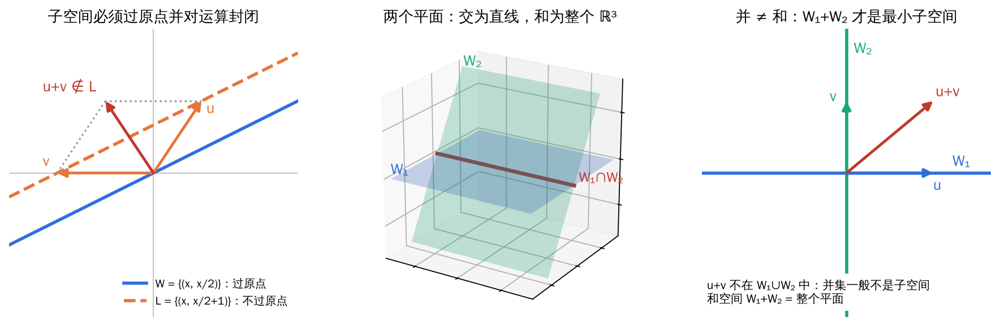
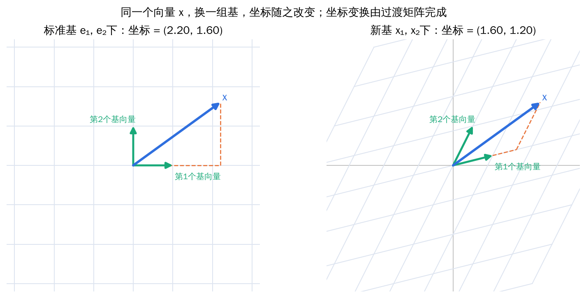
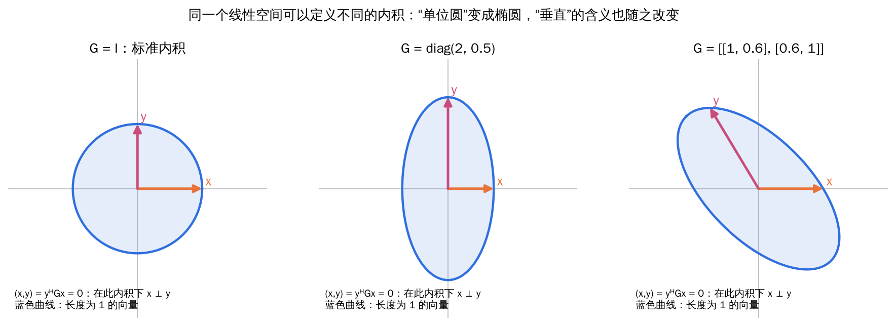
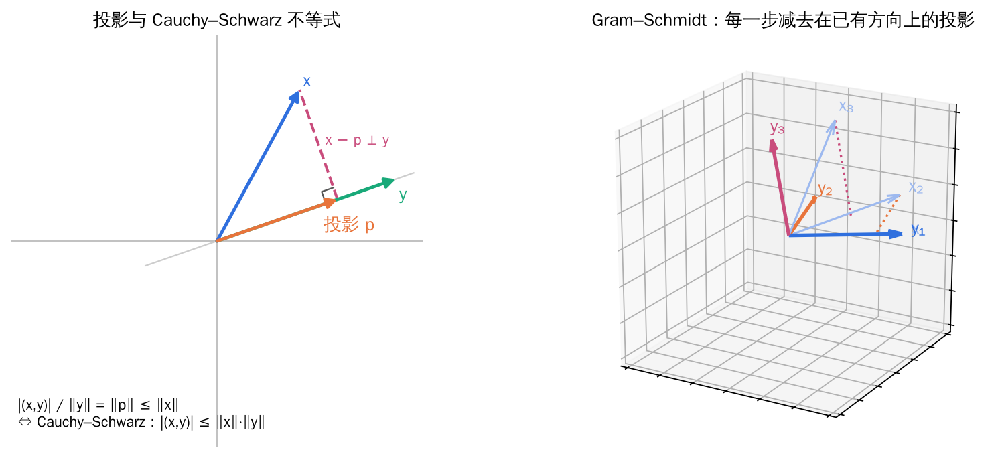
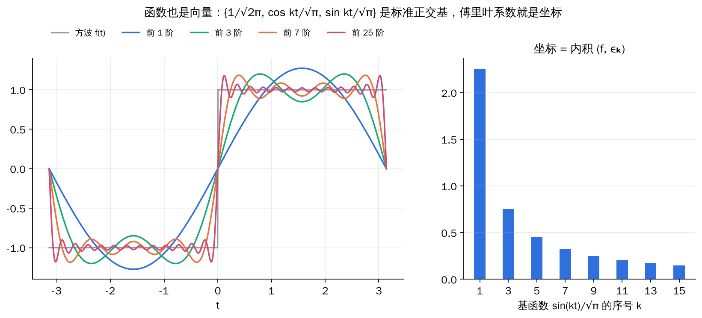
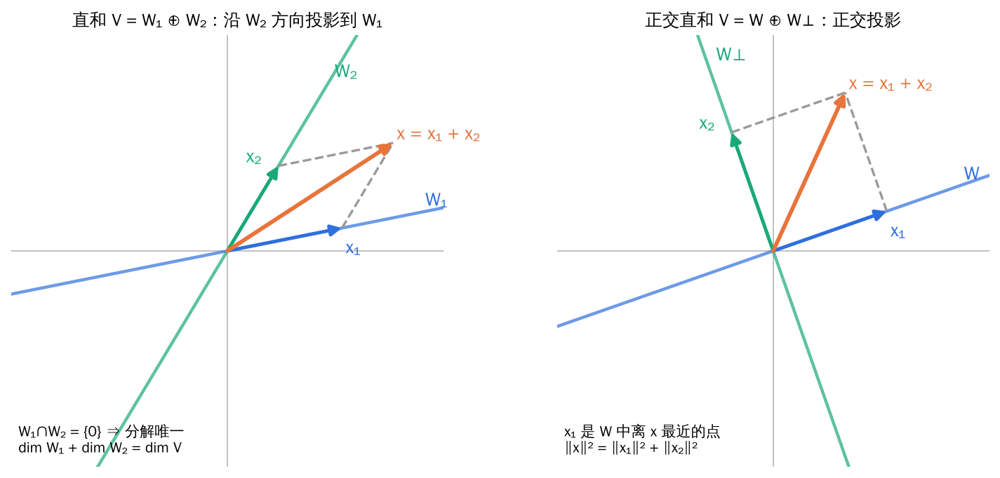

## 0. 阅读说明

矩阵理论的定理很多，但大多数都在回答同几个问题：**一个“空间”里有哪些元素、怎样用坐标描述它们、怎样度量长度和角度、怎样把空间拆成更简单的部分。**本章先把这些“舞台”搭好，后面的线性映射、矩阵分解与矩阵分析都在这个舞台上展开。

每节按“直观图像 → 严格定义 → 定理 → 例题”的顺序组织，颜色约定如下：

**直观理解**：先用几何图像建立感觉。

**定义**：需要准确记住的概念。

**定理**：结论及其成立条件。

**例题**：把结论落到具体计算上。

**易错点**：考试和计算中最容易出错的地方。

## 1. 线性空间

### 1.1 从箭头到抽象向量

三维空间中，每个点 A 对应一个从原点出发的箭头 OA，每个箭头又对应一个有序数组 (a₁, a₂, a₃)。箭头之间可以相加（平行四边形法则）、可以伸缩（数乘），这两种运算满足一系列熟悉的规律。

**直观理解**：线性空间就是把“箭头能相加、能伸缩”这件事抽象出来。只要一个集合里的元素能做加法和数乘，并且满足和箭头一样的八条运算规律，就可以把它们当作“向量”。这样，多项式、矩阵、函数、离散信号都能用同一套工具处理。

### 1.2 数域与线性空间的定义

**定义（数域）**：设 F 是包含 0 和 1 的数集，若 F 对加、减、乘、除（除数非零）四则运算封闭，则称 F 为数域。有理数集 ℚ、实数集 ℝ、复数集 ℂ 都是数域；整数集 ℤ 不是（对除法不封闭）。

**定义（线性空间）**：设 V 是非空集合，F 是数域。在 V 上定义加法，在 F 与 V 之间定义数乘，若对任意 x, y, z ∈ V 和 k, l ∈ F 满足：

1. 加法交换律 x + y = y + x；
2. 加法结合律 (x + y) + z = x + (y + z)；
3. 存在零元素 θ，使 x + θ = x；
4. 存在负元素 −x，使 x + (−x) = θ；
5. 1·x = x；
6. k(lx) = (kl)x；
7. (k + l)x = kx + lx；
8. k(x + y) = kx + ky，

则称 V 为数域 F 上的**线性空间**。前四条说明 (V, +) 是一个加群。

常见的线性空间：

| 空间 | 元素 | 加法与数乘 |
| --- | --- | --- |
| Fⁿ | n 元有序数组 | 按分量 |
| Fᵐˣⁿ | m×n 矩阵 | 矩阵加法与数乘 |
| Pₙ[x] | 次数小于 n 的多项式 | 多项式加法与数乘 |
| C[a, b] | [a, b] 上的连续函数 | 函数逐点相加、数乘 |
| 齐次方程组 Ax = 0 的解集 | 解向量 | 按分量 |

**例题：一个“奇怪”的线性空间**

设 V = ℝ⁺（正实数全体），F = ℝ，定义“加法”a ⊕ b = ab，“数乘”k ⊙ a = aᵏ。验证 V 是线性空间。

- 封闭性：正数相乘仍为正数，正数的实数次幂仍为正数；
- 零元素是 **1**：a ⊕ 1 = a；a 的负元素是 **1/a**：a ⊕ (1/a) = 1；
- 分配律：(k + l) ⊙ a = aᵏ⁺ˡ = aᵏaˡ = (k ⊙ a) ⊕ (l ⊙ a)，k ⊙ (a ⊕ b) = (ab)ᵏ = aᵏbᵏ。

其余几条同样可以逐一验证。这个例子说明：**“零元素”不一定是数 0，“加法”也不一定是普通加法**，关键在于运算是否满足八条规律。事实上 ln 把 (ℝ⁺, ⊕, ⊙) 一一对应到 (ℝ, +, ·)，两者“结构相同”，这就是下一章要讲的同构。

**易错点**：判断是否构成线性空间时，第一步先看**零元素是否在集合中、运算是否封闭**。例如集合 {(1, a₂, …, aₙ)ᵀ} 对普通加法不封闭（两向量相加第一个分量变成 2），因此不是线性空间。

### 1.3 线性组合

若 x = k₁x₁ + k₂x₂ + ⋯ + kₘxₘ，则称 x 可由 x₁, …, xₘ **线性表示**。

**例题：矩阵也能“线性表示”**

设 A = [[1, 1], [0, 1]]。问 A² 能否由 A 和 I 线性表示？

A² = [[1, 2], [0, 1]]。设 A² = aA + bI，比较元素：右上角 2 = a，对角线 1 = a + b，得 a = 2，b = −1，即 **A² = 2A − I**。

这个关系并非巧合：A 的特征多项式是 (λ − 1)² = λ² − 2λ + 1，代入 A 恰好为零矩阵。第三章的 Hamilton–Cayley 定理会说明：**任何 n 阶矩阵的 n 次幂都能由更低次幂线性表示**。

## 2. 线性子空间

### 2.1 子空间与判定定理

*左：过原点的直线是子空间，不过原点的直线对加法不封闭；中：ℝ³ 中两个过原点的平面，交是一条直线，和是整个空间；右：两条坐标轴的并不是子空间，u + v 跑到了并集之外。*

**定义（子空间）**：设 W 是线性空间 V 的非空子集，若 W 对 V 的加法和数乘也构成线性空间，则称 W 为 V 的**子空间**。

**定理（子空间判定）**：V 的非空子集 W 是子空间，当且仅当 W 对加法和数乘封闭：

\[
\forall\,x,y\in W,\ k\in F:\qquad x+y\in W,\quad kx\in W
\quad\Longleftrightarrow\quad
kx+ly\in W .
\]

八条运算律从 V 继承而来，不必重新验证。

- 任何子空间都包含零向量，所以**检验子空间时首先看零向量是否在 W 中**；
- {θ} 和 V 本身称为**平凡子空间**；
- ℝ² 不是 ℝ³ 的子空间（元素根本不在 ℝ³ 中），但 {(a₁, a₂, 0)ᵀ} 是 ℝ³ 的子空间，它与 ℝ² 结构相同。

### 2.2 交空间与和空间

**定理**：设 W₁、W₂ 是 V 的子空间，则

- **交空间** W₁ ∩ W₂ 是子空间；
- **和空间** W₁ + W₂ = {x₁ + x₂ | x₁ ∈ W₁, x₂ ∈ W₂} 是子空间，而且是包含 W₁ ∪ W₂ 的**最小**子空间；
- **并集** W₁ ∪ W₂ 一般**不是**子空间，只有当一个包含另一个时才是。

### 2.3 矩阵的四个基本子空间（先认识两个）

**定义**：设 A ∈ ℂᵐˣⁿ。

- **零空间（核）** N(A) = {x ∈ ℂⁿ | Ax = 0}，即齐次方程组 Ax = 0 的解空间，是 ℂⁿ 的子空间；
- **列空间（值域）** R(A) = {Ax | x ∈ ℂⁿ} = span{a₁, …, aₙ}，由 A 的列向量张成，是 ℂᵐ 的子空间。

Ax 正是 A 的各列以 x 的分量为系数的线性组合：

\[
Ax=\begin{pmatrix}a_1&a_2&\cdots&a_n\end{pmatrix}\begin{pmatrix}x_1\\\vdots\\x_n\end{pmatrix}
=x_1a_1+x_2a_2+\cdots+x_na_n .
\]

所以 **Ax = b 有解 ⇔ b ∈ R(A)**。由向量组 α₁, …, αₙ 生成的子空间记为 span{α₁, …, αₙ}，它是包含这些向量的最小子空间。

**例题：工程中的子空间**

线性滤波器常由差分方程 y(k) + a₁y(k−1) + ⋯ + aₙy(k−n) = 0 描述。若 y₁(k)、y₂(k) 都是解，则 c₁y₁ + c₂y₂ 代入后仍满足方程，所以全部解构成离散时间信号空间的一个子空间。**“线性系统满足叠加原理”在数学上就是“解集是子空间”。**

## 3. 基、坐标与维数

### 3.1 线性相关与线性无关

**定义**：若存在不全为零的 k₁, …, kₘ 使 k₁x₁ + ⋯ + kₘxₘ = θ，则称 x₁, …, xₘ **线性相关**；否则（只有全零系数才能组合出零向量）称为**线性无关**。

几何上：两个向量线性相关 ⇔ 共线；三个向量线性相关 ⇔ 共面。几个常用事实：

- 单个零向量线性相关；含零向量的向量组必线性相关；
- 线性无关组的任一部分组仍线性无关；线性相关组添加向量后仍线性相关；
- 若 x₁, …, xₘ 线性无关，而 x₁, …, xₘ, y 线性相关，则 y 可由 x₁, …, xₘ **唯一**线性表示。

**易错点：线性相关性依赖于数域。** 把 ℂ 看作 ℂ 上的线性空间，1 和 i 线性相关（i·1 + (−1)·i = 0，系数 i 属于 ℂ）；把 ℂ 看作 ℝ 上的线性空间，1 和 i 线性无关（实系数 a + bi = 0 只能 a = b = 0）。

### 3.2 基与坐标

**定义（基与坐标）**：若 V 中的向量组 x₁, …, xₙ 线性无关，且 V 中任一向量都能由它们线性表示，则称其为 V 的一组**基**。此时任一 x ∈ V 都有**唯一**的表示

\[
x=\xi_1x_1+\xi_2x_2+\cdots+\xi_nx_n=\begin{pmatrix}x_1&\cdots&x_n\end{pmatrix}\begin{pmatrix}\xi_1\\\vdots\\\xi_n\end{pmatrix},
\]

(ξ₁, …, ξₙ)ᵀ 称为 x 在这组基下的**坐标**。

**定理**：同一线性空间的不同基所含向量个数相同，这个数称为空间的**维数**，记作 dim V。

*坐标不是向量本身，而是“用哪组基去量”的读数。换一组基就像换一张斜的坐标纸，同一个箭头读出的数字不同。*

**例题：多项式的坐标就是 Taylor 系数**

在 Pₙ[x] 中取基 1, x, x², …, xⁿ⁻¹，多项式 f(x) 的坐标就是各次项系数。由 Taylor 公式

\[
f(x)=f(0)+f'(0)x+\frac{f''(0)}{2!}x^2+\cdots+\frac{f^{(n-1)}(0)}{(n-1)!}x^{n-1},
\]

坐标是 (f(0), f′(0), f″(0)/2!, …)ᵀ。若改用基 1, (x−a), (x−a)², …，坐标就变成 f 在 a 点的 Taylor 系数。**同一个多项式，换一个展开点，就是换一组基。**

**例题：维数依赖于数域**

ℂ 作为 ℂ 上的线性空间，基为 {1}，维数为 1；作为 ℝ 上的线性空间，基为 {1, i}，维数为 2。

### 3.3 过渡矩阵与坐标变换

**定义（过渡矩阵）**：设 x₁, …, xₙ 和 y₁, …, yₙ 是 V 的两组基，若

\[
\begin{pmatrix}y_1&\cdots&y_n\end{pmatrix}=\begin{pmatrix}x_1&\cdots&x_n\end{pmatrix}P,
\]

则称 P 为从基 {xᵢ} 到基 {yᵢ} 的**过渡矩阵**。P 的第 j 列是 yⱼ 在旧基下的坐标，P 必可逆。

**定理（坐标变换公式）**：设向量 x 在旧基下坐标为 ξ，在新基下坐标为 η，则

\[
\xi=P\eta,\qquad \eta=P^{-1}\xi .
\]

**易错点**：**基变换用 P 右乘，坐标变换用 P⁻¹**，方向相反。记忆方法：x = (旧基)ξ = (新基)η = (旧基)Pη，比较即得 ξ = Pη。

### 3.4 维数定理

**推论（基扩充定理）**：n 维空间中任意 m 个线性无关向量（m < n）都可以扩充为整个空间的一组基。

**定理（维数公式）**：设 W₁、W₂ 是有限维空间 V 的子空间，则

\[
\dim(W_1+W_2)=\dim W_1+\dim W_2-\dim(W_1\cap W_2).
\]

**直观理解**：这和集合的“容斥原理” |A∪B| = |A| + |B| − |A∩B| 形式相同。两个公共部分被重复计算了一次，所以要减去。例如 ℝ³ 中两个不同的过原点平面：2 + 2 − 1 = 3。

**证明思路**：取 W₁∩W₂ 的一组基 α₁, …, αᵣ，分别扩充成 W₁ 的基（再加 β₁, …, βₛ）和 W₂ 的基（再加 γ₁, …, γₜ），再证明 α、β、γ 合在一起恰好是 W₁+W₂ 的基。

**例题：求和空间与交空间的维数和基**

W₁ = span{α₁, α₂, α₃}，W₂ = span{β₁, β₂}。常用做法：

1. 把 α₁, α₂, α₃, β₁, β₂ 排成矩阵的列，做初等行变换，求出秩和极大无关组，得 W₁ + W₂ 的维数与基；
2. 用维数公式算出 dim(W₁∩W₂)；
3. 交空间的基：解 k₁α₁ + k₂α₂ + k₃α₃ = l₁β₁ + l₂β₂，得到的公共向量 l₁β₁ + l₂β₂ 张成 W₁ ∩ W₂。

## 4. 内积空间

### 4.1 内积的定义

**定义（内积）**：设 F = ℝ 或 ℂ，V 是 F 上的线性空间。若对任意 x, y ∈ V 都对应一个数 (x, y) ∈ F，且满足

1. **共轭对称**：(x, y) = conj((y, x))；
2. **可加性**：(x + y, z) = (x, z) + (y, z)；
3. **齐次性**：(kx, y) = k(x, y)；
4. **正定性**：(x, x) ≥ 0，且 (x, x) = 0 ⇔ x = θ，

则称 (x, y) 为内积，V 为**内积空间**。实内积空间称为**欧氏空间**，复内积空间称为**酉空间**。

**易错点**：复内积只对第一个变元线性，对第二个变元是**共轭线性**的：(x, ky) = conj(k)(x, y)。ℂⁿ 中的标准内积写作 (x, y) = yᴴx = Σ xᵢ·conj(yᵢ)，不要漏掉共轭，否则 (x, x) 可能不是正实数（例如 x = (1, i)ᵀ 时 xᵀx = 0）。

### 4.2 Hermite 矩阵、正定矩阵与度量矩阵

**定义**：若 Aᴴ = A（Aᴴ 为共轭转置），则称 A 为 **Hermite 矩阵**；若对任意非零 x 都有 xᴴAx > 0，则称 Hermite 矩阵 A 为**正定矩阵**。

设 ε₁, …, εₙ 是内积空间 V 的一组基，x、y 的坐标分别为 ξ、η。由内积的线性性：

\[
(x,y)=\sum_{i,j}\xi_i\,\overline{\eta_j}\,(\varepsilon_i,\varepsilon_j)=\eta^{H}G\,\xi,
\qquad G=\big((\varepsilon_i,\varepsilon_j)\big)^{\mathsf T}\ \text{（第 }i\text{ 行第 }j\text{ 列为 }(\varepsilon_j,\varepsilon_i)\text{）}.
\]

**定义（度量矩阵 / Gram 矩阵）**：上式中的 G 称为内积在这组基下的**度量矩阵**。G 是 Hermite 正定矩阵；反过来，任意 Hermite 正定矩阵 G 都可以通过 (x, y) = yᴴGx 定义一个内积。**内积与度量矩阵一一对应。**

*度量矩阵 G 决定了“长度为 1”的向量构成什么形状，也决定了谁和谁“垂直”。标准内积下的单位圆，换一个 G 就变成椭圆。*

**例题：判断能否定义内积**

在 ℂ² 中令 f(x) = xᴴAx，A = [[2, i], [−i, 2]]。A 是 Hermite 矩阵，顺序主子式 2 > 0、det A = 4 − 1 = 3 > 0，所以 A 正定，(x, y) = yᴴAx 是 ℂ² 上的一个内积。在这个内积下 e₁ = (1, 0)ᵀ 的长度是 √2，而不是 1。

## 5. 长度、夹角与正交

### 5.1 长度与 Cauchy–Schwarz 不等式

**定义（长度）**：‖x‖ = √(x, x)。长度满足：非负且只有零向量长度为 0；‖kx‖ = |k|·‖x‖；三角不等式 ‖x + y‖ ≤ ‖x‖ + ‖y‖。

**定理（Cauchy–Schwarz 不等式）**：对内积空间中任意 x, y，

\[
|(x,y)|\le\|x\|\,\|y\|,
\]

等号成立当且仅当 x、y 线性相关。

**直观理解（也是证明）**：y ≠ θ 时，把 x 分解成沿 y 的投影 p = ((x, y)/(y, y))·y 和垂直部分 x − p。由勾股定理 ‖x‖² = ‖p‖² + ‖x − p‖² ≥ ‖p‖² = |(x, y)|²/‖y‖²，整理即得不等式。**投影不会比原向量长**，这就是 Cauchy–Schwarz 的全部几何含义；等号成立恰好是 x 没有垂直部分，即 x 与 y 共线。

换不同的内积就得到不同的不等式。例如：

- ℝⁿ 标准内积：(Σ xᵢyᵢ)² ≤ (Σ xᵢ²)(Σ yᵢ²)；
- C[a, b] 上 (f, g) = ∫ f(t)g(t) dt：(∫ fg)² ≤ ∫ f² · ∫ g²。

### 5.2 夹角与正交

有了 Cauchy–Schwarz，就可以在实内积空间中定义夹角：

\[
\cos\langle x,y\rangle=\frac{(x,y)}{\|x\|\,\|y\|}\in[-1,1].
\]

**定义（正交）**：若 (x, y) = 0，则称 x 与 y **正交**。两两正交的非零向量组称为**正交向量组**；每个向量长度都为 1 的正交向量组称为**标准正交组**。

**定理**：正交向量组线性无关。因此 n 维内积空间中正交向量组最多含 n 个向量。由 n 个向量构成的标准正交组称为**标准正交基**。

- 零向量与任何向量都正交；
- x ⊥ y ⇔ ‖x + y‖² = ‖x‖² + ‖y‖²（勾股定理，在实空间中成立）；
- 在标准正交基下，**坐标就是内积**：x = Σ (x, εᵢ)εᵢ；**内积等于坐标的标准内积**：(x, y) = ηᴴξ，度量矩阵是单位阵。

**例题：函数空间里的正交基**

在 [−π, π] 上的光滑函数空间中定义 (f, g) = ∫ f(t)g(t) dt，则

\[
\frac{1}{\sqrt{2\pi}},\ \frac{\cos t}{\sqrt\pi},\ \frac{\sin t}{\sqrt\pi},\ \frac{\cos 2t}{\sqrt\pi},\ \frac{\sin 2t}{\sqrt\pi},\ \ldots
\]

是一组标准正交函数，例如 ∫ sin(mt)sin(nt) dt = 0（m ≠ n）。函数 f 在这组“基”上的坐标就是内积 (f, εₖ)，也就是 Fourier 系数。**傅里叶展开就是在函数空间里求正交坐标。**

*方波只在奇数阶正弦上有非零坐标；取的基函数越多，部分和越接近原函数。*

### 5.3 Gram–Schmidt 正交化

**定理**：有限维内积空间一定存在标准正交基。构造方法（Gram–Schmidt）：由线性无关组 x₁, …, xₙ，依次令

\[
y_1=x_1,\qquad
y_k=x_k-\sum_{i=1}^{k-1}\frac{(x_k,y_i)}{(y_i,y_i)}\,y_i\quad(k=2,\ldots,n),
\qquad
\varepsilon_k=\frac{y_k}{\|y_k\|}.
\]

每一步都从 xₖ 中减去它在已得到方向上的投影，余下的部分自然与前面所有方向正交，且 span{y₁, …, yₖ} = span{x₁, …, xₖ}。

**例题**：把 x₁ = (1, 1, 0)ᵀ、x₂ = (1, 0, 1)ᵀ 正交化（标准内积）。

- y₁ = (1, 1, 0)ᵀ；
- (x₂, y₁) = 1，(y₁, y₁) = 2，y₂ = x₂ − ½y₁ = (½, −½, 1)ᵀ；
- 检验 (y₂, y₁) = ½ − ½ + 0 = 0 ✓；
- 单位化：ε₁ = (1, 1, 0)ᵀ/√2，ε₂ = (1, −1, 2)ᵀ/√6。

第三章会看到，Gram–Schmidt 写成矩阵形式就是 **QR 分解**。

## 6. 直和与投影

### 6.1 直和

**定义（直和）**：若和空间 W₁ + W₂ 中每个向量 x 的分解 x = x₁ + x₂（x₁ ∈ W₁，x₂ ∈ W₂）都是**唯一**的，则称 W₁ + W₂ 为**直和**，记作 W₁ ⊕ W₂。

**定理（直和判定）**：以下条件等价：

1. W₁ + W₂ 是直和；
2. 零向量的分解唯一：x₁ + x₂ = θ ⇒ x₁ = x₂ = θ；
3. W₁ ∩ W₂ = {θ}；
4. dim(W₁ + W₂) = dim W₁ + dim W₂；
5. W₁ 的基与 W₂ 的基合起来是 W₁ + W₂ 的基。

**例题：方阵 = 对称阵 ⊕ 反对称阵**

在 ℝⁿˣⁿ 中，W₁ = {Aᵀ = A}，W₂ = {Aᵀ = −A}。任一方阵

\[
A=\underbrace{\frac{A+A^{\mathsf T}}{2}}_{\in W_1}+\underbrace{\frac{A-A^{\mathsf T}}{2}}_{\in W_2},
\]

又 W₁ ∩ W₂ 中的矩阵满足 A = Aᵀ = −A，只能是零矩阵，所以 ℝⁿˣⁿ = W₁ ⊕ W₂。维数检验：n(n+1)/2 + n(n−1)/2 = n²。

**例题：幂等矩阵把空间一分为二**

设 A² = A，证明 ℂⁿ = R(A) ⊕ N(A)。

- **和**：任一 x = Ax + (x − Ax)，其中 Ax ∈ R(A)，而 A(x − Ax) = Ax − A²x = 0，所以 x − Ax ∈ N(A)；
- **交为零**：若 y ∈ R(A) ∩ N(A)，则 y = Az，且 Ay = 0，于是 y = Az = A²z = Ay = 0。

几何上，A 就是“沿 N(A) 方向投影到 R(A) 上”的投影算子。这个结论在第三章的谱分解中会反复用到。

### 6.2 正交补与正交直和

**定义**：若 x 与子空间 W 中每个向量都正交，记 x ⊥ W；若 W₁ 中每个向量都与 W₂ 正交，记 W₁ ⊥ W₂。W 的**正交补** W⊥ = {x ∈ V | x ⊥ W}。若 W₁ ⊥ W₂，则 W₁ + W₂ 一定是直和，称为**正交直和**。

**定理**：设 W 是有限维内积空间 V 的子空间，则 W⊥ 也是子空间，且

\[
V=W\oplus W^{\perp},\qquad \dim W+\dim W^{\perp}=\dim V,\qquad (W^{\perp})^{\perp}=W .
\]

*一般直和是沿另一个子空间的方向“斜着”投影；正交直和是“垂直”投影，投影点是子空间中离 x 最近的点。*

**定理（矩阵子空间的正交关系）**：设 A ∈ ℂᵐˣⁿ，则

\[
N(A)=R(A^{H})^{\perp},\qquad \mathbb C^{n}=N(A)\oplus R(A^{H});\qquad
N(A^{H})=R(A)^{\perp},\qquad \mathbb C^{m}=N(A^{H})\oplus R(A).
\]

理由很简单：Ax = 0 意味着 x 与 A 的每一行（的共轭）都正交，也就是与 Aᴴ 的列空间正交。

**直观理解**：正交投影给出“最佳近似”。在 W 中找离 x 最近的点，答案就是 x 在 W 上的正交投影。最小二乘法、傅里叶级数截断、信号去噪，本质上都是这一句话。

## 7. 本章小结

| 概念 | 一句话理解 | 常用结论 |
| --- | --- | --- |
| 线性空间 | 能做加法和数乘的集合 | 零元素唯一、负元素唯一 |
| 子空间 | 对运算封闭的子集 | 必含零向量；交、和是子空间，并一般不是 |
| 基与坐标 | 用来“量”向量的标尺 | 坐标唯一；维数与基的选法无关 |
| 过渡矩阵 | 新基在旧基下的坐标 | 基右乘 P，坐标左乘 P⁻¹ |
| 维数公式 | 子空间版的容斥原理 | dim(W₁+W₂) = dim W₁ + dim W₂ − dim(W₁∩W₂) |
| 内积与度量矩阵 | 决定长度与角度 | 内积 ↔ Hermite 正定矩阵 |
| Cauchy–Schwarz | 投影不比原向量长 | 等号 ⇔ 线性相关 |
| Gram–Schmidt | 逐个减投影 | 得到标准正交基；矩阵形式是 QR |
| 直和 | 分解唯一 | ⇔ 交为 {0} ⇔ 维数相加 |
| 正交补 | 与 W 垂直的全部向量 | V = W ⊕ W⊥；N(A) = R(Aᴴ)⊥ |
