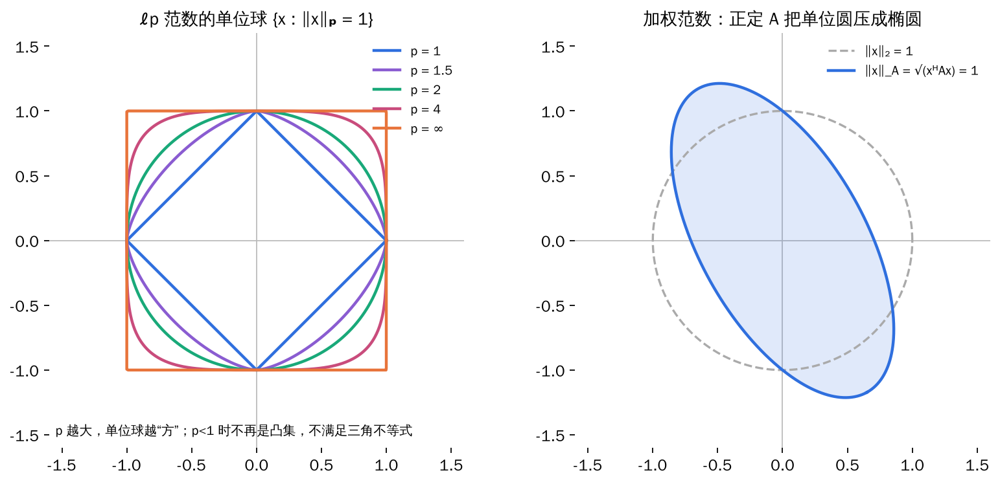
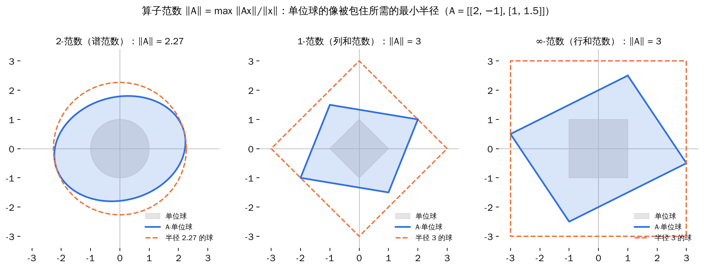
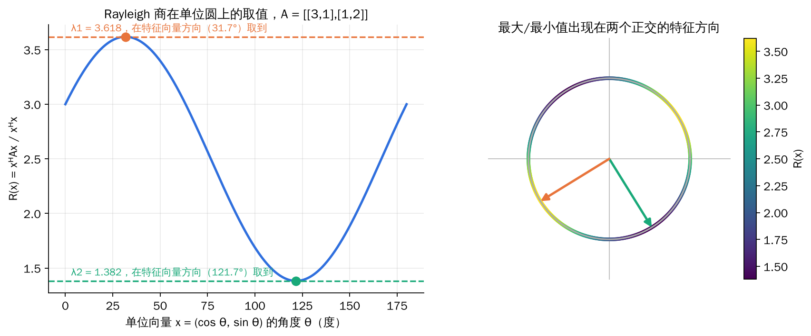
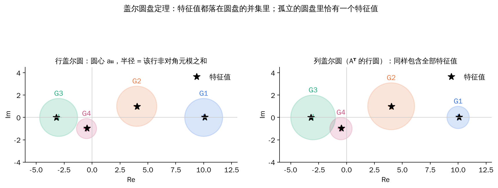
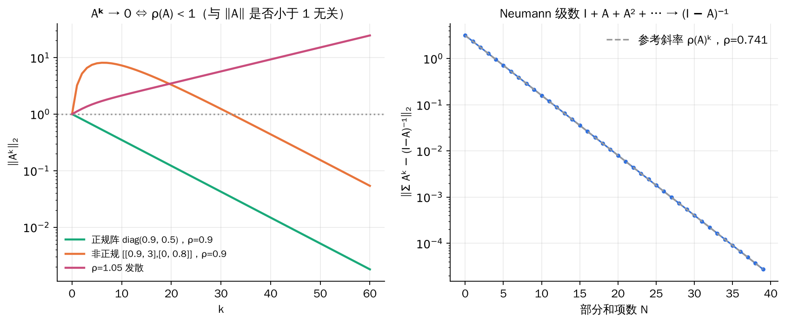
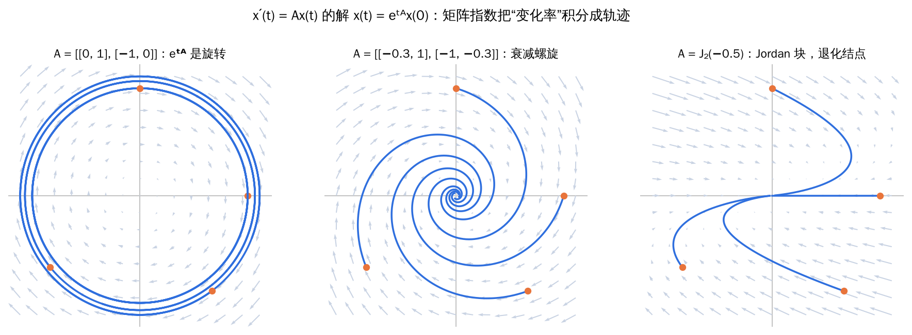

## 0. 从代数到分析

前三章是“代数”：讨论等式、分解、相似。这一章是“分析”：讨论**大小**和**极限**。

- 向量和矩阵有多“大”？——**范数**；
- 不解特征方程，能否估计特征值在哪里？——**谱半径、Rayleigh 商、盖尔圆**；
- Aᵏ 会不会趋于零？I + A + A² + ⋯ 收敛吗？——**矩阵序列与级数**；
- eᴬ、sin A 是什么意思、怎么算？——**矩阵函数**。

最后一个问题直接关系到线性微分方程 x′ = Ax 的求解：它的解就是 x(t) = eᵗᴬx(0)。

## 1. 向量范数

### 1.1 定义与常见范数

**定义（向量范数）**：设 V 是数域 F（ℝ 或 ℂ）上的线性空间。若对每个 x ∈ V 都对应一个实数 ‖x‖，满足

1. **正定性**：‖x‖ ≥ 0，且 ‖x‖ = 0 ⇔ x = θ；
2. **齐次性**：‖kx‖ = |k|·‖x‖；
3. **三角不等式**：‖x + y‖ ≤ ‖x‖ + ‖y‖，

则称 ‖·‖ 为 V 上的**向量范数**，(V, ‖·‖) 称为赋范线性空间。

对 x = (x₁, …, xₙ)ᵀ ∈ ℂⁿ，最常用的是 **p-范数**（1 ≤ p ≤ ∞）：

\[
\|x\|_1=\sum_{i=1}^{n}|x_i|,\qquad
\|x\|_2=\Big(\sum_{i=1}^{n}|x_i|^2\Big)^{1/2}=\sqrt{x^{H}x},\qquad
\|x\|_\infty=\max_{1\le i\le n}|x_i|,\qquad
\|x\|_p=\Big(\sum_{i=1}^{n}|x_i|^p\Big)^{1/p}.
\]

**直观理解**：在城市里从 A 走到 B，直线距离是 2-范数；只能沿街道横平竖直地走，距离是 1-范数（“曼哈顿距离”）；国际象棋里国王走一步可以斜走，所需步数是 ∞-范数（“切比雪夫距离”）。三种范数是三种量“远近”的标准。

*单位球 {x : ‖x‖ = 1} 的形状完全刻画了一个范数。p = 1 是菱形，p = 2 是圆，p = ∞ 是正方形；加权范数 √(xᴴAx) 的单位球是椭圆。*

其他常见范数：

- **加权范数**：设 A 是 Hermite 正定矩阵，‖x‖_A = √(xᴴAx)；
- **坐标诱导的范数**：设 ε₁, …, εₙ 是 V 的基，x 的坐标为 α，则 ‖x‖ := ‖α‖ₚ 是 V 上的范数；
- 若 ‖·‖ 是 ℂᵐ 上的范数、A ∈ ℂᵐˣⁿ 列满秩，则 ‖x‖_A := ‖Ax‖ 是 ℂⁿ 上的范数。

**易错点**：当 0 < p < 1 时，(Σ|xᵢ|ᵖ)^(1/p) **不是**范数，它不满足三角不等式（单位球不是凸集）。例如 p = ½，x = (1, 0)ᵀ、y = (0, 1)ᵀ，“范数”都是 1，而 x + y 的值为 (1 + 1)² = 4 > 2。

### 1.2 范数的等价性

**定义（范数等价）**：若存在正常数 c₁、c₂，使对一切 x 都有 c₁‖x‖_α ≤ ‖x‖_β ≤ c₂‖x‖_α，则称 ‖·‖_α 与 ‖·‖_β 等价。

**定理**：有限维线性空间上的任意两个向量范数都等价。（关键步骤：任一范数都是坐标的连续函数，在紧的单位球面上取得正的最大值和最小值。）

例如在 ℂⁿ 中：

\[
\|x\|_\infty\le\|x\|_2\le\|x\|_1\le\sqrt n\,\|x\|_2\le n\,\|x\|_\infty .
\]

**直观理解**：各种范数的单位球形状不同，但总能用一个范数的大球套住另一个范数的单位球，也能被它的小球套住。所以在有限维空间中，**讨论收敛性时选哪个范数都一样**，可以挑最方便计算的那个。

## 2. 矩阵范数

### 2.1 矩阵的向量范数与矩阵范数

矩阵组成的空间 ℂᵐˣⁿ 本身是 mn 维线性空间，所以可以把矩阵“拉直”后用向量范数度量：

\[
\|A\|_{m_1}=\sum_{i,j}|a_{ij}|,\qquad
\|A\|_F=\Big(\sum_{i,j}|a_{ij}|^2\Big)^{1/2}=\sqrt{\operatorname{tr}(A^{H}A)},\qquad
\|A\|_{m_\infty}=\max_{i,j}|a_{ij}|.
\]

但矩阵还能相乘，我们希望范数与乘法“协调”：

**定义（矩阵范数）**：若 ℂⁿˣⁿ 上的向量范数 ‖·‖ 还满足**次乘性**

\[
\|AB\|\le\|A\|\,\|B\|,
\]

则称它为**矩阵范数**。

- ‖A‖ₘ₁ 和 Frobenius 范数 ‖A‖_F 都是矩阵范数；
- ‖A‖ₘ∞ **不是**矩阵范数：A = B = [[1, 1], [1, 1]] 时 ‖AB‖ₘ∞ = 2 > 1·1；但 n·‖A‖ₘ∞ 是矩阵范数；
- F 范数是**酉不变**的：对酉矩阵 U、V，‖UAV‖_F = ‖A‖_F。

### 2.2 相容性与算子范数

**定义（相容）**：若矩阵范数 ‖·‖_M 与向量范数 ‖·‖_v 满足 ‖Ax‖_v ≤ ‖A‖_M‖x‖_v，则称二者**相容**。例如 ‖Ax‖₂ ≤ ‖A‖_F‖x‖₂（由 Cauchy–Schwarz 得到）。

**定理（算子范数 / 诱导范数）**：设 ‖·‖_v 是 ℂⁿ 上的向量范数，定义

\[
\|A\|=\max_{\|x\|_v=1}\|Ax\|_v=\max_{x\ne0}\frac{\|Ax\|_v}{\|x\|_v},
\]

则 ‖A‖ 是与 ‖·‖_v 相容的矩阵范数，称为由 ‖·‖_v **诱导的算子范数**。它是使 ‖Ax‖_v ≤ c‖x‖_v 恒成立的**最小**常数 c，并且 ‖I‖ = 1。

**定理（三种常用算子范数）**：设 A = (aᵢⱼ) ∈ ℂᵐˣⁿ，σ_max(A) 为 A 的最大奇异值，则

\[
\|A\|_1=\max_{j}\sum_{i=1}^{m}|a_{ij}|\ \ (\text{列和范数}),\qquad
\|A\|_\infty=\max_{i}\sum_{j=1}^{n}|a_{ij}|\ \ (\text{行和范数}),
\]
\[
\|A\|_2=\sqrt{\lambda_{\max}(A^{H}A)}=\sigma_{\max}(A)\ \ (\text{谱范数}).
\]

记忆方法：**1 竖列、∞ 横行**（1 像一根竖棍，∞ 横着放）。

*把对应范数的单位球用 A 映过去，再找能包住像的最小同形球，半径就是算子范数。2-范数中，单位圆被映成椭圆，最长半轴等于最大奇异值。*

**例题**：A = [[2, −1, 0], [0, 2, 3], [1, 2, 0]]，求 ‖A‖₁、‖A‖∞、‖A‖_F、‖A‖₂。

- 列绝对值和为 3, 5, 3，‖A‖₁ = **5**；
- 行绝对值和为 3, 5, 3，‖A‖∞ = **5**；
- ‖A‖_F = √(4 + 1 + 4 + 9 + 1 + 4) = **√23**；
- AᵀA 的最大特征值为 15，‖A‖₂ = **√15** ≈ 3.873。

‖A‖₁、‖A‖∞ 很容易算；‖A‖₂ 要求特征值，代价高。总有 ‖A‖₂ ≤ ‖A‖_F，也有 ‖A‖₂ ≤ √(‖A‖₁‖A‖∞)（本例 √15 ≤ 5），常用来快速估计谱范数。

**易错点**：F 范数与 2-范数相容，但 F 范数**不是**任何向量范数诱导出来的算子范数（因为 ‖I‖_F = √n ≠ 1）。“与同一个向量范数相容的矩阵范数可以有很多个”，算子范数只是其中最小的那个。

### 2.3 Rayleigh 商与极大极小定理

在求谱范数的过程中自然出现了 Hermite 矩阵的 **Rayleigh 商**：

\[
R(x)=\frac{x^{H}Ax}{x^{H}x},\qquad x\ne0 .
\]

**定理**：设 Hermite 矩阵 A 的特征值为 λ₁ ≥ λ₂ ≥ ⋯ ≥ λₙ，则

\[
\lambda_n\le R(x)\le\lambda_1,\qquad
\lambda_1=\max_{x\ne0}R(x),\qquad
\lambda_n=\min_{x\ne0}R(x),
\]

最大（小）值在对应的特征向量处取到。

*R(x) 只与 x 的方向有关。在单位圆上转一圈，R 在 λ₁ 和 λ₂ 之间变化，最大、最小值恰好出现在两个互相垂直的特征方向上。*

**直观理解**：用特征向量的标准正交基展开 x = Σ cᵢuᵢ，则 R(x) = Σ λᵢ|cᵢ|² / Σ |cᵢ|²，是各特征值的**加权平均**，权重为 |cᵢ|²。平均值自然夹在最大值与最小值之间。

**定理（Courant–Fischer 极大极小定理）**：设 Vₖ 表示 ℂⁿ 的 k 维子空间，则

\[
\lambda_k=\max_{V_k}\ \min_{x\in V_k,\,x\ne0}R(x)=\min_{V_{n-k+1}}\ \max_{x\in V_{n-k+1},\,x\ne0}R(x).
\]

**推论（Weyl 不等式，特征值的扰动）**：设 A、B 都是 n 阶 Hermite 矩阵，λₖ(·) 表示第 k 大特征值，则

\[
\lambda_k(A)+\lambda_n(B)\le\lambda_k(A+B)\le\lambda_k(A)+\lambda_1(B).
\]

特别地，|λₖ(A + B) − λₖ(A)| ≤ ‖B‖₂：**Hermite 矩阵的特征值对扰动是稳定的**，矩阵改变多少，特征值最多改变多少。

**定理**：若某个矩阵范数满足 ‖A‖ < 1，则 I − A 可逆，且

\[
\left\|(I-A)^{-1}\right\|\le\frac{\|I\|}{1-\|A\|}.
\]

（对算子范数 ‖I‖ = 1。）这一结论在第 4 节的 Neumann 级数中会再次出现。

## 3. 特征值估计

### 3.1 谱半径

**定义**：A 的全体特征值构成的集合 λ(A) 称为 A 的**谱**；特征值模的最大值 ρ(A) = max |λᵢ| 称为**谱半径**。

**定理**：

1. 谱半径不超过任何矩阵范数：ρ(A) ≤ ‖A‖；
2. 对任意 ε > 0，存在某个（与 A 有关的）矩阵范数使 ‖A‖ ≤ ρ(A) + ε。

所以 ρ(A) 是 A 的所有矩阵范数的下确界。

**证明（第 1 条）**：设 Ax = λx，取矩阵 X = (x, x, …, x)，则 AX = λX，于是 |λ|·‖X‖ = ‖AX‖ ≤ ‖A‖·‖X‖，约去 ‖X‖ > 0 即得。**一行就证完，这是“构造辅助矩阵”的典型技巧。**

**易错点**：谱半径本身**不是**矩阵范数。例如 A = [[0, 1], [0, 0]] ≠ 0，但 ρ(A) = 0，违反正定性。对正规矩阵（特别是 Hermite 矩阵）有 ρ(A) = ‖A‖₂。

### 3.2 盖尔圆盘定理

**定义（盖尔圆盘）**：设 A = (aᵢⱼ) ∈ ℂⁿˣⁿ，令 Rᵢ = Σ(j≠i) |aᵢⱼ|（第 i 行非对角元模之和），称复平面上的闭圆盘

\[
G_i=\{z\in\mathbb C:\ |z-a_{ii}|\le R_i\},\qquad i=1,\ldots,n
\]

为 A 的第 i 个**盖尔圆盘**（Gershgorin 圆）。

**定理（盖尔圆盘定理）**：

1. A 的每个特征值都落在 n 个盖尔圆盘的并集中：λ ∈ G₁ ∪ ⋯ ∪ Gₙ；
2. 若其中 k 个圆盘的并形成一个连通区域，且与其余 n − k 个圆盘不相交，则该区域中**恰有 k 个**特征值（按重数计）。特别地，孤立的圆盘中恰有一个特征值。

对 Aᵀ 用同样的结论，可以得到按**列**构造的圆盘，两者可以结合使用。

**证明（第 1 条）**：设 Ax = λx，取 x 中模最大的分量 xᵢ（|xᵢ| ≥ |xⱼ|）。第 i 个方程为 (λ − aᵢᵢ)xᵢ = Σ(j≠i) aᵢⱼxⱼ，两边取模、除以 |xᵢ| 得 |λ − aᵢᵢ| ≤ Σ(j≠i) |aᵢⱼ|·|xⱼ|/|xᵢ| ≤ Rᵢ。**直观上，非对角元越小，矩阵越接近对角阵，特征值越贴近对角元**；盖尔圆把“贴近多少”量化了。第 2 条用连续性论证：令 A(t) = D + t(A − D)，t 从 0 增大到 1，圆盘从点逐渐长大，特征值连续移动，跑不出连通区域。

*一个 4 阶复矩阵的行圆盘与列圆盘，黑色星号是真实特征值。四个圆盘互不相交，每个圆盘中恰有一个特征值。*

**例题**：估计 A = [[1, 0.02, 0.11], [0.01, i, 0.14], [0.02, 0.01, 0.5]] 的特征值。

三个行圆盘：

- G₁：圆心 1，半径 0.13；
- G₂：圆心 i，半径 0.15；
- G₃：圆心 0.5，半径 0.03。

三个圆盘两两不相交，所以每个圆盘中恰有一个特征值。实际特征值约为 1.0045、0.4961、0.9988i，与估计一致。不解三次方程，就能知道特征值大致在哪里、各有几个。

**推论**：

1. **对角占优矩阵可逆**：若对每个 i 都有 |aᵢᵢ| > Rᵢ，则原点不在任何圆盘中，0 不是特征值；
2. 若 A 的 n 个盖尔圆盘两两不相交，则 A 有 n 个互异特征值，因而**可对角化**；
3. **实矩阵的孤立圆盘中的特征值必为实数**：实矩阵的复特征值共轭成对出现，而圆心在实轴上的孤立圆盘关于实轴对称，只能容纳一个特征值，它的共轭也在同一圆盘中，所以只能是实数。

**技巧：用相似变换缩小圆盘**

令 D = diag(d₁, …, dₙ)，D⁻¹AD 的特征值与 A 相同，但第 i 行非对角元变成 aᵢⱼdⱼ/dᵢ。适当选取 dᵢ 可以缩小某个圆盘、放大另一些，把重叠的圆盘“分离”开，从而得到更精细的估计。

## 4. 矩阵序列与矩阵级数

### 4.1 收敛性

**定义**：若矩阵序列 {A⁽ᵏ⁾} 的每个元素都收敛，即 aᵢⱼ⁽ᵏ⁾ → aᵢⱼ，则称 A⁽ᵏ⁾ 收敛到 A。由于有限维空间中所有范数等价，这等价于对**任意**一种矩阵范数有 ‖A⁽ᵏ⁾ − A‖ → 0。

**定理（矩阵幂收敛）**：设 A ∈ ℂⁿˣⁿ，则

\[
\lim_{k\to\infty}A^{k}=0\quad\Longleftrightarrow\quad\rho(A)\lt 1 .
\]

推论：若存在某个矩阵范数使 ‖A‖ < 1，则 Aᵏ → 0。

**证明思路**：用 Jordan 标准形 A = PJP⁻¹，Aᵏ = PJᵏP⁻¹。每个 Jordan 块的幂中的元素形如 C(k, j)λᵏ⁻ʲ，多项式增长被 |λ|ᵏ 的指数衰减压倒的充分必要条件是 |λ| < 1。

*左：两个矩阵的谱半径都是 0.9，正规矩阵的 ‖Aᵏ‖ 单调衰减；非正规矩阵先增长到约 8 倍，之后才衰减，但最终都趋于零。是否收敛只看 ρ(A)，衰减前的暂态则与矩阵是否正规有关。右：Neumann 级数部分和的误差以 ρ(A)ᵏ 的速度下降。*

### 4.2 矩阵级数与幂级数

**定义**：若部分和 S_N = Σₖ₌₀ᴺ A⁽ᵏ⁾ 收敛，则称矩阵级数 Σ A⁽ᵏ⁾ 收敛；若 Σ ‖A⁽ᵏ⁾‖ 收敛（等价地，每个元素的级数都绝对收敛），则称其**绝对收敛**。绝对收敛的级数一定收敛，且可以任意重排。

**定理（矩阵幂级数的 Abel 型定理）**：设复幂级数 Σ cₖzᵏ 的收敛半径为 R，则

- 当 ρ(A) < R 时，矩阵幂级数 Σ cₖAᵏ 绝对收敛；
- 当 ρ(A) > R 时，Σ cₖAᵏ 发散。

**推论（Neumann 级数）**：

\[
\sum_{k=0}^{\infty}A^{k}=I+A+A^2+\cdots\ \text{收敛}\quad\Longleftrightarrow\quad\rho(A)\lt 1,
\qquad\text{此时}\quad\sum_{k=0}^{\infty}A^{k}=(I-A)^{-1}.
\]

这是数的等比级数 1 + q + q² + ⋯ = 1/(1 − q) 的矩阵版本。

**例题：Leontief 投入产出模型**

一个经济体有两个部门。生产 1 单位部门 1 的产品需要消耗部门 1、部门 2 的产品各 0.5、0.2 单位；生产 1 单位部门 2 的产品需要各 0.3、0.4 单位。消耗系数矩阵（第 j 列为部门 j 的投入）为

\[
A=\begin{pmatrix}0.5&0.3\\0.2&0.4\end{pmatrix}.
\]

为满足最终需求 d，总产出 x 必须满足 x = Ax + d，即 x = (I − A)⁻¹d。

- 经济含义：要满足需求 d，先得生产 d；生产 d 本身又消耗 Ad，生产 Ad 又消耗 A²d……总产出 x = d + Ad + A²d + ⋯，正是 Neumann 级数；
- 收敛性：‖A‖₁ = 0.7 < 1（每个部门的投入少于产出），所以级数收敛，经济体是“可持续”的；特征值为 0.7、0.2，ρ(A) = 0.7；
- 结果：(I − A)⁻¹ = (1/0.24)·[[0.6, 0.3], [0.2, 0.5]]，且 ‖(I − A)⁻¹‖₁ ≤ 1/(1 − 0.7) ≈ 3.33（实际值为 0.8/0.24 ≈ 3.33，恰好取到）。

## 5. 矩阵函数

### 5.1 用幂级数定义

**定义**：设复函数 f(z) = Σ cₖzᵏ 的收敛半径为 R，A 的谱半径 ρ(A) < R，定义矩阵函数

\[
f(A)=\sum_{k=0}^{\infty}c_kA^{k}.
\]

常用的有

\[
e^{A}=\sum_{k=0}^{\infty}\frac{A^{k}}{k!},\qquad
\sin A=\sum_{k=0}^{\infty}\frac{(-1)^kA^{2k+1}}{(2k+1)!},\qquad
\cos A=\sum_{k=0}^{\infty}\frac{(-1)^kA^{2k}}{(2k)!},
\]

它们对一切方阵都收敛（收敛半径为 ∞）。把 A 换成 tA 得到**含参矩阵函数** eᵗᴬ、sin(tA) 等。

**定理（性质）**：

1. 若 AB = BA，则 eᴬeᴮ = eᴮeᴬ = eᴬ⁺ᴮ；
2. eᴬ 总是可逆的，且 (eᴬ)⁻¹ = e⁻ᴬ（无论 A 是否可逆）；
3. sin²A + cos²A = I，eⁱᴬ = cos A + i sin A；
4. det eᴬ = e^(tr A)；
5. d/dt eᵗᴬ = Aeᵗᴬ = eᵗᴬA。

**易错点**：AB ≠ BA 时 eᴬ⁺ᴮ 一般**不等于** eᴬeᴮ。例如 A = [[0, 1], [0, 0]]、B = [[0, 0], [1, 0]]，可以直接验证二者不同。标量函数的恒等式能否推广到矩阵，关键看涉及的矩阵是否可交换。

**例题：eᵗᴬ 是旋转**

A = [[0, 1], [−1, 0]]，A² = −I，A³ = −A，A⁴ = I，……。按偶数次与奇数次分组：

\[
e^{tA}=\Big(1-\frac{t^2}{2!}+\frac{t^4}{4!}-\cdots\Big)I+\Big(t-\frac{t^3}{3!}+\cdots\Big)A
=\begin{pmatrix}\cos t&\sin t\\-\sin t&\cos t\end{pmatrix}.
\]

A 就像矩阵版的虚数单位 i（A² = −I），eᵗᴬ 就是 Euler 公式 eⁱᵗ = cos t + i sin t 的矩阵版本：一个旋转。

### 5.2 计算方法一：对角化与谱分解

**定理**：若 A = PBP⁻¹，则 f(A) = Pf(B)P⁻¹。因此对单纯矩阵

\[
f(A)=P\operatorname{diag}\big(f(\lambda_1),\ldots,f(\lambda_n)\big)P^{-1}=\sum_{i=1}^{s}f(\lambda_i)P_i,
\qquad
f(tA)=\sum_{i=1}^{s}f(\lambda_it)P_i .
\]

**例题**：A = [[1, 2], [0, 2]]，求 sin A。

第三章已求得谱分解 A = 1·P₁ + 2·P₂，P₁ = [[1, −2], [0, 0]]，P₂ = [[0, 2], [0, 1]]，所以

\[
\sin A=\sin1\cdot P_1+\sin2\cdot P_2=\begin{pmatrix}\sin1&2\sin2-2\sin1\\0&\sin2\end{pmatrix}.
\]

同理 eᴬ = [[e, 2e² − 2e], [0, e²]]。

### 5.3 计算方法二：Jordan 标准形

不能对角化时，用 A = PJP⁻¹ 化为 Jordan 块。对 k 阶 Jordan 块 Jₖ(a)，利用 J = aI + N 和 Taylor 展开：

\[
f\big(J_k(a)\big)=\begin{pmatrix}
f(a)&f'(a)&\dfrac{f''(a)}{2!}&\cdots&\dfrac{f^{(k-1)}(a)}{(k-1)!}\\
&f(a)&f'(a)&\ddots&\vdots\\
&&\ddots&\ddots&\dfrac{f''(a)}{2!}\\
&&&f(a)&f'(a)\\
&&&&f(a)
\end{pmatrix}.
\]

**例题**：J = J₃(2) = [[2, 1, 0], [0, 2, 1], [0, 0, 2]]。

- f(x) = eˣ：f = f′ = f″ = e²，所以 eᴶ = e²·[[1, 1, ½], [0, 1, 1], [0, 0, 1]]；
- f(x) = 1/x：f(2) = ½，f′(2) = −¼，f″(2)/2! = ⅛，所以 J⁻¹ = [[½, −¼, ⅛], [0, ½, −¼], [0, 0, ½]]，与直接求逆一致；
- f(x) = eᵗˣ：eᵗᴶ = e²ᵗ·[[1, t, t²/2], [0, 1, t], [0, 0, 1]]，出现了 te²ᵗ、t²e²ᵗ，这正是常微分方程重根时解的形式。

### 5.4 计算方法三：多项式插值（谱上一致）

**定义（f 在 A 的谱上给定）**：设 A 的最小多项式为 m(λ) = (λ − λ₁)ᵏ¹⋯(λ − λₛ)ᵏˢ，若 f 在每个 λᵢ 处都有直到 kᵢ − 1 阶的导数，则称 f 在 A 的谱上**给定**。

**定理**：设 deg m = d，f 在 A 的谱上给定，则存在唯一的次数小于 d 的多项式 r(λ) 满足

\[
r^{(j)}(\lambda_i)=f^{(j)}(\lambda_i),\qquad j=0,\ldots,k_i-1,\quad i=1,\ldots,s,
\]

并且 f(A) = r(A)。这一条件比“幂级数收敛”更弱，可以用来**推广**矩阵函数的定义（例如 f(x) = 1/x、√x）。

**直观理解**：f(A) 只“看得见” f 在 A 的特征值处的取值（及重根处的导数），对其他地方的 f 毫不关心。所以只要找一个在这些点上与 f“对得上”的低次多项式 r，就有 f(A) = r(A)。第三章用最小多项式算 A¹⁰⁰ 的方法，就是 f(x) = x¹⁰⁰ 时的特例。

**实用技巧**：不知道最小多项式时，可以改用任一零化多项式（比如特征多项式）代替，只是插值多项式的次数可能高一些。

**例题：只知道特征值时求 sin A、cos A**

设 4 阶矩阵 A 的特征值为 π、−π、0、0（未必可对角化），求 sin A 与 cos A。

用特征多项式 λ²(λ − π)(λ + π) 作零化多项式，找次数不超过 3 的 r(λ)：

- **sin A**：条件 r(π) = r(−π) = r(0) = 0，r′(0) = cos 0 = 1。前三个条件给出 r = aλ(λ² − π²)，再由 r′(0) = −aπ² = 1 得 a = −1/π²，所以

\[
\sin A=A-\frac{1}{\pi^2}A^{3}.
\]

- **cos A**：条件 r(±π) = −1，r(0) = 1，r′(0) = 0。设 r = α + βλ + γλ² + δλ³，得 α = 1，β = 0，δ = 0，γ = −2/π²，所以

\[
\cos A=I-\frac{2}{\pi^2}A^{2}.
\]

不知道 A 的具体元素，也能把 sin A、cos A 写成 A 的多项式。

### 5.5 应用：线性常微分方程组

**定理**：初值问题

\[
x'(t)=Ax(t)+b(t),\qquad x(t_0)=x_0
\]

的唯一解为

\[
x(t)=e^{(t-t_0)A}x_0+\int_{t_0}^{t}e^{(t-s)A}b(s)\,ds .
\]

齐次情形（b = 0）的解就是 x(t) = e^((t−t₀)A)x₀。

*特征值为 ±i 时 eᵗᴬ 是旋转，轨迹为圆；特征值实部为负时轨迹螺旋收缩到原点；Jordan 块（重特征值、只有一个特征方向）时，轨迹沿唯一的特征方向弯曲着进入原点。浅色箭头是向量场 Ax。*

**直观理解**：x′ = Ax 说的是“在位置 x 处，速度是 Ax”。矩阵指数把这个“速度场”沿时间积分，得到整条轨迹。特征值决定了运动的类型：实部的正负决定增长还是衰减，虚部决定旋转的快慢，Jordan 块带来 t·e^(λt) 这样的“多项式 × 指数”项。**整门课的工具在这里汇合**：特征值（第二章）、对角化与 Jordan 形（第三章）、矩阵函数（本章）。

## 6. 本章小结

| 概念 | 一句话理解 | 常用结论 |
| --- | --- | --- |
| 向量范数 | 度量向量大小的标准 | 有限维空间中所有范数等价 |
| 矩阵范数 | 还要满足次乘性 | ‖AB‖ ≤ ‖A‖‖B‖；‖A‖ₘ∞ 不是矩阵范数 |
| 算子范数 | 最大放大倍数 | ‖A‖₁ 列和，‖A‖∞ 行和，‖A‖₂ = σ_max |
| Rayleigh 商 | 特征值的加权平均 | λ_min ≤ R(x) ≤ λ_max；极大极小定理；Weyl 不等式 |
| 谱半径 | 特征值的最大模 | ρ(A) ≤ ‖A‖；不是范数 |
| 盖尔圆盘 | 特征值“离对角元不远” | 孤立圆盘恰含一个特征值；对角占优 ⇒ 可逆 |
| 矩阵幂 | Aᵏ 的长期行为 | Aᵏ → 0 ⇔ ρ(A) < 1 |
| Neumann 级数 | 矩阵版等比级数 | ρ(A) < 1 时 Σ Aᵏ = (I − A)⁻¹ |
| 矩阵函数 | 幂级数 / 谱上插值 | f(A) = Pf(J)P⁻¹ = Σ f(λᵢ)Pᵢ = r(A) |
| 矩阵指数 | 线性系统的“演化算子” | x(t) = eᵗᴬx₀；AB = BA 时 eᴬ⁺ᴮ = eᴬeᴮ |
