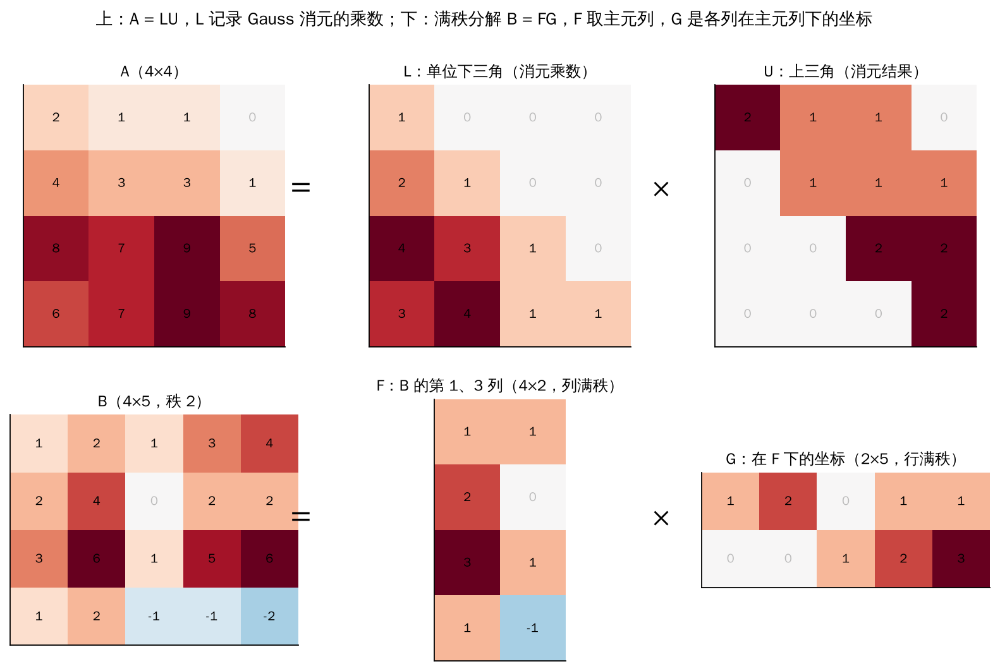
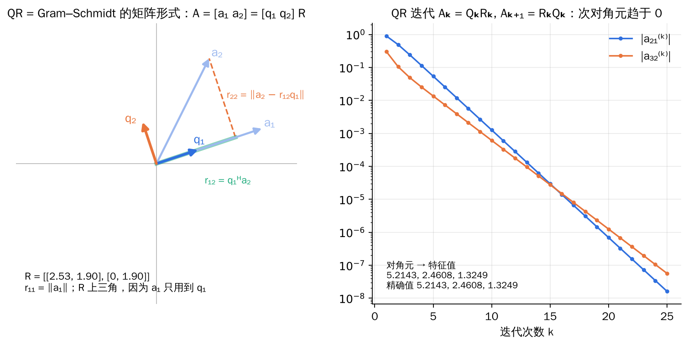
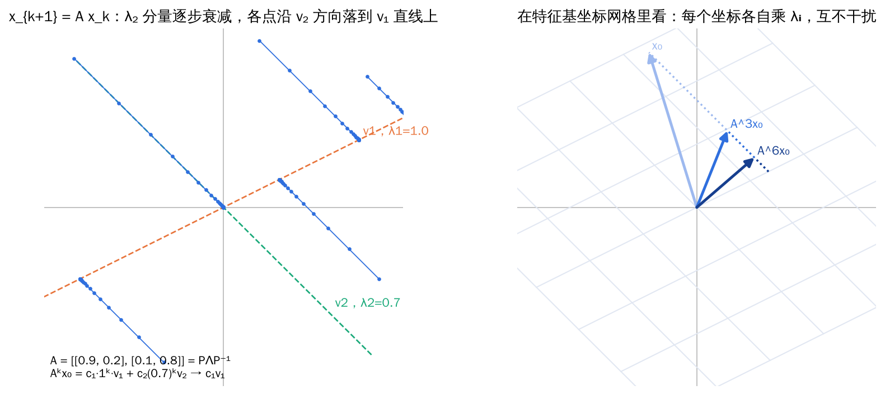
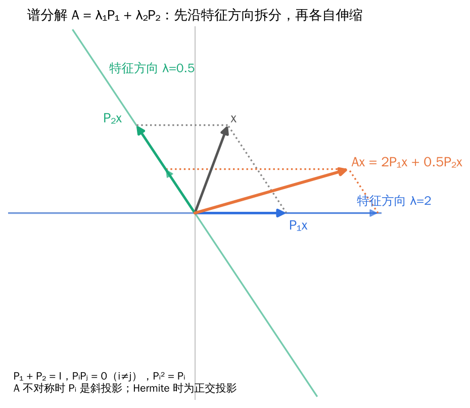
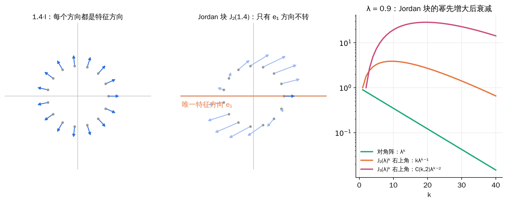

## 0. 为什么要分解矩阵

一个整数可以分解成质因数，分解后很多问题（最大公约数、开方）变得一目了然。矩阵分解也是同样的思路：**把一个复杂矩阵写成几个结构简单的矩阵的乘积**，每个因子都有明确的几何或计算意义。

| 分解 | 形式 | 因子的意义 | 主要用途 |
| --- | --- | --- | --- |
| 满秩分解 | A = FG | 列空间的基 × 坐标 | 秩、广义逆 |
| LU / LDU | A = LU | Gauss 消元的记录 | 解线性方程组 |
| Cholesky | A = GGᵀ | 正定阵的“平方根” | 正定方程组、采样 |
| QR | A = QR | 正交基 × 坐标 | 最小二乘、特征值计算 |
| Schur | A = UTUᴴ | 酉变换下的三角化 | 理论证明的万能工具 |
| 对角化 / 谱分解 | A = PΛP⁻¹ = Σ λᵢPᵢ | 特征基下的伸缩 | 矩阵幂、矩阵函数、微分方程 |
| Jordan | A = PJP⁻¹ | 不能对角化时的最简形式 | 一般矩阵的结构理论 |

**一条主线**：上一章说过，相似变换 P⁻¹AP 就是“换一组基看同一个变换”。对角化、Schur、Jordan 都在找“好基”：最好是特征向量组成的基（对角阵）；如果要求基正交，退一步得到三角阵（Schur）；如果特征向量不够，再退一步得到 Jordan 块。

## 1. 秩与单边逆

**引理（秩标准形）**：设 A ∈ Fᵐˣⁿ 的秩为 r，则存在可逆矩阵 P、Q 使

\[
PAQ=\begin{pmatrix}I_r&0\\0&0\end{pmatrix}.
\]

非方阵没有通常意义的逆，但可以有“单边逆”：

**定理（左逆与右逆）**：设 A ∈ ℂᵐˣⁿ。

- A 有**左逆**（存在 B 使 BA = Iₙ）⇔ A **列满秩**（rank A = n），此时可取 A_L⁻¹ = (AᴴA)⁻¹Aᴴ；
- A 有**右逆**（存在 C 使 AC = Iₘ）⇔ A **行满秩**（rank A = m），此时可取 A_R⁻¹ = Aᴴ(AAᴴ)⁻¹。

左逆、右逆一般不唯一。证明中要用到 **rank(AᴴA) = rank A**。

**例题：超定方程组与左逆**

方程个数多于未知数的 Ax = b（A 列满秩）一般无解。用左逆得到的 x = (AᴴA)⁻¹Aᴴb 恰好是最小二乘解：它使 ‖Ax − b‖ 最小。几何上，Ax 是 b 在列空间 R(A) 上的正交投影。

## 2. 满秩分解

**定理（满秩分解）**：设 A ∈ ℂᵐˣⁿ，rank A = r > 0，则存在列满秩的 F ∈ ℂᵐˣʳ 和行满秩的 G ∈ ℂʳˣⁿ 使

\[
A=FG .
\]

分解不唯一：对任意 r 阶可逆矩阵 D，A = (FD)(D⁻¹G) 也是满秩分解。

**直观理解**：A 的 n 个列向量都落在 r 维列空间里。F 的 r 列就是列空间的一组基，G 的第 j 列是 A 的第 j 列在这组基下的坐标。“A 的列 = 基 × 坐标”，这正是满秩分解。

**计算方法**：对 A 做初等行变换化为行最简形，主元所在列号为 j₁, …, jᵣ；

- F 取 A 的第 j₁, …, jᵣ 列（原矩阵的列，不是行最简形的列）；
- G 取行最简形的前 r 个非零行。

**例题**：求下列矩阵的满秩分解

\[
B=\begin{pmatrix}1&2&1&3&4\\2&4&0&2&2\\3&6&1&5&6\\1&2&-1&-1&-2\end{pmatrix}
\ \xrightarrow{\text{行变换}}\ 
\begin{pmatrix}1&2&0&1&1\\0&0&1&2&3\\0&0&0&0&0\\0&0&0&0&0\end{pmatrix}.
\]

主元在第 1、3 列，rank B = 2，于是

\[
F=\begin{pmatrix}1&1\\2&0\\3&1\\1&-1\end{pmatrix},\qquad
G=\begin{pmatrix}1&2&0&1&1\\0&0&1&2&3\end{pmatrix}.
\]

从 G 可以直接读出列之间的关系：第 2 列 = 2×第 1 列，第 4 列 = 第 1 列 + 2×第 3 列，第 5 列 = 第 1 列 + 3×第 3 列。

## 3. LU 分解与 Cholesky 分解

### 3.1 LU 分解就是 Gauss 消元

**直观理解**：Gauss 消元每一步“第 i 行减去第 k 行的 lᵢₖ 倍”，相当于左乘一个单位下三角的初等矩阵。消元结束得到上三角阵 U，把这些初等矩阵的逆乘起来就是 L，而 L 的下三角部分恰好就是各步的乘数 lᵢₖ。**LU 分解就是把消元过程“存档”。**

**定理（LU 与 LDU 分解）**：设 A ∈ ℂⁿˣⁿ 非奇异。A 可分解为 A = LU（L 为单位下三角阵、U 为上三角阵，称为 **Doolittle 分解**）的充分必要条件是 A 的各阶顺序主子式 Δₖ ≠ 0（k = 1, …, n−1），且此时分解唯一。进一步有唯一的 **LDU 分解**：

\[
A=LDU,\qquad D=\operatorname{diag}\!\left(\Delta_1,\ \frac{\Delta_2}{\Delta_1},\ \ldots,\ \frac{\Delta_n}{\Delta_{n-1}}\right),
\]

L 为单位下三角阵，U 为单位上三角阵。把 D 并到 U 上得 Doolittle 分解，并到 L 上得 **Crout 分解**（L 下三角、U 单位上三角）。

**例题**：对 A 做 LU 分解

\[
A=\begin{pmatrix}2&1&1&0\\4&3&3&1\\8&7&9&5\\6&7&9&8\end{pmatrix}
=\underbrace{\begin{pmatrix}1&&&\\2&1&&\\4&3&1&\\3&4&1&1\end{pmatrix}}_{L}
\underbrace{\begin{pmatrix}2&1&1&0\\&1&1&1\\&&2&2\\&&&2\end{pmatrix}}_{U}.
\]

第一步用第 1 行消第 2、3、4 行，乘数是 2、4、3，正好是 L 的第一列；后面同理。有了 LU，解 Ax = b 变成两次三角回代：先解 Ly = b，再解 Ux = y。若要对多个右端 b 求解，只需分解一次。

**易错点**：非奇异矩阵也可能没有 LU 分解。例如 A = [[0, 1], [1, 0]]，Δ₁ = 0，第一步就没有主元。此时需要先交换行：**任何非奇异矩阵都存在排列矩阵 P 使 PA = LU**（列主元消元），数值计算中总是这样做。

### 3.2 Cholesky 分解

**定理（Cholesky 分解）**：若 A 是 n 阶实对称正定矩阵，则存在唯一的对角元为正的下三角矩阵 G，使

\[
A=GG^{\mathsf T}.
\]

（复情形：Hermite 正定矩阵 A = GGᴴ。）

**直观理解**：正数 a 可以写成 (√a)²；正定矩阵是“矩阵版的正数”，G 就是它的“平方根”。由于对称性，Cholesky 只需要 LU 一半的计算量。在统计中，若要生成协方差为 Σ 的高斯随机向量，就取 Σ = GGᵀ，再令 x = Gz（z 为标准高斯向量）。

**例题**：A = [[4, 2], [2, 5]]。设 G = [[g₁₁, 0], [g₂₁, g₂₂]]，比较 GGᵀ 与 A 的元素：g₁₁² = 4 ⇒ g₁₁ = 2；g₂₁g₁₁ = 2 ⇒ g₂₁ = 1；g₂₁² + g₂₂² = 5 ⇒ g₂₂ = 2。所以 G = [[2, 0], [1, 2]]。

## 4. QR 分解

### 4.1 定理与几何意义

**定理（QR 分解）**：若复方阵 A 满秩（非奇异），则存在酉矩阵 Q 和上三角矩阵 R 使 A = QR；若进一步要求 R 的对角元为正，则分解唯一。

若 A ∈ ℂᵐˣⁿ 列满秩，则 A = QR，其中 Q ∈ ℂᵐˣⁿ 的列是标准正交组（**列正交规范矩阵**，QᴴQ = Iₙ），R 是 n 阶上三角矩阵。

**直观理解**：对 A 的列 a₁, a₂, …, aₙ 做 Gram–Schmidt 正交化得到 q₁, q₂, …, qₙ。因为 aₖ 只用到 q₁, …, qₖ 就能表示，

\[
a_k=r_{1k}q_1+r_{2k}q_2+\cdots+r_{kk}q_k,\qquad r_{ik}=q_i^{H}a_k,
\]

写成矩阵就是 A = QR，R 自然是上三角的。**Q 是列空间的标准正交基，R 是 A 的各列在这组基下的坐标。**

*左：r₁₂ 是 a₂ 在 q₁ 上的投影长度，r₂₂ 是减去投影后剩余部分的长度。右：对对称矩阵做 QR 迭代，次对角元按几何级数趋于零，对角元收敛到特征值。*

**例题**：求 A = [[1, 1, 0], [1, 0, 1], [0, 1, 1]] 的 QR 分解。

对列做 Gram–Schmidt：

- q₁ = (1, 1, 0)ᵀ/√2，r₁₁ = √2；
- r₁₂ = q₁ᵀa₂ = 1/√2，a₂ − r₁₂q₁ = (½, −½, 1)ᵀ，r₂₂ = √6/2，q₂ = (1, −1, 2)ᵀ/√6；
- r₁₃ = 1/√2，r₂₃ = 1/√6，a₃ − r₁₃q₁ − r₂₃q₂ = (−⅔, ⅔, ⅔)ᵀ，r₃₃ = 2/√3，q₃ = (−1, 1, 1)ᵀ/√3。

\[
Q=\begin{pmatrix}\tfrac{1}{\sqrt2}&\tfrac{1}{\sqrt6}&-\tfrac{1}{\sqrt3}\\[2pt]\tfrac{1}{\sqrt2}&-\tfrac{1}{\sqrt6}&\tfrac{1}{\sqrt3}\\[2pt]0&\tfrac{2}{\sqrt6}&\tfrac{1}{\sqrt3}\end{pmatrix},\qquad
R=\begin{pmatrix}\sqrt2&\tfrac{1}{\sqrt2}&\tfrac{1}{\sqrt2}\\[2pt]0&\tfrac{\sqrt6}{2}&\tfrac{1}{\sqrt6}\\[2pt]0&0&\tfrac{2}{\sqrt3}\end{pmatrix}.
\]

除了 Gram–Schmidt，还可以用上一章的 **Householder 反射**（每次把一列下方化零）或 **Givens 旋转**（每次消一个元素）构造 QR，二者数值上更稳定。

### 4.2 QR 迭代求特征值

**方法（QR 算法）**：令 A₁ = A，反复执行

\[
A_k=Q_kR_k,\qquad A_{k+1}=R_kQ_k=Q_k^{H}A_kQ_k .
\]

每个 Aₖ 都与 A 酉相似，特征值不变。在一定条件下（例如特征值模互不相等），Aₖ 趋于上三角矩阵，对角元收敛到 A 的特征值。

这是现代数值软件计算特征值的核心算法（实际中会先化为 Hessenberg 形，再加位移加速）。

## 5. Schur 分解、Hamilton–Cayley 定理与最小多项式

### 5.1 Schur 引理

**定理（Schur 引理）**：任意复方阵 A 都酉相似于上三角矩阵：存在酉矩阵 U 使

\[
U^{H}AU=T=\begin{pmatrix}\lambda_1&*&\cdots&*\\&\lambda_2&\cdots&*\\&&\ddots&\vdots\\&&&\lambda_n\end{pmatrix},
\]

T 的对角元是 A 的全部特征值。若实方阵 A 的特征值全为实数，则 A 正交相似于实上三角矩阵。

**证明思路（数学归纳）**：取一个单位特征向量 u₁ 作为第一个基向量，扩充成标准正交基 U₁，则 U₁ᴴAU₁ 的第一列变成 (λ₁, 0, …, 0)ᵀ。对右下角 n−1 阶子矩阵重复同样的操作即可。**每一步都只要求一个特征向量**，复数域中特征值总是存在，所以 Schur 分解总能完成。

Schur 引理是许多定理的“万能钥匙”：先三角化，再在三角阵上验证结论。

### 5.2 Hamilton–Cayley 定理

**定理（Hamilton–Cayley）**：设 f(λ) = det(λI − A) 是 A 的特征多项式，则

\[
f(A)=0 .
\]

**直观理解**：对可对角化的 A = PΛP⁻¹，f(A) = P·diag(f(λ₁), …, f(λₙ))·P⁻¹，而每个 f(λᵢ) = 0，所以 f(A) = 0。一般情形用 Schur 三角化后逐列验证。

**易错点**：不能直接“把 λ = A 代入 det(λI − A)”得到 det(A − A) = 0。这个“证明”混淆了数和矩阵：f(A) 是一个矩阵，而 det(0) 是一个数。

**用途 1：降次计算矩阵多项式。** 用特征多项式去除高次多项式 g(λ) = q(λ)f(λ) + r(λ)，则 g(A) = r(A)，只需计算低次的余式。

**用途 2：求逆矩阵。** 若 f(λ) = λⁿ + aₙ₋₁λⁿ⁻¹ + ⋯ + a₁λ + a₀ 且 a₀ ≠ 0（即 A 可逆），则

\[
A^{-1}=-\frac{1}{a_0}\left(A^{n-1}+a_{n-1}A^{n-2}+\cdots+a_1I\right).
\]

**例题：用 Hamilton–Cayley 求逆**

A = [[2, 1, 0], [0, 1, 1], [1, 0, 1]]，特征多项式 f(λ) = λ³ − 4λ² + 5λ − 3。由 A³ − 4A² + 5A − 3I = 0 得

\[
A^{-1}=\frac13\left(A^2-4A+5I\right)=\frac13\begin{pmatrix}1&-1&1\\1&2&-2\\-1&1&2\end{pmatrix}.
\]

不必做初等变换，只需算一次 A²。

### 5.3 最小多项式

**定义**：若多项式 φ 满足 φ(A) = 0，则称 φ 为 A 的**零化多项式**。零化多项式中次数最低的首一多项式称为 A 的**最小多项式**，记作 m_A(λ)。

**定理（最小多项式的性质）**：

1. 最小多项式唯一，且整除 A 的任一零化多项式（特别地整除特征多项式）；
2. 最小多项式与特征多项式的根相同（只是重数可能更低），即每个特征值都是最小多项式的根；
3. 相似矩阵有相同的最小多项式；
4. 分块对角阵 diag(A₁, A₂) 的最小多项式是 m_A₁ 与 m_A₂ 的最小公倍式；
5. **A 可对角化 ⇔ 最小多项式没有重根。**

**例题：用最小多项式算 A¹⁰⁰**

A = [[1, 1, 0], [0, 1, 0], [0, 0, 2]]，特征多项式 (λ−1)²(λ−2)。A − I ≠ 0，(A − I)(A − 2I) ≠ 0（其 (1, 2) 元为 −1），所以最小多项式就是 (λ−1)²(λ−2)，次数 3。

设 λ¹⁰⁰ = q(λ)m(λ) + aλ² + bλ + c，余式 r 在 m 的根上与 λ¹⁰⁰ 取值一致，二重根处导数也一致：

\[
r(1)=1,\qquad r'(1)=100,\qquad r(2)=2^{100}.
\]

解出 a、b、c 后 A¹⁰⁰ = aA² + bA + cI，结果为

\[
A^{100}=\begin{pmatrix}1&100&0\\0&1&0\\0&0&2^{100}\end{pmatrix}.
\]

**技巧**：重根处要用导数条件，这一思路在第四章计算矩阵函数时会再次出现。

## 6. 对角化

### 6.1 单纯矩阵

**定义**：若 A 相似于对角阵，即存在可逆 P 使 P⁻¹AP = Λ，则称 A 为**单纯矩阵**（可对角化矩阵）。

**定理（可对角化的判定）**：设 A ∈ ℂⁿˣⁿ 的互异特征值为 λ₁, …, λₛ，以下等价：

1. A 可对角化；
2. A 有 n 个线性无关的特征向量（此时 P 的列就是它们）；
3. 每个特征值的几何重数都等于代数重数；
4. ℂⁿ = E(λ₁) ⊕ ⋯ ⊕ E(λₛ)；
5. 最小多项式无重根；
6. 初等因子全是一次的（见第 8 节）。

充分条件：A 有 n 个互异特征值；或 A 有一个无重根的零化多项式。

**例题：幂等矩阵一定可对角化**

若 A² = A，则 φ(λ) = λ² − λ = λ(λ − 1) 是零化多项式且无重根，所以 A 可对角化，特征值只能是 0 和 1，A ≅ diag(Iᵣ, 0)，r = rank A = tr A。同理，A² = I（对合矩阵）也一定可对角化，特征值为 ±1。

### 6.2 对角化的威力：矩阵幂与微分方程

*左：反复左乘 A，λ = 0.7 的分量逐步衰减，轨迹落到 λ = 1 的特征直线上。右：用特征向量画的坐标网格里，每个坐标只是各自乘以 λᵢ。*

**例题：人口迁移的长期趋势**

每年城市人口有 20% 迁往乡村，乡村人口有 30% 迁往城市。记第 k 年城市、乡村人口为 xₖ = (cₖ, rₖ)ᵀ，则

\[
x_{k+1}=Ax_k,\qquad A=\begin{pmatrix}0.8&0.3\\0.2&0.7\end{pmatrix}.
\]

特征值 λ₁ = 1、λ₂ = 0.5，特征向量 v₁ = (3, 2)ᵀ、v₂ = (1, −1)ᵀ。于是

\[
A^{k}=P\begin{pmatrix}1&0\\0&0.5^{k}\end{pmatrix}P^{-1}
=\frac15\begin{pmatrix}3+2\cdot0.5^{k}&3-3\cdot0.5^{k}\\2-2\cdot0.5^{k}&2+3\cdot0.5^{k}\end{pmatrix}
\ \xrightarrow{k\to\infty}\ \frac15\begin{pmatrix}3&3\\2&2\end{pmatrix}.
\]

无论初始分布如何，长期看城市与乡村人口之比都趋于 **3 : 2**，也就是 λ = 1 的特征向量方向。0.5ᵏ 决定了趋于稳态的速度。

**例题：解耦线性微分方程组**

解 x′(t) = Ax(t)，A = [[1, 2], [2, 1]]。特征值 3、−1，特征向量 (1, 1)ᵀ、(1, −1)ᵀ。令 x = Py，则 y′ = Λy 变成两个独立的一阶方程 y₁′ = 3y₁、y₂′ = −y₂，于是

\[
x(t)=c_1e^{3t}\begin{pmatrix}1\\1\end{pmatrix}+c_2e^{-t}\begin{pmatrix}1\\-1\end{pmatrix}.
\]

**对角化把“相互耦合的系统”拆成“各自独立的标量问题”**，这是它在工程中最重要的用途。

### 6.3 酉对角化与正规矩阵

**定义**：若存在酉矩阵 U 使 UᴴAU 为对角阵，则称 A 可**酉对角化**。满足 AᴴA = AAᴴ 的矩阵称为**正规矩阵**。Hermite 矩阵、反 Hermite 矩阵、酉矩阵、实对称矩阵、正交矩阵都是正规矩阵。

**定理**：

1. A 可酉对角化 ⇔ A 是正规矩阵 ⇔ A 有 n 个两两正交的单位特征向量；
2. A 是 Hermite 矩阵 ⇔ A 可酉对角化且特征值全为实数；
3. A 是酉矩阵 ⇔ A 可酉对角化且特征值的模全为 1；
4. 实矩阵 A 是对称矩阵 ⇔ A 可正交对角化（存在正交矩阵 Q 使 QᵀAQ 为实对角阵）。

**直观理解**：正规矩阵的特征向量可以选成互相垂直的，所以它只是沿几条**互相垂直**的轴伸缩（复情形还可带旋转相位）。非正规矩阵的特征方向是“斜”的，这会带来第四章中看到的“暂态增长”等现象。

**例题：实对称矩阵的正交对角化步骤**

1. 求特征值（一定是实数）；
2. 对每个特征值求特征子空间的基；
3. **只在同一个特征子空间内部**做 Gram–Schmidt 正交化（不同特征值的特征向量本来就正交）；
4. 全部单位化，排成正交矩阵 Q，则 QᵀAQ = Λ。

已知一部分特征向量时，常用正交性反推其余的：例如 3 阶实对称矩阵特征值为 1, 1, 2，已知 λ = 2 的特征向量 (1, 1, 1)ᵀ，则 λ = 1 的特征子空间就是它的正交补 {x₁ + x₂ + x₃ = 0}，于是 A = I + (1/3)·(1, 1, 1)ᵀ(1, 1, 1)。

## 7. 谱分解与投影矩阵

### 7.1 谱分解

**定理（单纯矩阵的谱分解）**：设单纯矩阵 A 的互异特征值为 λ₁, …, λₛ，则存在唯一的一组矩阵 P₁, …, Pₛ 使

\[
A=\sum_{i=1}^{s}\lambda_iP_i,\qquad
\sum_{i=1}^{s}P_i=I,\qquad P_iP_j=\delta_{ij}P_i,\qquad AP_i=P_iA=\lambda_iP_i,
\]

并且对任意多项式 f，有 f(A) = Σ f(λᵢ)Pᵢ。Pᵢ 可以直接用 A 表示：

\[
P_i=\prod_{j\ne i}\frac{A-\lambda_jI}{\lambda_i-\lambda_j}.
\]

**直观理解**：Pᵢ 是“沿其他特征子空间、投影到第 i 个特征子空间”的投影算子。Ax 的计算可以分两步：先把 x 拆成各特征子空间中的分量 Pᵢx，再把每个分量乘以对应的 λᵢ。这和把光分解成不同频率的光谱完全类似，“谱分解”由此得名。

**例题**：A = [[1, 2], [0, 2]]，特征值 1、2。

\[
P_1=\frac{A-2I}{1-2}=\begin{pmatrix}1&-2\\0&0\end{pmatrix},\qquad
P_2=\frac{A-I}{2-1}=\begin{pmatrix}0&2\\0&1\end{pmatrix}.
\]

检验 P₁ + P₂ = I，P₁P₂ = 0，1·P₁ + 2·P₂ = A ✓。于是 A¹⁰⁰ = P₁ + 2¹⁰⁰P₂ = [[1, 2¹⁰¹ − 2], [0, 2¹⁰⁰]]。第四章会看到，sin A、eᴬ 也可以这样算。

### 7.2 幂等矩阵与正交投影矩阵

**定义**：满足 P² = P 的矩阵称为**幂等矩阵**（投影矩阵）；若同时满足 Pᴴ = P，称为**正交投影矩阵**。

**定理**：

1. 幂等矩阵 P 是沿 N(P) 到 R(P) 的投影，ℂⁿ = R(P) ⊕ N(P)，I − P 也幂等，rank P = tr P；
2. 正交投影矩阵对应正交直和 ℂⁿ = R(P) ⊕ R(P)⊥；
3. 若 A 列满秩，则投影到 R(A) 的正交投影矩阵为

\[
P_A=A\left(A^{H}A\right)^{-1}A^{H}.
\]

4. 正规矩阵的谱分解中，各 Pᵢ 都是正交投影矩阵。

**例题**：投影到直线 span{a}（a = (1, 2)ᵀ）的正交投影矩阵 P = aaᵀ/(aᵀa) = (1/5)·[[1, 2], [2, 4]]。验证 P² = P，Pᵀ = P，tr P = 1 = rank P。点 b = (3, 1)ᵀ 在直线上的投影 Pb = (1, 2)ᵀ，残差 (2, −1)ᵀ 与 a 正交 ✓。

## 8. λ 矩阵与 Jordan 标准形

并非所有矩阵都能对角化。Jordan 标准形回答了“相似变换下最简单能化到什么程度”。判断两个矩阵是否相似，转化为判断它们的特征矩阵 λI − A 是否“等价”，这就需要 λ 矩阵理论。

### 8.1 λ 矩阵与 Smith 标准形

**定义**：元素是 λ 的多项式的矩阵称为 **λ 矩阵**，例如特征矩阵 λI − A。

- **秩**：不恒为零的子式的最高阶数；
- **可逆**：存在 B(λ) 使 A(λ)B(λ) = B(λ)A(λ) = I，**当且仅当 det A(λ) 是非零常数**（不只是“不恒为零”）；
- **初等变换**：交换两行（列）；某行（列）乘**非零常数**；某行（列）加上另一行（列）的**多项式倍**；
- **相抵**：经有限次初等变换可互相得到，记作 A(λ) ≅ B(λ)。

**定义（行列式因子、不变因子、初等因子）**：设 A(λ) 的秩为 r。

- **k 阶行列式因子** Dₖ(λ)：全部 k 阶子式的首一最大公因式；
- **不变因子** dₖ(λ) = Dₖ(λ)/Dₖ₋₁(λ)（D₀ = 1），满足 d₁ | d₂ | ⋯ | dᵣ；
- **初等因子**：在复数域中把每个不变因子分解成 (λ − a)ᵉ 的乘积，所有 e > 0 的因式（按出现次数计）称为初等因子。

**定理（Smith 标准形）**：秩为 r 的 λ 矩阵相抵于唯一的

\[
\operatorname{diag}\big(d_1(\lambda),\ d_2(\lambda),\ \ldots,\ d_r(\lambda),\ 0,\ \ldots,\ 0\big),\qquad d_1\mid d_2\mid\cdots\mid d_r .
\]

两个 λ 矩阵相抵 ⇔ 有相同的行列式因子 ⇔ 有相同的不变因子 ⇔ 有相同的秩和初等因子。

**定理（相似判定）**：复方阵 A 与 B 相似 ⇔ λI − A ≅ λI − B ⇔ 二者有相同的不变因子 ⇔ 有相同的初等因子。

**例题：由不变因子读初等因子**

若 λI − A 的不变因子为 1, λ − 1, (λ − 1)²(λ + 2)，则初等因子是 λ − 1、(λ − 1)²、λ + 2（注意 λ − 1 在两个不变因子里各出现一次，要分别计入）。不变因子的乘积就是特征多项式 (λ − 1)³(λ + 2)，最后一个不变因子 (λ − 1)²(λ + 2) 就是最小多项式。

### 8.2 Jordan 标准形

**定义（Jordan 块）**：

\[
J_k(a)=\begin{pmatrix}a&1&&\\&a&\ddots&\\&&\ddots&1\\&&&a\end{pmatrix}_{k\times k},
\]

其特征矩阵的初等因子只有一个 (λ − a)ᵏ，最小多项式也是 (λ − a)ᵏ。由若干 Jordan 块组成的分块对角阵称为 **Jordan 矩阵**。

**定理（Jordan 标准形）**：设复方阵 A 的初等因子为 (λ − a₁)ᵏ¹, …, (λ − aₜ)ᵏᵗ，则

\[
A\sim J=\operatorname{diag}\big(J_{k_1}(a_1),\ \ldots,\ J_{k_t}(a_t)\big),
\]

若不计 Jordan 块的排列次序，J 由 A 唯一确定。

推论：

- 每个初等因子对应一个 Jordan 块；特征值 a 的 Jordan 块个数 = 几何重数；块的总阶数 = 代数重数；最大块的阶数 = a 在最小多项式中的重数；
- A 可对角化 ⇔ 初等因子都是一次的 ⇔ 所有 Jordan 块都是 1 阶的。

*左：数量阵对所有方向都只做伸缩；中：Jordan 块除了伸缩还有“剪切”，只有一个方向不转。右：Jordan 块的幂含 kλᵏ⁻¹、C(k,2)λᵏ⁻² 这样的项，即使 |λ| < 1 也会先增大后衰减。*

**直观理解**：Jordan 块 J = aI + N，其中 N 是只有上对角线为 1 的幂零矩阵：N 把 e₂ 送到 e₁，e₃ 送到 e₂，……，e₁ 送到 0，像一条“传送链”。由于 aI 与 N 可交换，

\[
J^{m}=(aI+N)^{m}=a^{m}I+\binom m1a^{m-1}N+\binom m2a^{m-2}N^2+\cdots,
\]

二项式展开在 Nᵏ = 0 处截断。这给出了 Jordan 块幂次和矩阵函数的计算公式。

### 8.3 不用 Smith 形也能定 Jordan 形：秩的计数

对每个特征值 a，令 rₖ = rank((A − aI)ᵏ)（r₀ = n），则

\[
\#\{\text{阶数}\ \ge k\ \text{的 Jordan 块}\}=r_{k-1}-r_k .
\]

**例题**：求 A = [[3, 1, 0], [−1, 1, 0], [1, 0, 2]] 的 Jordan 标准形。

1. 特征多项式 (λ − 2)³，只有一个特征值 2；
2. 2I − A = [[−1, −1, 0], [1, 1, 0], [−1, 0, 0]] 的秩为 2，几何重数 3 − 2 = 1，**只有一个 Jordan 块**；
3. 所以 J = J₃(2)，最小多项式为 (λ − 2)³。

求变换矩阵 P：需要一条长为 3 的**Jordan 链** (A − 2I)p₁ = 0，(A − 2I)p₂ = p₁，(A − 2I)p₃ = p₂。解得一组为 p₁ = (0, 0, 1)ᵀ、p₂ = (1, −1, 1)ᵀ、p₃ = (1, 0, 0)ᵀ，令 P = (p₁, p₂, p₃)，则 P⁻¹AP = J₃(2)。

**易错点**：

1. 特征值相同、重数相同的矩阵不一定相似。例如 diag(2, 2) 与 J₂(2)：特征多项式都是 (λ−2)²，但前者最小多项式是 λ − 2，后者是 (λ − 2)²；
2. 特征多项式和最小多项式都相同也不一定相似（4 阶以上）。例如 diag(J₂(0), J₂(0)) 与 diag(J₂(0), J₁(0), J₁(0))：两者特征多项式都是 λ⁴、最小多项式都是 λ²，但 Jordan 块的个数不同；
3. 判断相似的“最终标准”是初等因子（或 Jordan 形），而不是某一个不变量。

## 9. 本章小结

| 分解 / 结论 | 存在条件 | 关键公式或用途 |
| --- | --- | --- |
| 左逆 / 右逆 | 列满秩 / 行满秩 | (AᴴA)⁻¹Aᴴ / Aᴴ(AAᴴ)⁻¹ |
| 满秩分解 | 任意非零矩阵 | F = 主元列，G = 行最简形非零行 |
| LU（Doolittle） | 顺序主子式 Δ₁…Δₙ₋₁ ≠ 0 | 一般用 PA = LU |
| Cholesky | 实对称（Hermite）正定 | A = GGᵀ，唯一 |
| QR | 列满秩 | Gram–Schmidt / Householder / Givens；QR 迭代求特征值 |
| Schur | 任意复方阵 | A = UTUᴴ，T 上三角 |
| Hamilton–Cayley | 任意方阵 | f(A) = 0，用于降次和求逆 |
| 最小多项式 | 唯一，整除零化多项式 | 无重根 ⇔ 可对角化 |
| 对角化 | n 个无关特征向量 | Aᵏ = PΛᵏP⁻¹，解耦微分方程 |
| 酉对角化 | 正规矩阵 AᴴA = AAᴴ | Hermite ⇔ 实特征值；酉 ⇔ |λ| = 1 |
| 谱分解 | 单纯矩阵 | A = Σ λᵢPᵢ，f(A) = Σ f(λᵢ)Pᵢ |
| Jordan 标准形 | 任意复方阵 | 初等因子 ↔ Jordan 块；相似 ⇔ 初等因子相同 |
